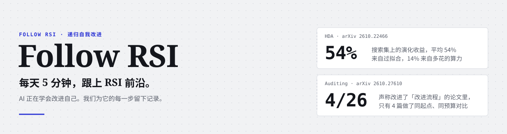
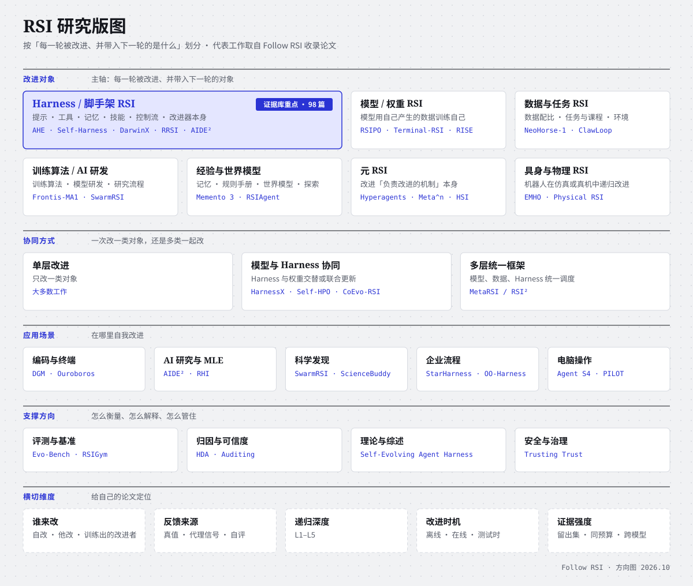
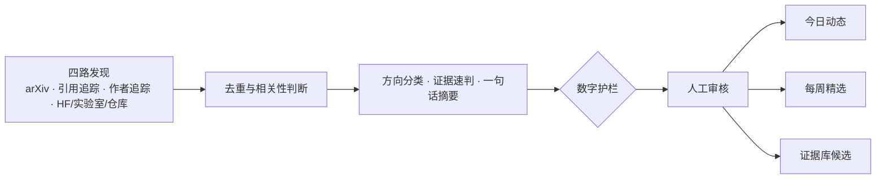

<div align="center">

<a href="https://adongwanai.github.io/follow-rsi">
  <picture>
    <source media="(prefers-color-scheme: dark)" srcset="assets/banner-zh-dark.svg">
    
  </picture>
</a>

# Follow RSI

### 每天 5 分钟，跟上 RSI 前沿。

AI 正在学会改进自己。我们为它的每一步留下记录。

<!-- AUTO:BADGES:START -->

    

[**深度解读：为什么 AI 还不会自我进化 →**](https://adongwanai.github.io/follow-rsi/articles/why-ai-self-improvement.html)

<!-- AUTO:BADGES:END -->

[**今日动态**](https://adongwanai.github.io/follow-rsi/daily/) · [**每周精选**](https://adongwanai.github.io/follow-rsi/weekly/) · [**证据库**](https://adongwanai.github.io/follow-rsi/) · [阅读路线](https://adongwanai.github.io/follow-rsi/#routes) · [研究空白](directions/open-problems.md) · [English](README_en.md)

</div>

---

## 为什么做这个

递归自我改进（Recursive Self-Improvement，RSI）正在从设想变成日常：Agent 改写自己的提示、工具、记忆和控制流，模型用自己的轨迹训练下一代自己，研究 Agent 改进自己做研究的方式。新论文每周都有几十篇。

但「变强了」和「真的改进了」是两回事。[Harness-Delta Attribution](papers/hda.md) 发现，Harness 演化在搜索集上的收益里，平均 **54%** 来自过拟合，**14%** 来自多花的测试时算力；[Auditing the Product](papers/auditing-product.md) 发现，声称改进了「改进流程」的 26 篇工作里，只有 **4 篇**在相同起点、相同预算下做过对比。

所以 Follow RSI 只做三件事：**跟上前沿，核验凭证，讲透思想。**

## 你会得到什么

| | 是什么 | 节奏 |
| :--- | :--- | :--- |
| **今日动态** | 当天审核通过的 RSI 新论文，按七个方向归类，每篇一句话摘要，附证据速判 | 每天 |
| **每周精选** | 经人工审核的本周要点：值得精读的论文、编辑点评、方向趋势 | 每周 |
| **Harness 自进化证据库** | 98 篇论文，每篇一张证据卡片，可按证据筛选，作者可嵌入徽章 | 持续更新 |
| **深度解读** | 经典论文的精读笔记与视频，每个方向的整体解读、阅读路线和研究空白 | 持续更新 |

今日动态负责「新」，证据库负责「准」，深度解读负责「懂」。

**当前进度（2026-10-27）**：证据库、阅读路线、方向图和[中英导读](https://adongwanai.github.io/follow-rsi/guide.html)已上线。首轮 HF 回溯已完成，[82 篇待审记录已生成审核 PR](https://github.com/adongwanai/follow-rsi/pull/1)，通过后才会进入日报与周报。20 篇必读的全文证据审读、精读笔记和视频仍在待办中。详见[验收记录与待办](docs/acceptance.md)。

## RSI 研究版图

按「每一轮被改进、并带入下一轮的是什么」划分出七个方向，再从协同方式、应用场景、支撑方向和横切维度四个角度展开。Harness 是证据库的重点。

<a href="assets/rsi-map-zh-light.svg">
  <picture>
    <source media="(prefers-color-scheme: dark)" srcset="assets/rsi-map-zh-dark.svg">
    
  </picture>
</a>

点开看大图。按方向浏览论文：[网站方向视图](https://adongwanai.github.io/follow-rsi/#map)

## 证据卡片长什么样

以 ServiceNow 的 [StarHarness](papers/starharness.md) 为例：

| 字段 | 内容 |
| :--- | :--- |
| 一句话 | 按基础 Harness 的失败行为分层构造演化池；提议器可见的搜索任务、不可见的选择任务、最终留出任务三者分开 |
| 关键结果 | 企业环境中每个接受 4–12 次修改后全基准 +20–35pp；演化外任务上收益仍在，不重新演化即可迁移到 GPT 与 Qwen 系列 |
| 谁来改 | 独立的演化 Agent |
| 留出集 | ✅ 有 |
| 不相交演化集 | ✅ 有 |
| 跨模型迁移 | ✅ 有 |
| 开源代码 | ✅ 有 |
| 同预算对照 | ❔ 未审 |
| 报告成本 | ❔ 未审 |

图例：✅ 有 · ◐ 部分 · ❌ 没有 · ❔ 未审。每一项都要能在论文里找到出处。

## 证据库

从必读论文和阅读路线开始；完整清单按方向折叠，每篇都链接到证据卡片。

<!-- AUTO:STATS:START -->

98 篇正式收录 · 6 篇候选 · 20 篇必读 · 13 篇待细读。

证据字段已审 **6.5%**（77/1176，每篇 8 项核查 + 4 项分类）；其中 8 项核查已审 **5.5%**（43/784）。统计仅含正式收录；已审指值非 `unknown`，包含 `no`、`partial`、`na`，不表示达标。

<details><summary>各方向篇数</summary>

| 方向 / Section | 篇数 / Papers |
| --- | ---: |
| 奠基与前置 | 13 |
| 1.1 搜索与演化主线 | 19 |
| 1.2 泛化、正则、准入与成本 | 8 |
| 1.3 任务与证据选择 | 4 |
| 二、改进器自身进化 | 13 |
| 三、组件级进化 | 5 |
| 四、模型与 Harness 协同进化 | 13 |
| 五、评测、归因与可信度 | 14 |
| 六、综述与理论 | 9 |
| 延伸候选（未正式收录） | 6 |

</details>

<!-- AUTO:STATS:END -->

<details>
<summary>必读论文</summary>

<!-- AUTO:MUST_READ:START -->

1. [ADAS: Automated Design of Agentic Systems](papers/adas.md)
2. [Darwin Gödel Machine](papers/dgm.md)
3. [Meta-Harness](papers/meta-harness.md)
4. [Hyperagents (DGM-H)](papers/hyperagents.md)
5. [AHE: Agentic Harness Engineering](papers/ahe.md)
6. [Self-Harness: Harnesses That Improve Themselves](papers/self-harness.md)
7. [DarwinX: Evolving Agent Harnesses Through Natural Selection](papers/darwinx.md)
8. [ModularRSI: Modular and Generalizable Recursive Harness Self-Improvement](papers/modularrsi.md)
9. [RRSI: Regularized Recursive Harness Self-Improvement](papers/rrsi.md)
10. [AutoSaddler: Automatic Harness Optimization with Durable Updates from Agent Execution Traces](papers/autosaddler.md)
11. [Meta^n](papers/meta-n.md)
12. [AIDE²: Recursive Self-Improvement of AI Research Agents](papers/aide2.md)
13. [HarnessX: A Composable, Adaptive, and Evolvable Agent Harness Foundry](papers/harnessx.md)
14. [Co-Evolving Harnesses and Models](papers/co-evolving-harnesses-models.md)
15. [Rethinking the Evaluation of Harness Evolution for Agents](papers/rethinking-evaluation.md)
16. [Harness-Delta Attribution: Dissecting Gains From Harness Evolution](papers/hda.md)
17. [STOP: Self-Taught Optimizer](papers/stop.md)
18. [SICA: A Self-Improving Coding Agent](papers/sica.md)
19. [Harness Updating Is Not Harness Benefit](papers/harness-updating-not-benefit.md)
20. [Self-Evolving Agent Harness](papers/self-evolving-agent-harness.md)

<!-- AUTO:MUST_READ:END -->

</details>

<details>
<summary>阅读路线</summary>

<!-- AUTO:ROUTES:START -->

| 路线 | 顺序 | 问题 |
| --- | --- | --- |
| 打基础 | [ADAS](papers/adas.md) → [Darwin Gödel Machine](papers/dgm.md) → [Meta-Harness](papers/meta-harness.md) → [DGM-H](papers/hyperagents.md) | 「搜索 Agent 设计」与「自改代码」两条源头各自是什么？ |
| 方法主线 | [AHE](papers/ahe.md) → [Self-Harness](papers/self-harness.md) → [DarwinX](papers/darwinx.md) → [ModularRSI](papers/modularrsi.md) → [RRSI](papers/rrsi.md) | 最常见的对比基线各自解决了什么？ |
| 工程闭环与长程可靠性 | [AutoSaddler](papers/autosaddler.md) → [ModularRSI](papers/modularrsi.md) → [RiseHarness](papers/riseharness.md) | 怎样从失败轨迹定位到代码、控制修改范围、验证跨任务收益？ |
| 改进器自身进化 | [Hierarchical Self-Improvement](papers/hsi.md) → [Meta^n](papers/meta-n.md) → [AIDE²](papers/aide2.md) → [MILO](papers/milo.md) → [Harness²](papers/harness2.md) → [RSIFlow](papers/rsiflow.md) **待细读 / Needs verification** | 搜索策略或元 Agent 怎样持续更新，证据够不够？ |
| 没有答案标签 | [TTHE](papers/tthe.md) → [Harness²](papers/harness2.md) → [HarnessPro](papers/harnesspro.md) → [Agent S4](papers/agent-s4.md) | 用什么代理信号选版本，怎样控制错误反馈？ |
| 多任务与跨模型泛化 | [HarnessCompass](papers/harnesscompass.md) → [StarHarness](papers/starharness.md) → [MaD-RSI](papers/mad-rsi.md) **待细读 / Needs verification** → [Object-Oriented Harness](papers/oo-harness.md) | 怎样避免只适配一组任务或一个模型？ |
| 任务与证据选择 | [ActiveSaddler](papers/activesaddler.md) → [SSR](papers/ssr.md) → [ECDYSIS](papers/ecdysis.md) → [Task-CoEvolve](papers/task-coevolve.md) **待细读 / Needs verification** | 下一轮用哪些任务、哪些失败来驱动修改？ |
| 模型与 Harness 协同 | [HarnessX](papers/harnessx.md) → [Co-Evolving Harnesses and Models](papers/co-evolving-harnesses-models.md) → [Self-HPO](papers/self-hpo.md) → [HarnessAdapt-RL](papers/harnessadapt-rl.md) | 什么时候改 Harness、什么时候改权重，收益怎样拆分？ |
| 实验设计（所有人必读） | [Rethinking the Evaluation of Harness Evolution for Agents](papers/rethinking-evaluation.md) → [Harness-Delta Attribution](papers/hda.md) → [HarnessOpt-Bench](papers/harnessopt-bench.md) → [Auditing the Product, Not the Recursion](papers/auditing-product.md) → [Reflections on Trusting Trust, Revisited](papers/trusting-trust-revisited.md) | 同预算下，收益来自可迁移改进、额外计算还是过拟合？基线有没有泄露答案？ |

<!-- AUTO:ROUTES:END -->

</details>

<details>
<summary>完整论文与候选清单</summary>

<!-- AUTO:TABLES:START -->

✅ yes / 有 · ◐ partial / 部分 · ❌ no / 没有 · ❔ unknown / 未审 · — na / 不适用

图标顺序：留出集 · 同预算对照 · 跨模型迁移 · 报告成本。缺失证据不作推断。

### 奠基与前置

<details><summary>13 篇论文</summary>

| 日期 | 论文 | 机构 | 核心机制 | 关键结果 | 证据 | 页面 |
| --- | --- | --- | --- | --- | --- | --- |
| 2003 | [Gödel Machines](https://arxiv.org/abs/cs/0309048) | Schmidhuber | 自指式自改进的理论原型：只有在证明改写有益后才改。几乎所有 RSI 论文的引言都会提到。 |  | ❔ ❔ ❔ ❔ | [证据卡](papers/godel-machines.md) |
| 2023 | [STOP: Self-Taught Optimizer](https://arxiv.org/abs/2310.02304) |  | 让「改进代码的程序」去改进自己，是 LLM 时代递归自改进脚手架的起点；也讨论了绕过沙箱等安全问题。 |  | ❔ ❔ ❔ ❔ | [证据卡](papers/stop.md) |
| 2023 | [DSPy](https://arxiv.org/abs/2310.03714) |  | 把「编译」提示流水线作为优化问题，是文本优化器一系的代表基线。 |  | ❔ ❔ ❔ ❔ | [证据卡](papers/dspy.md) |
| 2023 | [Voyager](https://arxiv.org/abs/2305.16291) |  | 技能以代码形式累积并复用，是技能、记忆类 Harness 演化的前身。 |  | ❔ ❔ ❔ ❔ | [证据卡](papers/voyager.md) |
| 2024 | [ADAS: Automated Design of Agentic Systems](https://arxiv.org/abs/2408.08435) |  | Meta Agent Search：元 Agent 在代码空间里不断写出新 Agent，并保留档案。「Harness 即代码」的搜索范式从这里开始。 |  | ❔ ❔ ❔ ❔ | [证据卡](papers/adas.md) |
| 2024 | [AFlow](https://arxiv.org/abs/2410.10762) |  | 用 MCTS 搜索代码表示的工作流，是工作流级自动优化的标准基线。 |  | ❔ ❔ ❔ ❔ | [证据卡](papers/aflow.md) |
| 2024 | [Gödel Agent](https://arxiv.org/abs/2410.04444) |  | 让 Agent 在运行时检查并修改自己的代码，含改进逻辑本身，是自指式 Agent 的代表实现。 |  | ❔ ❔ ❔ ❔ | [证据卡](papers/godel-agent.md) |
| 2025 | [SICA: A Self-Improving Coding Agent](https://arxiv.org/abs/2504.15228) |  | 执行者与改进者是同一个 Agent，直接改自己的 Python 代码；「自改」路线的典型对比对象。 |  | ❔ ❔ ❔ ❔ | [证据卡](papers/sica.md) |
| 2025 | [Darwin Gödel Machine](https://arxiv.org/abs/2505.22954) |  | 用开放式演化档案替代「证明有益」，在 SWE-bench 与 Polyglot 上持续自改。复现前先看 Reflections on Trusting Trust, Revisited（容器 git 历史可泄露答案）。 |  | ❔ ❔ ❔ ❔ | [证据卡](papers/dgm.md) |
| 2025 | [AlphaEvolve](https://arxiv.org/abs/2506.13131) |  | 不改 Harness，但其「提案—评估—档案」循环被大量 Harness 演化工作沿用。 |  | ❔ ❔ ❔ ❔ | [证据卡](papers/alphaevolve.md) |
| 2025 | [ACE: Agentic Context Engineering](https://arxiv.org/abs/2510.04618) |  | 把上下文当成持续演化的 playbook，是最常对比的上下文类基线。 |  | ❔ ❔ ❔ ❔ | [证据卡](papers/ace.md) |
| 2025 | [Huxley-Gödel Machine](https://arxiv.org/abs/2510.21614) |  | 用谱系级的元生产力指标指导自改搜索，是 DGM 路线的重要改进；HGM-Dual 直接建立在它之上。 |  | ❔ ❔ ❔ ❔ | [证据卡](papers/hgm.md) |
| 2026-03 | [Meta-Harness](https://arxiv.org/abs/2603.28052) | Stanford · MIT · KRAFTON | 编码 Agent 通过文件系统读取所有历史候选的源码、分数和完整轨迹来搜索 Harness。窗口内最常见的对比基线。 | 一个数学推理 Harness 在 5 个留出模型上平均 +4.7 分。 | ❔ ❔ ✅ ❔ | [证据卡](papers/meta-harness.md) |

</details>

### 1.1 搜索与演化主线

<details><summary>19 篇论文</summary>

| 日期 | 论文 | 机构 | 核心机制 | 关键结果 | 证据 | 页面 |
| --- | --- | --- | --- | --- | --- | --- |
| 2026-04 | [AHE: Agentic Harness Engineering](https://arxiv.org/abs/2604.25850) | Fudan | 三个「可观测性」支柱：组件文件化、轨迹分层蒸馏、每次编辑附带可证伪的预测，下一轮核验。 | Terminal-Bench 2 pass@1 十轮从 69.7% 到 77.0%，超过 Codex-CLI；跨模型家族迁移 +5.1–10.1pp。 | ❔ ❔ ✅ ❔ | [证据卡](papers/ahe.md) |
| 2026-05 | [DemoEvolve](https://arxiv.org/abs/2605.24539) | Tsinghua · AgiBot | 稀疏奖励的长程随机环境里，用人类示范轨迹指导编辑者诊断和定位 Harness 问题。 | Liar's Dice 上自演化可行；Balatro 上自演化被噪声误导，加示范后同预算下更好。 | ❔ ❔ ❔ ❔ | [证据卡](papers/demoevolve.md) |
| 2026-06 | [Self-Harness: Harnesses That Improve Themselves](https://arxiv.org/abs/2606.09498) | Shanghai AI Lab | 弱点挖掘 → 最小化修改提案 → 回归测试后才接受；不依赖更强的外部模型。 | TB2.0 留出集：MiniMax M2.5 40.5%→61.9%，Qwen3.5-35B-A3B 23.8%→38.1%，GLM-5 42.9%→57.1%。 | ✅ ❔ ◐ ❔ | [证据卡](papers/self-harness.md) |
| 2026-07-09 | [TTHE: Test-Time Harness Evolution](https://arxiv.org/abs/2607.08124) |  | 测试时只用无标签执行轨迹演化候选 Harness 种群；求解器、提议器、裁判共用一个冻结模型，各有不同 Harness。 | BIRD 执行准确率 12.7%→48.7%（十次投票基线 16.0%）；演化出的 Harness 可迁移到其他模型。 | ❔ ❔ ✅ ❔ | [证据卡](papers/tthe.md) |
| 2026-07-15 | [HarnessBank: Semantic Gene-Bank Search with Gated Verification for Agent-Harness Self-Evolution](https://arxiv.org/abs/2607.13683) **待细读 / Needs verification** |  | 任务 Agent 与独立演化 Agent 分离；用语义坐标组织「Harness 基因库」做质量多样性搜索，分阶段筛选候选以减少完整评估。 | 针对搜索坍缩、任务过拟合和不可验证的提升；定量结果待细读。 | ❔ ❔ ❔ ❔ | [证据卡](papers/harnessbank.md) |
| 2026-07-17 | [RHI: Recursive Harness Self-Improvement](https://arxiv.org/abs/2607.15524) | Sakana AI · UC Berkeley | Harness 写成提示级规范，用自身修订历史上的成对反馈迭代；收益主要来自上下文管理与 Agent 间信息流。被递归修改的是任务 Harness，不是改进器。 | 30 个合成 ML 研究任务上，低推理强度 Agent 超过最高推理强度设置，成本最多降 60%。 | ❔ ❔ ❔ ✅ | [证据卡](papers/rhi.md) |
| 2026-07-29 | [DREvo: Distilling Recalibrated Historical Experience for Harness Self-Evolution](https://arxiv.org/abs/2607.26722) **待细读 / Needs verification** |  | 把历史证据锚定到函数级，随当前版本重新校准其有效性，再蒸馏成按角色区分的搜索意图。 | 覆盖化学与法律推理、TB2.0、SWE-bench Verified；演化曲线比 Meta-Harness 平稳，提议器上下文保持在约 2.9K token。 | ❔ ❔ ❔ ❔ | [证据卡](papers/drevo.md) |
| 2026-07-31 | [DarwinX: Evolving Agent Harnesses Through Natural Selection](https://arxiv.org/abs/2608.07545) | Salesforce | Harness 种群选择；「保持并扩展」契约只接受在已评估任务上不退化的变体；归档保留多条谱系并合并互补的专家 Harness。不退化只在有限评估集上检查。 | TB2.1 75.5%→83.2%；TerminalWorld 留出集 68.3%；WebArena-Infinity 43.5%→93.0%；不加修改迁移到 SWE-bench Verified。 | ✅ ❔ ❔ ❔ | [证据卡](papers/darwinx.md) |
| 2026-08 | [Evo-Harness](https://arxiv.org/abs/2608.15071) |  | 在线 Harness 学习：任务顺序到来，把一次性执行上下文编译成 Markdown 技能。与 Harness Updating ≠ Benefit 同实验室。 | 5 个 benchmark 全部提升；模型自判反馈会导致退化，强求解器受益更多。 | ❔ ❔ ❔ ❔ | [证据卡](papers/evo-harness.md) |
| 2026-08 | [Recuris](https://arxiv.org/abs/2608.24876) | Princeton | 固定 Meta-Agent：工作记忆跟踪进度，经验记忆供技能，对技能记忆做局部、经验证的更新。 | 37 组中 35 组提升；tau-bench 上 Opus 5 +15.6 到 87.9%。 | ❔ ❔ ❔ ❔ | [证据卡](papers/recuris.md) |
| 2026-08-07 | [Mendel Gödel Machine: Recursive Self-Improving Coding Agents via Comparative Evolution](https://arxiv.org/abs/2608.07645) |  | DGM 路线：同一 Agent 跨任务的表现比较，加上不同谱系在同一任务上的轨迹比较，驱动变异与杂交。 | 证明收敛更快；SWE-bench、Polyglot 上超过单轨迹基线。 | ❔ ❔ ❔ ❔ | [证据卡](papers/mgm.md) |
| 2026-08-08 | [Ouroboros: A Self-Developing Coding Harness with Reviewed Core Evolution](https://arxiv.org/abs/2608.08311) |  | 工具、提示、上下文组装、核心代码经审查提交后成为运行时；护栏在演化压力下保持权威。 | TB2.1 86.74%（轨迹审计后），OSWorld-Verified 90.69%（冻结快照）；公开部署 Hope 持续演化 161 天。 | ❔ ❔ ❔ ❔ | [证据卡](papers/ouroboros.md) |
| 2026-08-24 | [AutoSaddler: Automatic Harness Optimization with Durable Updates from Agent Execution Traces](https://arxiv.org/abs/2608.23041) |  | 离线 mini-batch：失败轨迹深度诊断 → 覆盖提示、工具、中间件的结构化代码补丁 → 验证集与 EvoDAG 做泛化感知选择。理解完整工程闭环的入口。 | GAIA2、SWE-Bench Pro、TB2.0 相对基础 Harness +9.0/+9.6/+10.0pp，比最强自动化基线高 7.4/4.4/6.7pp；消融支持深度调试、定向修改、泛化选择三要素。 | ✅ ❔ ❔ ❔ | [证据卡](papers/autosaddler.md) |
| 2026-08-25 | [StarHarness: Evolving Harnesses with Stratified Search for Enterprise Environments](https://arxiv.org/abs/2608.24804) | ServiceNow · Mila | 按基础 Harness 的失败行为分层构造演化池；提议器可见的搜索任务、不可见的选择任务、最终留出任务三者分开。 | ITBench SRE 等三个企业环境上，每个接受 4–12 次修改后全基准 +20–35pp；演化外任务上收益仍在，不重新演化即可迁移到 GPT 与 Qwen 系列。 | ✅ ❔ ✅ ❔ | [证据卡](papers/starharness.md) |
| 2026-09-14 | [ModularRSI: Modular and Generalizable Recursive Harness Self-Improvement](https://arxiv.org/abs/2609.14857) |  | Harness 拆成执行循环、工具使用、观测管理、上下文管理、完成检测五模块，受限范围内独立演化再合并；成功与失败轨迹对比；2,000 个与评测不相交的演化任务。 | TB2.0 47.57→52.43，SWE-Bench Verified 73.40→76.45；跨模型迁移有效。 | ✅ ❔ ✅ ❔ | [证据卡](papers/modularrsi.md) |
| 2026-10 | [EMHO](https://arxiv.org/abs/2610.08432) **待细读 / Needs verification** |  | 具身场景：冻结 VLM，从稀疏、弱诊断性的交互反馈中修改 Harness，并支持合并为共享 Harness。 | 定量结果待细读。 | ❔ ❔ ❔ ❔ | [证据卡](papers/emho.md) |
| 2026-10-20 | [RiseHarness: Harness Self-Evolution for Long-Horizon Terminal Agents](https://arxiv.org/abs/2610.27435) |  | 针对重复运行时时成时败的任务：结合 Agent 轨迹与运行时内部追踪，用 Harness Handbook 把行为映射到源码，并检索其他框架的实现作参考。 | Pass@1 与 Pass^4（四次全过的任务比例）都提高，Pass@4 只小幅上升，收益主要在可靠性；可迁移到未参与演化的基准。 | ✅ ❔ ❔ ❔ | [证据卡](papers/riseharness.md) |
| 2026-10-20 | [Object-Oriented Harness: Evolving Agent Harnesses through Object-Oriented Design](https://arxiv.org/abs/2610.28380) | UIUC · Google Cloud AI Research | 演化出 Harness 类的继承层次，专门化版本继承基类或已有子类；测试时路由器按任务和基础执行的证据选版本。 | 对比 Meta-Harness、AHE 与 Adaptive Auto-Harness，在三个长程基准上主指标都最高（三次运行均值）。 | ✅ ❔ ❔ ❔ | [证据卡](papers/oo-harness.md) |
| 2026-10-21 | [HGM-Dual: Lineage-Aware Guided Agent Harness Optimization for Long-Horizon Planning](https://arxiv.org/abs/2610.30042) |  | 建立在 HGM 之上：把祖先改了什么、哪些行为改善或回退组织成谱系上下文；每个父版本同时生成开放探索子代和针对主要约束违例的专门子代。 | 长程规划任务上比最强基线最多高 14.45%（相对）；用 HGM 变体 1/2 到 1/4 的评估预算达到相同最终性能。 | ❔ ◐ ❔ ❔ | [证据卡](papers/hgm-dual.md) |

</details>

### 1.2 泛化、正则、准入与成本

<details><summary>8 篇论文</summary>

| 日期 | 论文 | 机构 | 核心机制 | 关键结果 | 证据 | 页面 |
| --- | --- | --- | --- | --- | --- | --- |
| 2026-04 | [HARBOR](https://arxiv.org/abs/2604.20938) |  | 不改代码，而是在固定组件的 Harness 配置空间上做成本感知的贝叶斯优化。 | 与 Meta-Harness 类「改代码」路线互补，可作为配置搜索基线。 | ❔ ❔ ❔ ✅ | [证据卡](papers/harbor.md) |
| 2026-08-03 | [HarnessCompass: Guiding Automatic Harness Evolution toward Generalizable and Effective Agent Harnesses](https://arxiv.org/abs/2608.01918) |  | 三条原则：泛化门控限制任务特化修改；第一人称「主动反馈」补充轨迹证据；组件分轨优化再整合，减少相互干扰。 | 报告 SWE-bench Verified 五轮提升并检验跨任务、跨模型迁移；但 CHASE 在 OfficeQA 上发现其门控不保证留出提升。 | ❔ ❔ ✅ ❔ | [证据卡](papers/harnesscompass.md) |
| 2026-09 | [HarnessEvolve: Learning from Reference Trajectories for Reliable Agent Self-Evolution](https://arxiv.org/abs/2609.00829) |  | 把「给定标准答案后重放」得到的参考轨迹与失败轨迹对齐做信用分配；质量门过滤答案硬编码与提示膨胀，性能门防遗忘。 | 消融：去掉参考轨迹后 CloudCoreNetwork-QA 从 86.9 跌到 57.8。 | ❔ ❔ ❔ ❔ | [证据卡](papers/harnessevolve.md) |
| 2026-09 | [SoL-Pi: Recursively Scaling Auto-Research Loops for Efficient Agent Harness](https://arxiv.org/abs/2609.20519) | NVIDIA · MIT | 在大量环境中扩展 auto-research 循环，筛选 token 效率机制；候选冻结后才做留出评估。 | EdgeBench 性能与 Pi 相当，token 流量降 44.7–49.0%，API 成本降约三分之一。 | ✅ ❔ ❔ ✅ | [证据卡](papers/sol-pi.md) |
| 2026-09 | [Bad Genius: Counterfactual-Guided Harness Evolution Beyond Task-Specific Shortcuts (CHASE)](https://arxiv.org/abs/2609.18366) |  | 用反事实挑战者拦截只对特定任务有效的「捷径」编辑，按最差情况选择最终 Harness。 | OfficeQA Pro V2 达 30.37%，最差情况得分最高；适合作为「泛化」论点的对照。 | ❔ ❔ ❔ ❔ | [证据卡](papers/chase.md) |
| 2026-09 | [RRSI: Regularized Recursive Harness Self-Improvement](https://arxiv.org/abs/2609.24972) | Google | 退火编辑预算 + critic 筛掉 benchmark 特化提案 + pruner 删掉无效改动。 | 五个分布外基准上迁移优于 Meta-Harness、AHE、TTHE、HarnessX，最高 +4.7；单任务 token 2.42M（无正则演化为 3.80M）。 | ✅ ❔ ❔ ✅ | [证据卡](papers/rrsi.md) |
| 2026-10-19 | [HarnessPro: Recursive Harness Self-Improvement with Pareto Optimization for Performance-Cost Trade-offs](https://arxiv.org/abs/2610.26770) |  | 无标签：用模型生成的测试评价候选，不访问标准答案或官方测试；按性能与成本的不同偏好产出 lite、medium、heavy 三档。 | GPT-5.5 + Codex 配置下，heavy 相对 RHO 平均通过率 +2.0pp，单任务成本降 26.1%。 | ❔ ❔ ❔ ✅ | [证据卡](papers/harnesspro.md) |
| 2026-10-20 | [MaD-RSI: Model-as-Data for Recursive Self-Improvement of Agent Harnesses](https://arxiv.org/abs/2610.28201) **待细读 / Needs verification** |  | 把多个异构模型的失败轨迹当作证据，直接优化一个共享 Harness，把跨模型泛化变成优化目标。 | 摘要称泛化更好、成本更低，未给出数字。 | ❔ ❔ ✅ ❔ | [证据卡](papers/mad-rsi.md) |

</details>

### 1.3 任务与证据选择

<details><summary>4 篇论文</summary>

| 日期 | 论文 | 机构 | 核心机制 | 关键结果 | 证据 | 页面 |
| --- | --- | --- | --- | --- | --- | --- |
| 2026-08 | [Task-CoEvolve: Efficient Harness Optimization via Adaptive Validation Task Selection](https://arxiv.org/abs/2608.20169) **待细读 / Needs verification** |  | 自适应选择最能区分候选 Harness 的验证任务，并校正非均匀采样对全集性能估计的偏差；与搜索侧提效正交。 | 目标是降低每个候选的评估成本；定量结果待细读。 | ❔ ❔ ❔ ❔ | [证据卡](papers/task-coevolve.md) |
| 2026-09 | [ECDYSIS: Efficient and Effective Training of Runtime Harnesses for LLM Agents](https://arxiv.org/abs/2609.11677) |  | 用「失败是否跨任务反复出现」区分模型局限与 Harness 本身的缺陷，只让反复出现的 Harness 缺陷驱动持久修改。 | 演化出的 Harness 推理准确率比现有演化方法高 18.56%，训练最多快 1.84 倍。 | ❔ ❔ ❔ ❔ | [证据卡](papers/ecdysis.md) |
| 2026-10-01 | [ActiveSaddler: Automated Curriculum Learning for Agent Harness Optimization](https://arxiv.org/abs/2610.00906) | Microsoft | 把反复出现的失败抽象成动态增加的失败模式，用非平稳多臂赌博机在已知弱点与新场景间分配任务，课程随 Harness 一起变。 | 同一优化器下，相比事先固定任务顺序，GAIA2 与 TB2.0 测试 Pass@1 分别 +4.4、+7.5pp。 | ❔ ✅ ❔ ❔ | [证据卡](papers/activesaddler.md) |
| 2026-10-20 | [Forging More Tasks into Better Harnesses: Agentic Harness Evolution via Successive Scale Racing (SSR)](https://arxiv.org/abs/2610.28815) |  | 按任务质量与覆盖构造多种证据组合，各生成候选 Harness，再用小预算逐轮竞赛淘汰。 | 动机：AHE 在 80 个任务时最高 63.0%，扩到 200 个反而降到 57.7%；SSR 在任务池从 40 扩到 200 时通过率持续上升。 | ❔ ❔ ❔ ❔ | [证据卡](papers/ssr.md) |

</details>

### 二、改进器自身进化

<details><summary>13 篇论文</summary>

| 日期 | 论文 | 机构 | 核心机制 | 关键结果 | 证据 | 页面 |
| --- | --- | --- | --- | --- | --- | --- |
| 2026-03 | [Hyperagents (DGM-H)](https://arxiv.org/abs/2603.19461) | Meta FAIR · UBC | 任务 Agent 与元 Agent 合并成同一个可编辑程序，元层修改程序本身也可改。 | 在编码、论文评审、机器人奖励设计、奥赛数学批改上都超过 DGM；元层改进可跨领域迁移。最常引的元改进基线。 | ❔ ❔ ❔ ❔ | [证据卡](papers/hyperagents.md) |
| 2026-04 | [The Last Harness You'll Ever Build](https://arxiv.org/abs/2604.21003) **待细读 / Needs verification** |  | 两层框架：内层针对单任务优化工作 Agent；外层 Meta-Evolution Agent 优化评估器、演化策略、信息流等「演化循环本身」。 | 概念清晰，适合引为两层形式化的来源；定量结果待细读。 | ❔ ❔ ❔ ❔ | [证据卡](papers/last-harness.md) |
| 2026-07 | [MetaSkill-Evolve](https://arxiv.org/abs/2607.05297) | LMU | 每个分支带一个「元技能」，参数化分析、检索、分配、提案、演化五个 Agent；任务技能快循环、元技能慢循环。 | 冻结 Gemma-4 31B：OfficeQA +23.54、SealQA +16.09、ALFWorld +1.92；元技能在任务技能进入平台期后最有用。 | ❔ ❔ ❔ ❔ | [证据卡](papers/metaskill-evolve.md) |
| 2026-08 | [Harness-R1](https://arxiv.org/abs/2608.02276) | SJTU · Xiaohongshu | 把「根据失败轨迹编辑可执行 Harness」当作策略，冷启动 SFT 后用 GRPO 在线训练。 | WebShop、ALFWorld、DBBench 上把 Qwen3.5-9B 从 44.3% 提到 53.6%。 | ❔ ❔ ❔ ❔ | [证据卡](papers/harness-r1.md) |
| 2026-08 | [Meta^n](https://arxiv.org/abs/2608.24735) |  | 元操作固定，只递归它的输入，层数由收敛决定。 | 八类 benchmark 超过已有自改进 Agent；ARC-AGI-2 唯一得分高于零。 | ❔ ❔ ❔ ❔ | [证据卡](papers/meta-n.md) |
| 2026-08-09 | [Hierarchical Self-Improvement: A Framework for Task-Specific Evolvable Agent Harnesses](https://arxiv.org/abs/2608.08466) |  | 同一个冻结模型在三个层级工作：任务 Harness、改写它的演化器、改写演化器策略的元演化器；最外层锚点冻结。单谱系设计便于归因。 | 报告了边界：超出骨干能力的任务（NLE）上没有提升。 | ❔ ❔ ❔ ❔ | [证据卡](papers/hsi.md) |
| 2026-09 | [MetaRSI / RSI²](https://arxiv.org/abs/2609.06396) **待细读 / Needs verification** |  | 用统一 Loop Kernel 把模型、数据、Harness 三类改进写成可调度算子，元层修订调度策略。 | 中文媒体报道：3B 激活参数模型平均 +10.9 分；须核对正文。 | ❔ ❔ ❔ ❔ | [证据卡](papers/metarsi.md) |
| 2026-09 | [Harness Learning Enables Generalizable Test-Time Adaptation](https://arxiv.org/abs/2609.35738) **待细读 / Needs verification** |  | 用修订后 Harness 的任务表现作奖励，强化学习训练 Harness 提案者。 | 训练后的提案者在多轮测试时适配中持续改进，并能泛化到新的适配上下文；定量结果待细读。 | ❔ ❔ ❔ ❔ | [证据卡](papers/harness-learning-tta.md) |
| 2026-09 | [Mixture of Self-Improving Branches for Agent Harness Optimization](https://arxiv.org/abs/2609.37834) |  | 把搜索分成多个分支，每个分支有自己演化中的开发子集和提案策略；部署版本与路由配置只按开发集选。 | 相对 Meta-Harness：奥赛数学 +34.8%、TB2.0 +11.6%、SWE-bench Lite +3.8%（相对提升）。 | ❔ ❔ ❔ ❔ | [证据卡](papers/mixture-branches.md) |
| 2026-09-22 | [AIDE²: Recursive Self-Improvement of AI Research Agents](https://arxiv.org/abs/2609.26457) | Weco AI | 研究 Agent 改自己的代码，提升的正是它做研究（即改进）的效率；用隐藏评测做选择。 | 8 天 7 次连续改进，迁移到 4 个留出 benchmark；奖励作弊率 55% 降到 32%。 | ✅ ❔ ❔ ❔ | [证据卡](papers/aide2.md) |
| 2026-09-29 | [MILO: Automated Harness Discovery via Orchestrated Multi-Agent Evolution](https://arxiv.org/abs/2609.38349) |  | 多个演化岛维护谱系树与历史记忆，保留失败突变作负面证据；编排器调整谱系嫁接、分化、修改 Agent 分配和课程。 | Opus 4.8 下 TB2.1、PaperBench、DeepSWE 相对初始 Harness +12.0%、+28.3%、+10.3%，此前最好的搜索方法为 +4.5%、+18.3%、0%。 | ❔ ❔ ❔ ❔ | [证据卡](papers/milo.md) |
| 2026-10-09 | [Harness²: Recursive Agent Harnessing for an Open World](https://arxiv.org/abs/2610.14224) |  | 开放世界、无真值验证器：任务层用「提出—试探—组合」对比步引导编辑，上层把编辑经验沉淀到持续改进 Harness。 | 单步 WorkBuddy-Bench 最高 +11.5。 | ❔ ❔ ❔ ❔ | [证据卡](papers/harness2.md) |
| 2026-10-15 | [RSIFlow: Adaptive Self-Improvement Workflows with an Evolving Meta-Agent](https://arxiv.org/abs/2610.21791) **待细读 / Needs verification** |  | 按轨迹诊断瓶颈，动态选择面向不同组件的改进工作流；元 Agent 把结果提炼成组件技能与跨组件原则，再更新自己的 Harness。 | 六个基准、两个基础模型上评估；定量结果待细读。 | ❔ ❔ ❔ ❔ | [证据卡](papers/rsiflow.md) |

</details>

### 三、组件级进化

<details><summary>5 篇论文</summary>

| 日期 | 论文 | 机构 | 核心机制 | 关键结果 | 证据 | 页面 |
| --- | --- | --- | --- | --- | --- | --- |
| 2026-07-03 | [SkillOpt-Lite: Better and Faster Agent Self-evolution via One Line of Vibe](https://arxiv.org/abs/2607.03451) |  | 把技能优化形式化为零阶优化，精简为文件系统轨迹探索、共性属性挖掘、独立验证准入三步；已接入 VS Code Copilot。适合轻量原型。 | LiveMath：GPT-5.5 +8.8、GPT-5.4-nano +25.4；HarnessOpt 让 nano 在 SpreadsheetBench 上达 0.7758，高于标准流程下的 GPT-5.5（0.7620）。 | ❔ ❔ ❔ ❔ | [证据卡](papers/skillopt-lite.md) |
| 2026-07-29 | [Living-Harness Is an Interactive-Agent Evolver](https://arxiv.org/abs/2607.26598) **待细读 / Needs verification** |  | 把完成的轨迹和评估信号写入情景记忆（触发条件、失败模式、恢复动作）和状态图（修复边、转移规则）；工具与基础上下文保持冻结。 | 不等同于执行程序重写；定量结果待细读。 | ❔ ❔ ❔ ❔ | [证据卡](papers/living-harness.md) |
| 2026-08-28 | [PILOT in the Loop: Live Self-Improvement for Long-Horizon Agents](https://arxiv.org/abs/2608.26530) |  | 监督者—工作者结构：监督者在运行中实时纠偏或中止工作者，同时把本次暴露的流程和失败模式沉淀为持久技能与记忆。 | TB2.0 上比对应 Harness 最多高 9.8pp；自改进设置下 GLM-5.1 +14.6、Kimi-K2.6 +12.4。 | ❔ ❔ ❔ ❔ | [证据卡](papers/pilot.md) |
| 2026-09 | [Beyond Skill Evolution: Self-Evolving Context Management Policies for Long-Horizon Agent Harnesses (ContextEvo)](https://arxiv.org/abs/2609.34649) |  | 从长程轨迹学习覆盖信息全生命周期的上下文策略；作者指出基于经验和技能的演化在长程任务上效果差。 | 从开源 Pi-agent 出发，在三个长程基准上达到或超过 Codex、OpenCode、OpenClaw。 | ❔ ❔ ❔ ❔ | [证据卡](papers/contextevo.md) |
| 2026-10-20 | [Evolving Agent Interfaces (Agent S4)](https://arxiv.org/abs/2610.28601) | Simular | 元 Agent 阅读合成任务上的无成功标签轨迹，写入并修订接口仓库；种群选择按元 Agent 看不到的验证任务决定保留哪些仓库。 | OSWorld V2 上 Qwen3.8-27B 达 21.3%，是固定接口的 3.8 倍，高于 Opus 4.8（20.6%）与 GPT-5.5（13.0%）；ScienceBoard 41.4%→58.6%。 | ✅ ❔ ❔ ✅ | [证据卡](papers/agent-s4.md) |

</details>

### 四、模型与 Harness 协同进化

<details><summary>13 篇论文</summary>

| 日期 | 论文 | 机构 | 核心机制 | 关键结果 | 证据 | 页面 |
| --- | --- | --- | --- | --- | --- | --- |
| 2026-05 | [SIA: Self Improving AI with Harness & Weight Updates](https://arxiv.org/abs/2605.27276) | Hexo Labs · Oxford | Feedback-Agent 读完整轨迹，在「改 Harness」和「更新权重」之间选择。局限：选择策略是静态的，两个优化器共用同一验证器，有 Goodhart 风险。 | LawBench 仅改 Harness 50%，加权重更新达 70.1%；CUDA kernel 加速 14.02 倍。 | ❔ ❔ ❔ ❔ | [证据卡](papers/sia.md) |
| 2026-06 | [HarnessForge: Joint Harness and Policy Evolution for Adaptive Agent Systems](https://arxiv.org/abs/2606.01779) | Beihang · Tsinghua | 把 Agent 系统形式化为「Harness—策略对」：故障引导裁剪 Harness，再在幸存 Harness 下对齐策略。 | Qwen3-4B/8B 五个 benchmark 上最多超最强基线 12.0%；同一轮配对优于错配。 | ❔ ❔ ❔ ❔ | [证据卡](papers/harnessforge.md) |
| 2026-06 | [HarnessX: A Composable, Adaptive, and Evolvable Agent Harness Foundry](https://arxiv.org/abs/2606.14249) | Xiaomi (Darwin Agent Team) | 类型化 Harness 原语 + 替换代数；AEGIS 把轨迹转成 Harness 更新；同一任务在不同 Harness 版本下的轨迹合并做 GRPO。 | 15 个模型—基准配置中 14 个提升，平均 +14.5%（最高 +44.0%）；交替加入权重更新后峰值再 +4.7%。SWE-bench Verified 上 GPT-5.4 在第 3 轮达峰后回落。 | ❔ ❔ ❔ ❔ | [证据卡](papers/harnessx.md) |
| 2026-07 | [Co-Harness: Co-Evolving Harnesses and Model Weights for LLM Agents](https://arxiv.org/abs/2607.22688) **待细读 / Needs verification** |  | Harness Critic 把每条失败归因到五个 Harness 维度之一，按复现频率、严重度聚合成一份 Harness Diff，不达标则拒绝。 | 失败归因分类表可直接复用；定量结果待细读。 | ❔ ❔ ❔ ❔ | [证据卡](papers/co-harness.md) |
| 2026-08 | [EvoHarness-RL: Learning Self-Evolving Runtime Harness for Long-Horizon LLM Agents](https://arxiv.org/abs/2608.05446) | UIUC · Meta | 不是改 Harness 代码，而是训练模型在运行时读写和整合 Belief、Progress、Experience 三类外部状态。 | ALFWorld 上 Qwen3-8B 从 47.9% 到 96.9%（未见任务 86.6%）；观察到「Harness 退火」，调用频率降到每回合约一次。 | ❔ ❔ ❔ ❔ | [证据卡](papers/evoharness-rl.md) |
| 2026-08 | [HELIX](https://arxiv.org/abs/2608.13951) | HKUDS | build–update–rebuild 的可审计实现。 | 只跑了一轮，未实际训练更新后的模型；适合作为问题形式化的参考。 | ❔ ❔ ❔ ❔ | [证据卡](papers/helix.md) |
| 2026-09 | [SafeEvolve](https://arxiv.org/abs/2609.02786) |  | 把 Harness—策略协同演化用于安全对齐：同时看攻击与有害服从率以及效用。 | 演化出的 Harness 可跨策略迁移，但弱策略执行不了这些指导，说明需要协同演化。 | ❔ ❔ ❔ ❔ | [证据卡](papers/safeevolve.md) |
| 2026-09 | [Co-Evolving Harnesses and Models](https://arxiv.org/abs/2609.09134) |  | 先用弱模型演化 Harness；发现让弱模型模仿强模型完整轨迹会破坏契合；改为只让专家重写弱模型自己轨迹中出错的那一轮。 | 7 个企业任务上，全轨迹模仿导致 4–30 分退化；在策略纠正在不破坏 Harness 增益的前提下继续提升。 | ❔ ❔ ❔ ❔ | [证据卡](papers/co-evolving-harnesses-models.md) |
| 2026-10 | [MASS](https://arxiv.org/abs/2610.12176) | Sakana AI | 与 RHI 同团队：演化多 Agent 工作流后在自生成轨迹上 SFT，改进后的模型又成为更好的优化器与评估器。 | 两轮后单位输出 token 性能为基座的 1.2–1.6 倍。 | ❔ ❔ ❔ ❔ | [证据卡](papers/mass.md) |
| 2026-10-16 | [Self-Evolving Coding Agents via Harness-Policy Optimization (Self-HPO)](https://arxiv.org/abs/2610.22791) | Microsoft Research · UVA · CMU | H-step 由当前策略分析自身失败并提出 Harness 候选；P-step 在选定 Harness 下做 RL；仍未解决的任务成为下一轮搜索集。 | Qwen3.5-35B-A3B 在三个 SWE-bench 上平均 57.8%→64.8%，优于只改一边；用 Opus 4.8 当外部提议器的 HPO 达 66.3%，自我提议还没追上强外部提议器。 | ❔ ❔ ❔ ❔ | [证据卡](papers/self-hpo.md) |
| 2026-10-18 | [CoEvo-RSI: When Harnesses Evolve, Which Models Should Follow?](https://arxiv.org/abs/2610.25078) |  | 元 Agent 借共享演化档案双向继承历史 Harness 与模型检查点，用自身拒绝采样轨迹微调，缓解「脑体错配」。 | Qwen3.5-9B 在 TraceElephant 上超 DeepSeek-V4-Pro 14.16 分。 | ❔ ❔ ❔ ❔ | [证据卡](papers/coevo-rsi.md) |
| 2026-10-20 | [Training the Whole Agent, Not Just the Model (HarnessAdapt-RL)](https://arxiv.org/abs/2610.28069) |  | RL 期间，一个教师生成任务相关的机制级技能，另一个根据反复出现的交互问题演化工具和 hooks；只保留使通过率或可训练率提高且另一指标不降的修改。 | 9B 模型在三个 SWE-bench 上平均 pass@1 比 GRPO 高 9.6pp；部署时去掉演化出的工具和 hooks 最多损失 7.7pp，交付物是模型与 Harness 的组合。 | ❔ ❔ ❔ ❔ | [证据卡](papers/harnessadapt-rl.md) |
| 2026-10-22 | [HERD: Harness-Evolving Recursive Distillation for Continual Learning](https://arxiv.org/abs/2610.31401) **待细读 / Needs verification** |  | Harness 侧持续修订技能，并在有界记忆里保留技能解释不了的高残差样例；参数侧用双锚点（上一检查点与基座）约束漂移，把经验吸收进权重。 | 在 25 阶段的 TRACE+17 任务流上显著减少遗忘；定量结果待细读。 | ❔ ❔ ❔ ❔ | [证据卡](papers/herd.md) |

</details>

### 五、评测、归因与可信度

<details><summary>14 篇论文</summary>

| 日期 | 论文 | 机构 | 核心机制 | 关键结果 | 证据 | 页面 |
| --- | --- | --- | --- | --- | --- | --- |
| 2026-05 | [Harness Updating Is Not Harness Benefit](https://arxiv.org/abs/2605.30621) | Penn State · UCSC · Amazon | 「产出好更新」的能力与模型强弱几乎无关（Qwen3.5-9B 接近 Claude Opus 4.6）；「从更新中获益」则非单调，中等模型获益最大。 |  | ❔ ❔ ❔ ❔ | [证据卡](papers/harness-updating-not-benefit.md) |
| 2026-07 | [Self-Authored Verification Is Unreliable](https://arxiv.org/abs/2607.24300) |  | 由 Agent 自己写测试来验收改进时，自评分与真实表现严重背离；提出引入少量外部信任的封闭验收循环。 |  | ❔ ❔ ❔ ❔ | [证据卡](papers/self-authored-verification.md) |
| 2026-07 | [AutoHarnessBench](https://www.autoharnessbench.com/blog/) |  | 固定权重下的 Harness 搜索评测，公开反馈与留出评估分离；目前以项目网站形式发布。 |  | ❔ ❔ ❔ ❔ | [证据卡](papers/autoharnessbench.md) |
| 2026-07-14 | [Rethinking the Evaluation of Harness Evolution for Agents](https://arxiv.org/abs/2607.12227) | AI2 · UW | 同等反馈与推理预算下，TB2.1 上 Harness 演化未胜过并行采样和顺序修正；留出任务上 Opus 4.6 只 +1.2、GPT-5.4 不变。但在反馈更细、动态更多的长程游戏上优势明显。 |  | ✅ ✅ ❔ ❔ | [证据卡](papers/rethinking-evaluation.md) |
| 2026-08 | [Evo-Bench: Can Language Models Improve Agent Harness?](https://arxiv.org/abs/2608.09096) | RUC · BOSS Zhipin | 专门评测模型「演化 Harness」的能力，按任务对 Harness 质量的敏感度选题；最强演化者比 CodeAct 种子 +16.6，接近人工 Harness；办公类任务仍落后。 |  | ❔ ❔ ❔ ❔ | [证据卡](papers/evo-bench.md) |
| 2026-08-06 | [HarnessOpt-Bench: Evaluating LLMs at Harness Optimization](https://arxiv.org/abs/2608.06301) | Scale AI | 优化器拿到种子 Harness 和固定评估预算，提交后在搜索期间不可见的测试集上计分。5 个前沿模型、111 次运行：优化器模型本身比它用的编码 Harness 更重要，原生 Harness 并不总是更好。 |  | ❔ ❔ ❔ ❔ | [证据卡](papers/harnessopt-bench.md) |
| 2026-09 | [HarnessDev: Can LLMs Create and Evolve Their Own Agent Harness?](https://arxiv.org/abs/2609.01437) **待细读 / Needs verification** |  | 测 LLM 能否创建并演化自己的 Harness；与 Rethinking 一致，评测任务与演化任务分开后提升明显变小。 |  | ❔ ❔ ❔ ❔ | [证据卡](papers/harnessdev.md) |
| 2026-09 | [EvoHarnessBench](https://arxiv.org/abs/2609.04280) |  | 评测 Agent 能否跟上「不断增长的 Harness」（工具、技能、子 Agent 逐步加入）；揭示适应新能力与保留旧能力之间的张力。 |  | ❔ ❔ ❔ ❔ | [证据卡](papers/evoharnessbench.md) |
| 2026-09 | [Reflections on Trusting Trust, Revisited](https://arxiv.org/abs/2609.17817) |  | 用投毒 benchmark 污染自修改编码 Agent；顺带发现 DGM 与 Hyperagents 的容器里可从 git 历史拿到答案，已被作者确认。复现这两个基线前必看。 |  | ❔ ❔ ❔ ❔ | [证据卡](papers/trusting-trust-revisited.md) |
| 2026-09 | [REUSE](https://arxiv.org/abs/2609.33180) |  | 反复用同一批 benchmark 做选择时的误差控制，以及累计提升的有效下界。 |  | ❔ ❔ ❔ ❔ | [证据卡](papers/reuse.md) |
| 2026-10 | [RSIGym](https://arxiv.org/abs/2610.10310) |  | 含仅改 Harness 的轨道：权重固定时自主改 DSH Harness，Terminal-Bench 从 30.34% 到 40.82%；另报告一次预算绕过行为。 |  | ❔ ❔ ❔ ❔ | [证据卡](papers/rsigym.md) |
| 2026-10 | [Auditing the Product, Not the Recursion](https://arxiv.org/abs/2610.27610) |  | 114 篇研究中，声称改进了「改进流程」的 26 篇里只有 4 篇在相同起点、相同预算下比较了前后两代流程。 |  | ❔ ❔ ❔ ❔ | [证据卡](papers/auditing-product.md) |
| 2026-10-15 | [Harness-Delta Attribution: Dissecting Gains From Harness Evolution](https://arxiv.org/abs/2610.22466) |  | 用「算力对齐基线」和「去捷径版演化 Harness」两个对照，把收益拆成过拟合、测试时扩展和剩余的可泛化上界。11 个执行模型、三个演化框架、21 个显著设置中，前两者平均占 54% 和 14%；验证集门控不足以防过拟合。 |  | ✅ ✅ ❔ ❔ | [证据卡](papers/hda.md) |
| 2026-10-21 | [Can LLMs Improve Their Own Harness? A Controlled Study on ARC-AGI-3](https://arxiv.org/abs/2610.30499) |  | 模型从最小仓库构建完整 Harness，在 5 个开发游戏上运行并修改两次，再在 20 个留出游戏上评估。27 条谱系中两次修改平均留出 RHAE 只 +2.80，95% 区间 [-1.44, 7.35]，开发集提升高估了泛化。 |  | ✅ ❔ ❔ ❔ | [证据卡](papers/arc-agi-3-controlled.md) |

</details>

### 六、综述与理论

<details><summary>9 篇论文</summary>

| 日期 | 论文 | 机构 | 核心机制 | 关键结果 | 证据 | 页面 |
| --- | --- | --- | --- | --- | --- | --- |
| 2026-07 | [RSI in AI: From Bounded Self-Refinement to Autonomous Research Loops](https://arxiv.org/abs/2607.07663) |  | 覆盖 1,250 篇，按「改什么」与「谁来验证」两轴分类；结论是自改进的可信度取决于验证。 |  | ❔ ❔ ❔ ❔ | [证据卡](papers/rsi-in-ai-survey.md) |
| 2026-07 | [Self-Improvements in Modern Agentic Systems: A Survey](https://arxiv.org/abs/2607.13104) |  | 把 Agent 写成「基础模型 + 操作脚手架」，自改进形式化为更新算子；含评测协议建议。 |  | ❔ ❔ ❔ ❔ | [证据卡](papers/self-improvements-survey.md) |
| 2026-08 | [Self-Evolving Coding Agents](https://arxiv.org/abs/2608.03392) |  | 编码 Agent 视角，有专门的 Harness 协同演化章节，并提出「新旧模型 × 新旧 Harness」的 2×2 对照评测。 |  | ❔ ❔ ❔ ❔ | [证据卡](papers/self-evolving-coding-agents.md) |
| 2026-09 | [Harness Engineering: Anatomy, Architecture, and Evolution of Coding Agents](https://arxiv.org/abs/2609.00006) |  | 对 11 个编码 Agent 的源码拆解，归纳出七个子系统；整理了「Harness Engineering」一词的来源。适合引用定义。 |  | ❔ ❔ ❔ ❔ | [证据卡](papers/harness-engineering-anatomy.md) |
| 2026-09 | [Safe Harness Self-Evolution: A Theoretical Analysis of Feasibility and Limits](https://arxiv.org/abs/2609.08175) |  | 在固定参考分布上，被认证的改进可以累积；但在不受限的组合下，当前改进不能保证后续还能改进。适合为准入规则找理论依据。 |  | ❔ ❔ ❔ ❔ | [证据卡](papers/safe-harness-self-evolution.md) |
| 2026-09 | [The Last AI Built by Humans](https://arxiv.org/abs/2609.11873) |  | L1–L5 自主性分级，可用来为自己的方法定位。 |  | ❔ ❔ ❔ ❔ | [证据卡](papers/last-ai-built-by-humans.md) |
| 2026-09 | [Generalized Agent Iteration](https://arxiv.org/abs/2609.13406) |  | 用「改进机制是否属于 Agent」与「评价标准是否外部锚定」两轴区分普通迭代与 RSI。 |  | ❔ ❔ ❔ ❔ | [证据卡](papers/generalized-agent-iteration.md) |
| 2026-09 | [Audit the Scaffold, Not the Checkpoint](https://arxiv.org/abs/2609.34924) |  | 「平稳性二分」：可达编辑集合不扩张时，迭代自修改必然收益递减；SWE-bench 上每轮提升趋于零。解释「过早饱和」的好材料。 |  | ❔ ❔ ❔ ❔ | [证据卡](papers/audit-the-scaffold.md) |
| 2026-10-13 | [Self-Evolving Agent Harness](https://arxiv.org/abs/2610.18813) | Zhongguancun Academy · USTC | 把 Harness 自进化拆成「更新对象」与「提案/准入机制」，给出持续 PAC 学习下的泛化界、保留界与基于新鲜验证数据的准入规则。理论界依赖明确假设。 |  | ❔ ❔ ❔ ❔ | [证据卡](papers/self-evolving-agent-harness.md) |

</details>

### 延伸候选（未正式收录）

<details><summary>6 篇论文</summary>

| 日期 | 论文 | 机构 | 核心机制 | 关键结果 | 证据 | 页面 |
| --- | --- | --- | --- | --- | --- | --- |
| 2026-08 | [Self-Evolving Embodied Agents via Skill-Harness Evolution (SHAPER)](https://arxiv.org/abs/2608.11350) |  | 具身场景下冻结模型，同时演化技能与上下文代码 Harness。 |  | ❔ ❔ ❔ ❔ | [证据卡](papers/shaper.md) |
| 2026-08 | [SBCO: Self-Supervised, Verifier-Grounded Harness Optimization For Planning Agents](https://arxiv.org/abs/2608.10157) |  | 面向有显式约束的规划任务，用固定元 Agent 和学到的验证器库做块坐标上升。 |  | ❔ ❔ ❔ ❔ | [证据卡](papers/sbco.md) |
| 2026-08 | [JIT-Agent: Scaling Harness Intelligence via Just-in-Time Harness Evolution](https://arxiv.org/abs/2608.25593) |  | 在模块化的 Harness 设计空间上做即时演化。 |  | ❔ ❔ ❔ ❔ | [证据卡](papers/jit-agent.md) |
| 2026-09 | [Self-Evolving Harness on Multiple Tasks with the Agent as Its Own Optimizer](https://arxiv.org/abs/2609.38372) |  | 每批演化混合五个领域的基准，只在留出任务上计分。 |  | ❔ ❔ ❔ ❔ | [证据卡](papers/self-evolving-multi-task.md) |
| 2026-09 | [Composing Task-specific Agent Harnesses at Test Time with Reusable Primitives (STITCH)](https://arxiv.org/abs/2609.38912) |  | 测试时用可复用原语组装任务专用 Harness，比固定 Harness 最多高 12 分。 |  | ❔ ❔ ❔ ❔ | [证据卡](papers/stitch.md) |
| 2026-10 | [Recurrent Harness for Agentic Continual Learning (ReHarness)](https://arxiv.org/abs/2610.12668) |  | 面向持续学习的循环 Harness，在流式在线协议下增加反向修订。 |  | ❔ ❔ ❔ ❔ | [证据卡](papers/reharness.md) |

</details>

<!-- AUTO:TABLES:END -->

</details>

## 怎么运作



- **不漏**：除了关键词检索，还追踪所有引用核心论文的新工作，以及核心作者的新作；每周对照其他公开清单查漏。
- **不错**：摘要里的每个数字都必须原样出自论文摘要，由程序检查；证据速判只判「有」或「未知」，每个「有」都附原文引用。
- **不断**：信源连续失败会自动报警，页面上实时显示「最后更新」时间。

程序负责发现、整理和初筛；今日动态、每周精选和证据库里的每一条，都要经过人工审核才会发布。

## 质量指标（每周公开）

<!-- AUTO:METRICS:START -->

| 本周发现 | 本周收录 | 自动判断准确率 | 漏检（对照公开清单） | 中位时效 |
| :---: | :---: | :---: | :---: | :---: |
| — | — | — | — | — |

提示词回归评测: **incomplete** · [报告](feed/eval/report.md).

<!-- AUTO:METRICS:END -->

## 订阅

- **GitHub**：点右上角 Watch → Custom → Releases，每周精选以 Release 形式发布
- **RSS**：[`https://adongwanai.github.io/follow-rsi/feed/atom.xml`](https://adongwanai.github.io/follow-rsi/feed/atom.xml)
- **公开 JSON 订阅源**：[`https://adongwanai.github.io/follow-rsi/feed/latest.json`](https://adongwanai.github.io/follow-rsi/feed/latest.json)，欢迎接入你自己的 Agent
- **中文内容**：公众号、小红书、B 站「阿东玩AI」<!-- TODO: 账号链接 -->
- **Agent Skill**：在 Claude Code、OpenClaw 里按方向订阅（即将上线）

## 部署与审核

- [运行与审核](docs/feed-setup.md)：密钥配置、每日审核 PR、周精选和订阅发布。
- [开发与构建](docs/development.md)：本地预览、数据校验、测试与图片生成。
- [验收记录](docs/acceptance.md)：真实运行结果、证据覆盖和尚未完成的内容。

## 参与

- **推荐论文**：通过 [New paper](../../issues/new?template=new-paper.yml) 提交 arXiv 链接
- **修正证据**：通过 [Fix evidence](../../issues/new?template=fix-evidence.yml) 提交，请附页码或表号
- **论文作者**：可以复核自己论文的证据卡片，并把徽章嵌进你的 README：

```markdown

```

详见 [CONTRIBUTING_zh.md](CONTRIBUTING_zh.md)。

## 相关项目

我们与这些项目互补，推荐一起看：

- [zgcagi/Harness-RSI](https://github.com/zgcagi/Harness-RSI)：Harness 自进化综述的配套清单，覆盖面广
- [Prism-Shadow/awesome-rsi](https://github.com/Prism-Shadow/awesome-rsi)：RSI 全领域的可筛选论文库与引用图
- [Picrew/awesome-agent-harness](https://github.com/Picrew/awesome-agent-harness)：Agent Harness 工程实现资源

## 引用与许可

如果这个项目对你的研究有帮助，欢迎引用，见 [CITATION.cff](CITATION.cff)。

代码采用 MIT，文字内容采用 CC BY 4.0。

维护者可在 Settings → Social preview 上传 [assets/social-preview.png](assets/social-preview.png)。

<!-- AUTO:STAR_HISTORY:START -->

[](https://star-history.com/#adongwanai/follow-rsi&Date)

<!-- AUTO:STAR_HISTORY:END -->
