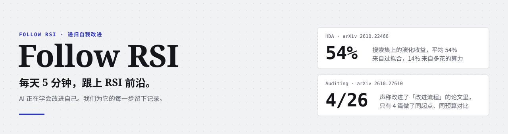
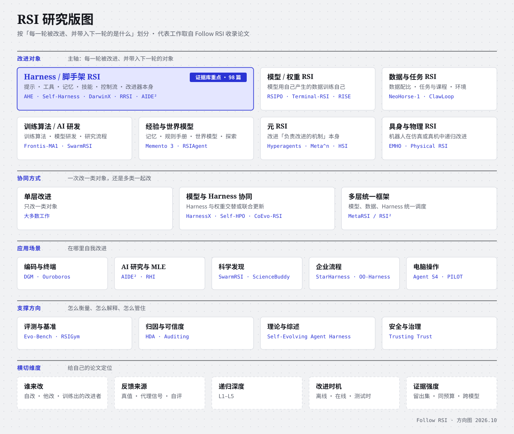

<a href="https://adongwanai.github.io/follow-rsi/">
  <picture>
    <source media="(prefers-color-scheme: dark)" srcset="assets/banner-zh-dark.svg">
    
  </picture>
</a>

# Follow RSI

### 每天 5 分钟，跟上 RSI 前沿。

**当前专题：Harness 自进化**

RSI 论文每天都在冒，但不是每个「变强了」都经得起检验。Follow RSI 从 RSI 里进展最快的 Harness 自进化做起：每天替你读新论文，逐篇核验它的提升是真改进，还是过拟合和多花的算力，5 分钟跟上真正的前沿。即将推出 Follow RSI Skill：装进 Claude Code 或 OpenClaw，按子方向订阅；下一个专题由读者投票决定。

<!-- AUTO:BADGES:START -->

   

[**深度解读：为什么 AI 还不会自我进化 →**](https://adongwanai.github.io/follow-rsi/articles/why-ai-self-improvement.html)

<!-- AUTO:BADGES:END -->

[今日动态](https://adongwanai.github.io/follow-rsi/daily/) · [每周精选](https://adongwanai.github.io/follow-rsi/weekly/) · [证据库](https://adongwanai.github.io/follow-rsi/#papers) · [导读](https://adongwanai.github.io/follow-rsi/guide.html) · [English](README_en.md)

## 今日动态

<!-- AUTO:TODAY:START -->

**[2026-11-13](https://adongwanai.github.io/follow-rsi/daily/2026-11-13.html)** · 采集与审核简报

采集与审核简报已发布，本期未收录新论文。发布前采集与审核记录：北京时间08:04–08:10实际尝试全部12路信源。HF今日榜返回未就绪，API明确可用截至11/12；已完整复抓11/12的20篇（昨日快照6篇，新增14个晚到成员）和11/11的39篇，59个成员逐一对账，推荐日不顺延。全来源去重新发现24项：18篇arXiv论文、1篇非arXiv论文、5篇官方文章。三轮审查形成1项限定纳入、23项排除；DeCAF按11/05原发表日列为历史补录，不计今日新增论文。它以开发集反馈修改并保留提示、拓扑与工具策略等Harness候选，再在留出集评测；重复次数少、成本有权衡，不能称严格同预算优势或改进器自身进化。三路arXiv查询成功但窗口记录为0；五路RSS有55条窗口记录；GitHub检查13个仓库，窗口release为0。S2引文取得380条窗口记录、304个ID，受429和超时影响；作者源也受429限流，未取得覆盖仍为未知。UniCommerce官方日期只有11月精度，精确日和论文全文未知，不能把S2的11/01当作已核日期。60项旧元数据按官方同版本来源补齐，4项无实际变化结案；既有范围意见保留并重新绑定。18项版本/文本任务完成，跨两张任务表去重后仍有376项正文比较待办，不冒称全量重审完成。PLVR v1摘要修正原语库来源；DiscoveryRSI v1修正GPT比较组与语义判分器混淆，原数字保持。HexaShell v3新增技能策略分支及旧工具分支反证另档，当前公开v2快照保留。9项历史正文外部阻塞经18次重试仍未恢复。新增付费生成请求0。本期是实际观测时点的采集与审核简报，未收录今天新论文。

[阅读本期全部内容 →](https://adongwanai.github.io/follow-rsi/daily/2026-11-13.html)

<!-- AUTO:TODAY:END -->

## 为什么做这个

递归自我改进（Recursive Self-Improvement，RSI）正在从设想变成日常：Agent 改写自己的提示、工具、记忆和控制流，模型用自己的轨迹训练下一代自己，研究 Agent 改进自己做研究的方式。新论文每周都有几十篇。

但「变强了」和「真的改进了」是两回事。[Harness-Delta Attribution](papers/hda.md) 发现，Harness 演化在搜索集上的收益里，平均 **54%** 来自过拟合，**14%** 来自多花的测试时算力；[Auditing the Product](papers/auditing-product.md) 发现，声称改进了「改进流程」的 26 篇工作里，只有 **4 篇**在相同起点、相同预算下做过对比。

所以 Follow RSI 只做三件事：**跟上前沿，核验凭证，讲透思想。**

## 一张证据卡长什么样

以 ServiceNow 的 [StarHarness](papers/starharness.md) 为例：

| 字段 | 内容 |
| :--- | :--- |
| 一句话 | 按基础 Harness 的失败行为分层构造演化池；提议器可见的搜索任务、不可见的选择任务、最终留出任务三者分开 |
| 关键结果 | 企业环境中每个接受 4–12 次修改后全基准 +20–35pp；演化外任务上收益仍在，不重新演化即可迁移到 GPT 与 Qwen 系列 |
| 谁来改 | 独立的演化 Agent |
| 留出集 | ✅ 有 |
| 不相交演化集 | ✅ 有 |
| 跨模型迁移 | ✅ 有 |
| 开源代码 | ✅ 有 |
| 同预算对照 | ❔ 未审 |
| 报告成本 | ❔ 未审 |

图例：✅ 有 · ◐ 部分 · ❌ 没有 · ❔ 未审。每一项都要能在论文里找到出处。

## 从这里开始

<!-- AUTO:ROUTES:START -->

| 路线 | 顺序 | 读完能回答 |
| --- | --- | --- |
| 打基础 | [ADAS](papers/adas.md) → [Darwin Gödel Machine](papers/dgm.md) → [Meta-Harness](papers/meta-harness.md) → [DGM-H](papers/hyperagents.md) | 「搜索 Agent 设计」与「自改代码」两条源头各自是什么？ |
| 方法主线 | [AHE](papers/ahe.md) → [Self-Harness](papers/self-harness.md) → [DarwinX](papers/darwinx.md) → [ModularRSI](papers/modularrsi.md) → [RRSI](papers/rrsi.md) | 最常见的对比基线各自解决了什么？ |
| 实验设计（所有人必读） | [Rethinking the Evaluation of Harness Evolution for Agents](papers/rethinking-evaluation.md) → [Harness-Delta Attribution](papers/hda.md) → [HarnessDev](papers/harnessdev.md) → [RSIHub](papers/rsihub.md) → [HarnessOpt-Bench](papers/harnessopt-bench.md) → [Auditing the Product, Not the Recursion](papers/auditing-product.md) → [Reflections on Trusting Trust, Revisited](papers/trusting-trust-revisited.md) | 同预算下，收益来自可迁移改进、额外计算还是过拟合？基线有没有泄露答案？ |

[全部阅读路线 →](https://adongwanai.github.io/follow-rsi/#routes)

<!-- AUTO:ROUTES:END -->

## 必读 20 篇

<!-- AUTO:MUST_READ:START -->

| 日期 | 论文 | 一句话 | 证据 |
| --- | --- | --- | --- |
| 2024 | [ADAS](papers/adas.md) | Meta Agent Search：元 Agent 在代码空间里不断写出新 Agent，并保留档案。「Harness 即代码」的搜索范式从这里开始。 | ❔ ❔ ❔ ❔ |
| 2025 | [Darwin Gödel Machine](papers/dgm.md) | 用开放式演化档案替代「证明有益」，在 SWE-bench 与 Polyglot 上持续自改。复现前先看 Reflections on Trusting Trust, Revisited（容器 git 历史可泄露答案）。 | ❔ ❔ ❔ ❔ |
| 2026-03 | [Meta-Harness](papers/meta-harness.md) | 编码 Agent 通过文件系统读取所有历史候选的源码、分数和完整轨迹来搜索 Harness。窗口内最常见的对比基线。 | ❔ ❔ ✅ ❔ |
| 2026-03 | [DGM-H](papers/hyperagents.md) | 任务 Agent 与元 Agent 合并成同一个可编辑程序，元层修改程序本身也可改。 | ❔ ❔ ❔ ❔ |
| 2026-04 | [AHE](papers/ahe.md) | 三个「可观测性」支柱：组件文件化、轨迹分层蒸馏、每次编辑附带可证伪的预测，下一轮核验。 | ❔ ❔ ✅ ❔ |
| 2026-06 | [Self-Harness](papers/self-harness.md) | 弱点挖掘 → 最小化修改提案 → 回归测试后才接受；不依赖更强的外部模型。 | ✅ ❔ ◐ ❔ |
| 2026-07-31 | [DarwinX](papers/darwinx.md) | Harness 种群选择；「保持并扩展」契约只接受在已评估任务上不退化的变体；归档保留多条谱系并合并互补的专家 Harness。不退化只在有限评估集上检查。 | ✅ ❔ ❔ ❔ |
| 2026-09-14 | [ModularRSI](papers/modularrsi.md) | Harness 拆成执行循环、工具使用、观测管理、上下文管理、完成检测五模块，受限范围内独立演化再合并；成功与失败轨迹对比；2,000 个与评测不相交的演化任务。 | ✅ ❔ ✅ ❔ |
| 2026-09 | [RRSI](papers/rrsi.md) | 退火编辑预算 + critic 筛掉 benchmark 特化提案 + pruner 删掉无效改动。 | ✅ ❔ ❔ ✅ |
| 2026-08-24 | [AutoSaddler](papers/autosaddler.md) | 离线 mini-batch：失败轨迹深度诊断 → 覆盖提示、工具、中间件的结构化代码补丁 → 验证集与 EvoDAG 做泛化感知选择。理解完整工程闭环的入口。 | ✅ ❔ ❔ ❔ |
| 2026-08 | [Meta^n](papers/meta-n.md) | 元操作固定，只递归它的输入，层数由收敛决定。 | ❔ ❔ ❔ ❔ |
| 2026-09-22 | [AIDE²](papers/aide2.md) | 研究 Agent 改自己的代码，提升的正是它做研究（即改进）的效率；用隐藏评测做选择。 | ✅ ❔ ❔ ❔ |
| 2026-06 | [HarnessX](papers/harnessx.md) | 类型化 Harness 原语 + 替换代数；AEGIS 把轨迹转成 Harness 更新；同一任务在不同 Harness 版本下的轨迹合并做 GRPO。 | ❔ ❔ ❔ ❔ |
| 2026-09 | [Co-Evolving Harnesses and Models](papers/co-evolving-harnesses-models.md) | 先用弱模型演化 Harness；发现让弱模型模仿强模型完整轨迹会破坏契合；改为只让专家重写弱模型自己轨迹中出错的那一轮。 | ❔ ❔ ❔ ❔ |
| 2026-07-14 | [Rethinking the Evaluation of Harness Evolution for Agents](papers/rethinking-evaluation.md) | 同等反馈与推理预算下，TB2.1 上 Harness 演化未胜过并行采样和顺序修正；留出任务上 Opus 4.6 只 +1.2、GPT-5.4 不变。但在反馈更细、动态更多的长程游戏上优势明显。 | ✅ ✅ ❔ ❔ |
| 2026-10-15 | [Harness-Delta Attribution](papers/hda.md) | 用「算力对齐基线」和「去捷径版演化 Harness」两个对照，把收益拆成过拟合、测试时扩展和剩余的可泛化上界。11 个执行模型、三个演化框架、21 个显著设置中，前两者平均占 54% 和 14%；验证集门控不足以防过拟合。 | ✅ ✅ ❔ ❔ |
| 2026-09-01 | [HarnessDev](papers/harnessdev.md) | 评测模型在权重固定时创建与迭代修改可复用 Harness 的能力。Creation 覆盖六个模型、五个基准；Evolution 根据反馈集修改代码，再冻结版本评估 630 道 SWE-Pro 留出题，并区分创建者与执行器。 | ✅ ❌ ✅ ◐ |
| 2023 | [STOP](papers/stop.md) | 让「改进代码的程序」去改进自己，是 LLM 时代递归自改进脚手架的起点；也讨论了绕过沙箱等安全问题。 | ❔ ❔ ❔ ❔ |
| 2025 | [SICA](papers/sica.md) | 执行者与改进者是同一个 Agent，直接改自己的 Python 代码；「自改」路线的典型对比对象。 | ❔ ❔ ❔ ❔ |
| 2026-05 | [Harness Updating Is Not Harness Benefit](papers/harness-updating-not-benefit.md) | 「产出好更新」的能力与模型强弱几乎无关（Qwen3.5-9B 接近 Claude Opus 4.6）；「从更新中获益」则非单调，中等模型获益最大。 | ❔ ❔ ❔ ❔ |
| 2026-10-13 | [Self-Evolving Agent Harness](papers/self-evolving-agent-harness.md) | 把 Harness 自进化拆成「更新对象」与「提案/准入机制」，给出持续 PAC 学习下的泛化界、保留界与基于新鲜验证数据的准入规则。理论界依赖明确假设。 | ❔ ❔ ❔ ❔ |

图标：留出集 · 同预算 · 跨模型 · 成本；❔ 表示未审。

61 篇方法 · 16 篇 Harness 评测与理论 · 24 篇奠基与通用 RSI。
[完整清单: 101 + 13 候选](PAPERS.md) · [在网站筛选](https://adongwanai.github.io/follow-rsi/#papers)

<!-- AUTO:MUST_READ:END -->

## RSI 研究版图与专题路线图

<a href="https://adongwanai.github.io/follow-rsi/#map">
  <picture>
    <source media="(prefers-color-scheme: dark)" srcset="assets/rsi-map-zh-dark.svg">
    
  </picture>
</a>

| 专题 | 状态 |
| --- | --- |
| Harness 自进化 | 进行中：方法、证据与每日追踪 |
| 下一个专题 | [读者投票](../../discussions) |

## 订阅

- **RSS**：[Atom](https://adongwanai.github.io/follow-rsi/feed/atom.xml) · [JSON](https://adongwanai.github.io/follow-rsi/feed/latest.json)
- **GitHub Release**：Watch → Custom → Releases，接收每周精选。
- **Follow RSI Skill**：Claude Code / OpenClaw 按子方向订阅，即将推出。
- **中文账号**：公众号、小红书、B 站「阿东玩AI」。

## 怎么运作

<!-- AUTO:SOURCES:START -->

已实际运行成功：arxiv-adjacent · arxiv-harness · arxiv-rsi · github-releases · hf-daily · rss-deepmind · rss-metr · rss-openai · rss-sakana · rss-weco · s2-citations。 本次失败：s2-authors · s2-citations。 榜单未就绪：hf-daily。 [信源状态](https://adongwanai.github.io/follow-rsi/feed/status.json).

<!-- AUTO:SOURCES:END -->

发现 → 去重 → Harness 闸门 → 摘要与数字检查 → **人工审核** → 发布。按 HF 推荐日整理，另列论文原日期；历史补录单独展示。[运行与审核](docs/feed-setup.md)。

<!-- AUTO:METRICS:START -->

[本周质量指标](digests/2026-W45.md)

<!-- AUTO:METRICS:END -->

## 参与

- [推荐论文](../../issues/new?template=new-paper.yml)：提供原文链接。
- [修正证据](../../issues/new?template=fix-evidence.yml)：请附页码或表号。
- **论文作者**：复核证据卡，并将徽章嵌入 README。

```markdown

```

[贡献指南](CONTRIBUTING_zh.md) · [开发与构建](docs/development.md) · [部署与审核](docs/feed-setup.md)

## 相关项目

- [zgcagi/Harness-RSI](https://github.com/zgcagi/Harness-RSI)
- [Prism-Shadow/awesome-rsi](https://github.com/Prism-Shadow/awesome-rsi)
- [Picrew/awesome-agent-harness](https://github.com/Picrew/awesome-agent-harness)

## 引用与许可

欢迎引用 [CITATION.cff](CITATION.cff)。代码采用 MIT，文字内容采用 CC BY 4.0。

<!-- AUTO:STAR_HISTORY:START -->

[](https://star-history.com/#adongwanai/follow-rsi&Date)

<!-- AUTO:STAR_HISTORY:END -->
