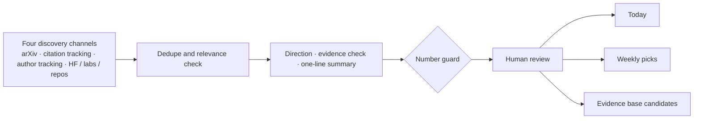

<div align="center">

<a href="https://adongwanai.github.io/follow-rsi">
  <picture>
    <source media="(prefers-color-scheme: dark)" srcset="assets/banner-dark.svg">
    
  </picture>
</a>

# Follow RSI

### Five minutes a day to keep up with recursive self-improvement.

AI is learning to improve itself. We keep the record.

<!-- AUTO:BADGES:START -->

    

<!-- AUTO:BADGES:END -->

[**Today**](https://adongwanai.github.io/follow-rsi/daily/) · [**Weekly picks**](https://adongwanai.github.io/follow-rsi/weekly/) · [**Evidence base**](https://adongwanai.github.io/follow-rsi/) · [Reading routes](https://adongwanai.github.io/follow-rsi/#routes) · [Open problems](directions/open-problems.md) · [中文](README.md)

</div>

---

## Why this exists

Recursive self-improvement (RSI) is moving from thought experiment to daily practice: agents rewrite their own prompts, tools, memory and control flow; models train their next selves on their own trajectories; research agents improve how they do research. Dozens of new papers appear every week.

But "the score went up" is not the same as "the system improved." [Harness-Delta Attribution](papers/hda.md) finds that, on average, **54%** of harness-evolution gains on the search set come from overfitting and **14%** from extra test-time compute. [Auditing the Product](papers/auditing-product.md) finds that of 26 works claiming a better improvement procedure, only **4** compared generations from the same starting point at a matched budget.

So Follow RSI does three things: **keep up with the frontier, check the receipts, explain the ideas.**

## What you get

| | What it is | Cadence |
| :--- | :--- | :--- |
| **Today** | New RSI papers approved that day, sorted into seven directions, each with a one-line summary and an evidence check | Daily |
| **Weekly picks** | Human-reviewed highlights: papers worth a close read, editor's notes, direction trends | Weekly |
| **Harness evolution evidence base** | 98 papers, one evidence card each, filterable by evidence; authors can embed a badge | Ongoing |
| **Deep dives** | Notes and videos on landmark papers, direction overviews, reading routes and open problems | Ongoing |

Today keeps you current. The evidence base keeps you accurate. Deep dives help you understand.

## The RSI research map

Seven directions, defined by what gets improved and carried into the next round, plus four lenses: how they combine, where they apply, what supports them, and the dimensions for positioning a paper. The evidence base focuses on harness RSI.

<a href="assets/rsi-map-light.svg">
  <picture>
    <source media="(prefers-color-scheme: dark)" srcset="assets/rsi-map-dark.svg">
    
  </picture>
</a>

Open the image for full size. Browse papers by direction: [map view on the site](https://adongwanai.github.io/follow-rsi/#map)

## What an evidence card looks like

Take [StarHarness](papers/starharness.md) from ServiceNow:

| Field | Entry |
| :--- | :--- |
| In one line | Builds the evolution pool by stratifying tasks on the base harness's failures; keeps proposer-visible search tasks, hidden selection tasks and held-out tasks separate |
| Key result | +20–35 pp across enterprise benchmarks after 4–12 accepted changes per environment; gains hold on tasks excluded from evolution and transfer to GPT and Qwen models without re-evolution |
| Who edits | A separate evolution agent |
| Held-out evaluation | ✅ yes |
| Disjoint evolution set | ✅ yes |
| Cross-model transfer | ✅ yes |
| Code released | ✅ yes |
| Matched-budget baseline | ❔ not yet reviewed |
| Cost reported | ❔ not yet reviewed |

Legend: ✅ yes · ◐ partial · ❌ no · ❔ not yet reviewed. Every entry must point to a page or table in the paper.

## Evidence base

Start with the must-reads and reading routes; the full collection is grouped by direction, with a link to every evidence card.

<!-- AUTO:STATS:START -->

98 included · 6 candidates · 20 must-reads · 13 need verification.

Evidence fields **6.5% reviewed so far** (77/1176; 8 checks + 4 classifications per paper). The 8 audit checks alone are **5.5% reviewed so far** (43/784). Included papers only; reviewed means non-`unknown`, including `no`, `partial`, and `na`, not a pass rate.

<details><summary>Paper counts by direction</summary>

| 方向 / Section | 篇数 / Papers |
| --- | ---: |
| Foundations | 13 |
| 1.1 Search & evolution (frozen model) | 19 |
| 1.2 Generalization, regularization, admission & cost | 8 |
| 1.3 Task & evidence selection | 4 |
| 2. Evolving the improver (meta / multi-level) | 13 |
| 3. Component-level evolution (skills, memory, context, interfaces) | 5 |
| 4. Model–harness co-evolution | 13 |
| 5. Evaluation, attribution & trustworthiness | 14 |
| 6. Surveys & theory | 9 |
| Candidates (not yet reviewed) | 6 |

</details>

<!-- AUTO:STATS:END -->

<details>
<summary>Must-reads</summary>

<!-- AUTO:MUST_READ:START -->

1. [ADAS: Automated Design of Agentic Systems](papers/adas.md)
2. [Darwin Gödel Machine](papers/dgm.md)
3. [Meta-Harness](papers/meta-harness.md)
4. [Hyperagents (DGM-H)](papers/hyperagents.md)
5. [AHE: Agentic Harness Engineering](papers/ahe.md)
6. [Self-Harness: Harnesses That Improve Themselves](papers/self-harness.md)
7. [DarwinX: Evolving Agent Harnesses Through Natural Selection](papers/darwinx.md)
8. [ModularRSI: Modular and Generalizable Recursive Harness Self-Improvement](papers/modularrsi.md)
9. [RRSI: Regularized Recursive Harness Self-Improvement](papers/rrsi.md)
10. [AutoSaddler: Automatic Harness Optimization with Durable Updates from Agent Execution Traces](papers/autosaddler.md)
11. [Meta^n](papers/meta-n.md)
12. [AIDE²: Recursive Self-Improvement of AI Research Agents](papers/aide2.md)
13. [HarnessX: A Composable, Adaptive, and Evolvable Agent Harness Foundry](papers/harnessx.md)
14. [Co-Evolving Harnesses and Models](papers/co-evolving-harnesses-models.md)
15. [Rethinking the Evaluation of Harness Evolution for Agents](papers/rethinking-evaluation.md)
16. [Harness-Delta Attribution: Dissecting Gains From Harness Evolution](papers/hda.md)
17. [STOP: Self-Taught Optimizer](papers/stop.md)
18. [SICA: A Self-Improving Coding Agent](papers/sica.md)
19. [Harness Updating Is Not Harness Benefit](papers/harness-updating-not-benefit.md)
20. [Self-Evolving Agent Harness](papers/self-evolving-agent-harness.md)

<!-- AUTO:MUST_READ:END -->

</details>

<details>
<summary>Reading routes</summary>

<!-- AUTO:ROUTES:START -->

| Route | Order | Question |
| --- | --- | --- |
| Foundations | [ADAS](papers/adas.md) → [Darwin Gödel Machine](papers/dgm.md) → [Meta-Harness](papers/meta-harness.md) → [DGM-H](papers/hyperagents.md) | What are the two origins of searching agent designs and modifying one’s own code? |
| Mainline methods | [AHE](papers/ahe.md) → [Self-Harness](papers/self-harness.md) → [DarwinX](papers/darwinx.md) → [ModularRSI](papers/modularrsi.md) → [RRSI](papers/rrsi.md) | What does each of the most common comparison baselines address? |
| Engineering loop & long-horizon reliability | [AutoSaddler](papers/autosaddler.md) → [ModularRSI](papers/modularrsi.md) → [RiseHarness](papers/riseharness.md) | How can failures be traced to code, edits kept in scope, and gains across tasks verified? |
| Evolving the improver | [Hierarchical Self-Improvement](papers/hsi.md) → [Meta^n](papers/meta-n.md) → [AIDE²](papers/aide2.md) → [MILO](papers/milo.md) → [Harness²](papers/harness2.md) → [RSIFlow](papers/rsiflow.md) **待细读 / Needs verification** | How do search strategies or meta agents keep updating, and is the evidence sufficient? |
| No ground-truth labels | [TTHE](papers/tthe.md) → [Harness²](papers/harness2.md) → [HarnessPro](papers/harnesspro.md) → [Agent S4](papers/agent-s4.md) | Which proxy signals select versions, and how can incorrect feedback be controlled? |
| Multi-task & cross-model generalization | [HarnessCompass](papers/harnesscompass.md) → [StarHarness](papers/starharness.md) → [MaD-RSI](papers/mad-rsi.md) **待细读 / Needs verification** → [Object-Oriented Harness](papers/oo-harness.md) | How can adaptation to just one task set or one model be avoided? |
| Task & evidence selection | [ActiveSaddler](papers/activesaddler.md) → [SSR](papers/ssr.md) → [ECDYSIS](papers/ecdysis.md) → [Task-CoEvolve](papers/task-coevolve.md) **待细读 / Needs verification** | Which tasks and failures should drive edits in the next round? |
| Model–harness co-evolution | [HarnessX](papers/harnessx.md) → [Co-Evolving Harnesses and Models](papers/co-evolving-harnesses-models.md) → [Self-HPO](papers/self-hpo.md) → [HarnessAdapt-RL](papers/harnessadapt-rl.md) | When should the harness change, when should weights change, and how can their gains be separated? |
| Experimental design (everyone) | [Rethinking the Evaluation of Harness Evolution for Agents](papers/rethinking-evaluation.md) → [Harness-Delta Attribution](papers/hda.md) → [HarnessOpt-Bench](papers/harnessopt-bench.md) → [Auditing the Product, Not the Recursion](papers/auditing-product.md) → [Reflections on Trusting Trust, Revisited](papers/trusting-trust-revisited.md) | Under matched budgets, do gains come from transferable improvements, extra computation, or overfitting? Do the baselines leak answers? |

<!-- AUTO:ROUTES:END -->

</details>

<details>
<summary>All papers and candidates</summary>

<!-- AUTO:TABLES:START -->

✅ yes / 有 · ◐ partial / 部分 · ❌ no / 没有 · ❔ unknown / 未审 · — na / 不适用

Icon order: held-out · matched budget · cross-model transfer · cost. Missing evidence is never inferred.

### Foundations

<details><summary>13 papers</summary>

| Date | Paper | Organizations | Mechanism | Key result | Evidence | Page |
| --- | --- | --- | --- | --- | --- | --- |
| 2003 | [Gödel Machines](https://arxiv.org/abs/cs/0309048) | Schmidhuber | A theoretical prototype of self-referential self-improvement: rewrite only after proving the change beneficial. Almost every RSI paper mentions it in the introduction. |  | ❔ ❔ ❔ ❔ | [Receipt](papers/godel-machines.md) |
| 2023 | [STOP: Self-Taught Optimizer](https://arxiv.org/abs/2310.02304) |  | A program that improves code improves itself, marking a starting point for recursive self-improvement scaffolds in the LLM era; it also discusses safety issues such as bypassing sandboxes. |  | ❔ ❔ ❔ ❔ | [Receipt](papers/stop.md) |
| 2023 | [DSPy](https://arxiv.org/abs/2310.03714) |  | Treats the “compilation” of prompt pipelines as an optimization problem, serving as a representative baseline for text optimizers. |  | ❔ ❔ ❔ ❔ | [Receipt](papers/dspy.md) |
| 2023 | [Voyager](https://arxiv.org/abs/2305.16291) |  | Accumulates and reuses skills as code, a precursor to harness evolution through skills and memory. |  | ❔ ❔ ❔ ❔ | [Receipt](papers/voyager.md) |
| 2024 | [ADAS: Automated Design of Agentic Systems](https://arxiv.org/abs/2408.08435) |  | Meta Agent Search: a meta agent continually writes new agents in code space and maintains an archive. The search paradigm of “harness as code” starts here. |  | ❔ ❔ ❔ ❔ | [Receipt](papers/adas.md) |
| 2024 | [AFlow](https://arxiv.org/abs/2410.10762) |  | Uses MCTS to search workflows represented as code, a standard baseline for automated workflow optimization. |  | ❔ ❔ ❔ ❔ | [Receipt](papers/aflow.md) |
| 2024 | [Gödel Agent](https://arxiv.org/abs/2410.04444) |  | Lets an agent inspect and modify its own code at runtime, including the improvement logic itself; a representative implementation of self-referential agents. |  | ❔ ❔ ❔ ❔ | [Receipt](papers/godel-agent.md) |
| 2025 | [SICA: A Self-Improving Coding Agent](https://arxiv.org/abs/2504.15228) |  | The executor and improver are the same agent, directly modifying its own Python code; a typical comparison for the self-modification approach. |  | ❔ ❔ ❔ ❔ | [Receipt](papers/sica.md) |
| 2025 | [Darwin Gödel Machine](https://arxiv.org/abs/2505.22954) |  | Replaces “prove beneficial” with an open-ended evolutionary archive, continually modifying itself on SWE-bench and Polyglot. Before reproducing it, read Reflections on Trusting Trust, Revisited: container git history can leak answers. |  | ❔ ❔ ❔ ❔ | [Receipt](papers/dgm.md) |
| 2025 | [AlphaEvolve](https://arxiv.org/abs/2506.13131) |  | Does not modify the harness, but its proposal–evaluation–archive loop is reused by many harness evolution studies. |  | ❔ ❔ ❔ ❔ | [Receipt](papers/alphaevolve.md) |
| 2025 | [ACE: Agentic Context Engineering](https://arxiv.org/abs/2510.04618) |  | Treats context as a continually evolving playbook, one of the most frequently used context baselines. |  | ❔ ❔ ❔ ❔ | [Receipt](papers/ace.md) |
| 2025 | [Huxley-Gödel Machine](https://arxiv.org/abs/2510.21614) |  | Uses a lineage-level meta-productivity metric to guide self-modification search, an important improvement on the DGM approach; HGM-Dual builds directly on it. |  | ❔ ❔ ❔ ❔ | [Receipt](papers/hgm.md) |
| 2026-03 | [Meta-Harness](https://arxiv.org/abs/2603.28052) | Stanford · MIT · KRAFTON | A coding agent searches for harnesses by reading source code, scores, and full trajectories of all historical candidates through the filesystem. The most common comparison baseline in the covered period. | A mathematical reasoning harness averages +4.7 points on 5 held-out models. | ❔ ❔ ✅ ❔ | [Receipt](papers/meta-harness.md) |

</details>

### 1.1 Search & evolution (frozen model)

<details><summary>19 papers</summary>

| Date | Paper | Organizations | Mechanism | Key result | Evidence | Page |
| --- | --- | --- | --- | --- | --- | --- |
| 2026-04 | [AHE: Agentic Harness Engineering](https://arxiv.org/abs/2604.25850) | Fudan | Three pillars of observability: components as files, hierarchical trajectory distillation, and a falsifiable prediction attached to each edit for verification in the next round. | Terminal-Bench 2 pass@1 rises from 69.7% to 77.0% over ten rounds, surpassing Codex-CLI; transfer across model families yields +5.1–10.1pp. | ❔ ❔ ✅ ❔ | [Receipt](papers/ahe.md) |
| 2026-05 | [DemoEvolve](https://arxiv.org/abs/2605.24539) | Tsinghua · AgiBot | In long-horizon stochastic environments with sparse rewards, human demonstration trajectories guide an editor to diagnose and locate harness problems. | Self-evolution works on Liar's Dice; on Balatro, noise misleads self-evolution, while adding demonstrations performs better at the same budget. | ❔ ❔ ❔ ❔ | [Receipt](papers/demoevolve.md) |
| 2026-06 | [Self-Harness: Harnesses That Improve Themselves](https://arxiv.org/abs/2606.09498) | Shanghai AI Lab | Mine weaknesses → propose minimal edits → accept only after regression tests; does not rely on a stronger external model. | TB2.0 held-out set: MiniMax M2.5 40.5%→61.9%, Qwen3.5-35B-A3B 23.8%→38.1%, GLM-5 42.9%→57.1%. | ✅ ❔ ◐ ❔ | [Receipt](papers/self-harness.md) |
| 2026-07-09 | [TTHE: Test-Time Harness Evolution](https://arxiv.org/abs/2607.08124) |  | Evolves a population of candidate harnesses at test time using only unlabeled execution trajectories; the solver, proposer, and judge share one frozen model, each with a different harness. | BIRD execution accuracy 12.7%→48.7% (ten-vote baseline 16.0%); the evolved harness transfers to other models. | ❔ ❔ ✅ ❔ | [Receipt](papers/tthe.md) |
| 2026-07-15 | [HarnessBank: Semantic Gene-Bank Search with Gated Verification for Agent-Harness Self-Evolution](https://arxiv.org/abs/2607.13683) **待细读 / Needs verification** |  | Separates the task agent from an independent evolution agent; organizes a “harness gene bank” by semantic coordinates for quality-diversity search, screening candidates in stages to reduce full evaluations. | Targets search collapse, task overfitting, and unverifiable gains; quantitative results need close reading. | ❔ ❔ ❔ ❔ | [Receipt](papers/harnessbank.md) |
| 2026-07-17 | [RHI: Recursive Harness Self-Improvement](https://arxiv.org/abs/2607.15524) | Sakana AI · UC Berkeley | Expresses the harness as a prompt-level specification and iterates using paired feedback from its own revision history; gains mainly come from context management and information flow between agents. The task harness is recursively modified, not the improver. | On 30 synthetic ML research tasks, a low-reasoning-effort agent exceeds the highest-reasoning-effort setting, reducing cost by up to 60%. | ❔ ❔ ❔ ✅ | [Receipt](papers/rhi.md) |
| 2026-07-29 | [DREvo: Distilling Recalibrated Historical Experience for Harness Self-Evolution](https://arxiv.org/abs/2607.26722) **待细读 / Needs verification** |  | Anchors historical evidence at the function level, recalibrates its validity against the current version, then distills it into search intentions differentiated by role. | Covers chemistry and legal reasoning, TB2.0, and SWE-bench Verified; evolution curves are steadier than Meta-Harness, while proposer context stays around 2.9K token. | ❔ ❔ ❔ ❔ | [Receipt](papers/drevo.md) |
| 2026-07-31 | [DarwinX: Evolving Agent Harnesses Through Natural Selection](https://arxiv.org/abs/2608.07545) | Salesforce | Harness population selection: a “preserve and expand” contract accepts only variants that do not regress on evaluated tasks; an archive retains multiple lineages and merges complementary expert harnesses. Non-regression is checked only on a finite evaluation set. | TB2.1 75.5%→83.2%; TerminalWorld held-out set 68.3%; WebArena-Infinity 43.5%→93.0%; transfers to SWE-bench Verified without modification. | ✅ ❔ ❔ ❔ | [Receipt](papers/darwinx.md) |
| 2026-08 | [Evo-Harness](https://arxiv.org/abs/2608.15071) |  | Online harness learning: as tasks arrive sequentially, compiles one-off execution context into Markdown skills. From the same lab as Harness Updating ≠ Benefit. | Improves on all 5 benchmarks; model self-judgment feedback causes regression, while stronger solvers benefit more. | ❔ ❔ ❔ ❔ | [Receipt](papers/evo-harness.md) |
| 2026-08 | [Recuris](https://arxiv.org/abs/2608.24876) | Princeton | A fixed Meta-Agent: working memory tracks progress, experience memory provides skills, and skill memory receives local, verified updates. | Improves in 35 of 37 groups; on tau-bench, Opus 5 gains +15.6 to reach 87.9%. | ❔ ❔ ❔ ❔ | [Receipt](papers/recuris.md) |
| 2026-08-07 | [Mendel Gödel Machine: Recursive Self-Improving Coding Agents via Comparative Evolution](https://arxiv.org/abs/2608.07645) |  | The DGM approach: comparisons of the same agent across tasks, combined with trajectory comparisons of different lineages on the same task, drive mutation and crossover. | Demonstrates faster convergence; exceeds single-trajectory baselines on SWE-bench and Polyglot. | ❔ ❔ ❔ ❔ | [Receipt](papers/mgm.md) |
| 2026-08-08 | [Ouroboros: A Self-Developing Coding Harness with Reviewed Core Evolution](https://arxiv.org/abs/2608.08311) |  | Tools, prompts, context assembly, and core code become the runtime after reviewed commits; guardrails retain authority under evolutionary pressure. | TB2.1 86.74% (after trajectory auditing), OSWorld-Verified 90.69% (frozen snapshot); the public deployment Hope evolves continuously for 161 days. | ❔ ❔ ❔ ❔ | [Receipt](papers/ouroboros.md) |
| 2026-08-24 | [AutoSaddler: Automatic Harness Optimization with Durable Updates from Agent Execution Traces](https://arxiv.org/abs/2608.23041) |  | Offline mini-batches: deep diagnosis of failure trajectories → structured code patches covering prompts, tools, and middleware → generalization-aware selection using a validation set and EvoDAG. An entry point to the complete engineering loop. | On GAIA2, SWE-Bench Pro, and TB2.0: +9.0/+9.6/+10.0pp over the base harness, and 7.4/4.4/6.7pp above the strongest automated baseline; ablations support deep debugging, targeted edits, and generalization-aware selection. | ✅ ❔ ❔ ❔ | [Receipt](papers/autosaddler.md) |
| 2026-08-25 | [StarHarness: Evolving Harnesses with Stratified Search for Enterprise Environments](https://arxiv.org/abs/2608.24804) | ServiceNow · Mila | Builds a stratified evolution pool from the base harness’s failure behaviors; separates search tasks visible to the proposer, hidden selection tasks, and final held-out tasks. | Across three enterprise environments including ITBench SRE, each accepts 4–12 edits and gains +20–35pp across the full benchmark; gains persist on tasks outside evolution, and transfer to GPT and Qwen families requires no re-evolution. | ✅ ❔ ✅ ❔ | [Receipt](papers/starharness.md) |
| 2026-09-14 | [ModularRSI: Modular and Generalizable Recursive Harness Self-Improvement](https://arxiv.org/abs/2609.14857) |  | Splits the harness into five modules: execution loop, tool use, observation management, context management, and completion detection; evolves each within a restricted scope, then merges them; contrasts successful and failed trajectories; uses 2,000 evolution tasks disjoint from evaluation. | TB2.0 47.57→52.43, SWE-Bench Verified 73.40→76.45; cross-model transfer is effective. | ✅ ❔ ✅ ❔ | [Receipt](papers/modularrsi.md) |
| 2026-10 | [EMHO](https://arxiv.org/abs/2610.08432) **待细读 / Needs verification** |  | Embodied setting: freezes the VLM, modifies the harness from sparse interaction feedback with weak diagnostic value, and supports merging into a shared harness. | Quantitative results need close reading. | ❔ ❔ ❔ ❔ | [Receipt](papers/emho.md) |
| 2026-10-20 | [RiseHarness: Harness Self-Evolution for Long-Horizon Terminal Agents](https://arxiv.org/abs/2610.27435) |  | Targets tasks with inconsistent success across repeated runs: combines agent trajectories and internal runtime traces, maps behavior to source code using a Harness Handbook, and retrieves implementations from other frameworks as references. | Both Pass@1 and Pass^4 (the fraction of tasks passing all four runs) improve, while Pass@4 rises only slightly; gains mainly concern reliability and transfer to benchmarks not used in evolution. | ✅ ❔ ❔ ❔ | [Receipt](papers/riseharness.md) |
| 2026-10-20 | [Object-Oriented Harness: Evolving Agent Harnesses through Object-Oriented Design](https://arxiv.org/abs/2610.28380) | UIUC · Google Cloud AI Research | Evolves an inheritance hierarchy of harness classes, with specialized versions inheriting from the base class or existing subclasses; a test-time router chooses versions using the task and evidence from base execution. | Compared with Meta-Harness, AHE, and Adaptive Auto-Harness, achieves the highest primary metric on all three long-horizon benchmarks (means over three runs). | ✅ ❔ ❔ ❔ | [Receipt](papers/oo-harness.md) |
| 2026-10-21 | [HGM-Dual: Lineage-Aware Guided Agent Harness Optimization for Long-Horizon Planning](https://arxiv.org/abs/2610.30042) |  | Builds on HGM: organizes ancestor edits and behavioral improvements or regressions into lineage context; each parent produces both an open-exploration child and a specialized child targeting the main constraint violation. | On long-horizon planning tasks, exceeds the strongest baseline by up to 14.45% (relative); matches the final performance of HGM variants with 1/2 to 1/4 of their evaluation budget. | ❔ ◐ ❔ ❔ | [Receipt](papers/hgm-dual.md) |

</details>

### 1.2 Generalization, regularization, admission & cost

<details><summary>8 papers</summary>

| Date | Paper | Organizations | Mechanism | Key result | Evidence | Page |
| --- | --- | --- | --- | --- | --- | --- |
| 2026-04 | [HARBOR](https://arxiv.org/abs/2604.20938) |  | Performs cost-aware Bayesian optimization over a harness configuration space with fixed components, without changing code. | Complements code-editing approaches such as Meta-Harness and can serve as a configuration-search baseline. | ❔ ❔ ❔ ✅ | [Receipt](papers/harbor.md) |
| 2026-08-03 | [HarnessCompass: Guiding Automatic Harness Evolution toward Generalizable and Effective Agent Harnesses](https://arxiv.org/abs/2608.01918) |  | Three principles: generalization gates restrict task-specific edits; first-person “active feedback” supplements trajectory evidence; components are optimized on separate tracks and then integrated to reduce interference. | Reports improvement over five rounds on SWE-bench Verified and tests cross-task and cross-model transfer; however, CHASE finds on OfficeQA that its gates do not guarantee held-out gains. | ❔ ❔ ✅ ❔ | [Receipt](papers/harnesscompass.md) |
| 2026-09 | [HarnessEvolve: Learning from Reference Trajectories for Reliable Agent Self-Evolution](https://arxiv.org/abs/2609.00829) |  | Aligns reference trajectories obtained by replaying with standard answers against failed trajectories for credit assignment; a quality gate filters hardcoded answers and prompt bloat, while a performance gate prevents forgetting. | Ablation: removing reference trajectories drops CloudCoreNetwork-QA from 86.9 to 57.8. | ❔ ❔ ❔ ❔ | [Receipt](papers/harnessevolve.md) |
| 2026-09 | [SoL-Pi: Recursively Scaling Auto-Research Loops for Efficient Agent Harness](https://arxiv.org/abs/2609.20519) | NVIDIA · MIT | Scales the auto-research loop across many environments to select token-efficient mechanisms; held-out evaluation occurs only after candidates are frozen. | Matches Pi on EdgeBench, reducing token traffic by 44.7–49.0% and API cost by about one third. | ✅ ❔ ❔ ✅ | [Receipt](papers/sol-pi.md) |
| 2026-09 | [Bad Genius: Counterfactual-Guided Harness Evolution Beyond Task-Specific Shortcuts (CHASE)](https://arxiv.org/abs/2609.18366) |  | Uses counterfactual challengers to block “shortcut” edits that work only for specific tasks, selecting the final harness by worst-case performance. | Reaches 30.37% on OfficeQA Pro V2 with the highest worst-case score; useful as a comparison for claims about generalization. | ❔ ❔ ❔ ❔ | [Receipt](papers/chase.md) |
| 2026-09 | [RRSI: Regularized Recursive Harness Self-Improvement](https://arxiv.org/abs/2609.24972) | Google | Anneals the editing budget, uses a critic to filter benchmark-specific proposals, and a pruner to remove ineffective edits. | Transfers better than Meta-Harness, AHE, TTHE, and HarnessX on five out-of-distribution benchmarks, by up to +4.7; per-task token use is 2.42M (3.80M for unregularized evolution). | ✅ ❔ ❔ ✅ | [Receipt](papers/rrsi.md) |
| 2026-10-19 | [HarnessPro: Recursive Harness Self-Improvement with Pareto Optimization for Performance-Cost Trade-offs](https://arxiv.org/abs/2610.26770) |  | Label-free: evaluates candidates with model-generated tests, without accessing standard answers or official tests; produces lite, medium, and heavy tiers for different performance–cost preferences. | With GPT-5.5 + Codex, heavy improves average pass rate by +2.0pp over RHO and reduces per-task cost by 26.1%. | ❔ ❔ ❔ ✅ | [Receipt](papers/harnesspro.md) |
| 2026-10-20 | [MaD-RSI: Model-as-Data for Recursive Self-Improvement of Agent Harnesses](https://arxiv.org/abs/2610.28201) **待细读 / Needs verification** |  | Uses failure trajectories from multiple heterogeneous models as evidence to directly optimize one shared harness, making cross-model generalization an optimization objective. | The abstract claims better generalization and lower costs without providing numbers. | ❔ ❔ ✅ ❔ | [Receipt](papers/mad-rsi.md) |

</details>

### 1.3 Task & evidence selection

<details><summary>4 papers</summary>

| Date | Paper | Organizations | Mechanism | Key result | Evidence | Page |
| --- | --- | --- | --- | --- | --- | --- |
| 2026-08 | [Task-CoEvolve: Efficient Harness Optimization via Adaptive Validation Task Selection](https://arxiv.org/abs/2608.20169) **待细读 / Needs verification** |  | Adaptively selects validation tasks that best distinguish candidate harnesses and corrects bias from nonuniform sampling in full-set performance estimates; orthogonal to improving search efficiency. | Aims to reduce evaluation cost per candidate; quantitative results need close reading. | ❔ ❔ ❔ ❔ | [Receipt](papers/task-coevolve.md) |
| 2026-09 | [ECDYSIS: Efficient and Effective Training of Runtime Harnesses for LLM Agents](https://arxiv.org/abs/2609.11677) |  | Uses whether failures recur across tasks to distinguish model limitations from defects in the harness itself; only recurring harness defects drive persistent edits. | The evolved harness has reasoning accuracy 18.56% higher than existing evolution methods, with training up to 1.84 times faster. | ❔ ❔ ❔ ❔ | [Receipt](papers/ecdysis.md) |
| 2026-10-01 | [ActiveSaddler: Automated Curriculum Learning for Agent Harness Optimization](https://arxiv.org/abs/2610.00906) | Microsoft | Abstracts recurring failures into a dynamically growing set of failure patterns and uses a nonstationary multi-armed bandit to allocate tasks between known weaknesses and new scenarios; the curriculum changes with the harness. | With the same optimizer, test Pass@1 on GAIA2 and TB2.0 improves by +4.4 and +7.5pp respectively over a task order fixed in advance. | ❔ ✅ ❔ ❔ | [Receipt](papers/activesaddler.md) |
| 2026-10-20 | [Forging More Tasks into Better Harnesses: Agentic Harness Evolution via Successive Scale Racing (SSR)](https://arxiv.org/abs/2610.28815) |  | Constructs multiple evidence combinations based on task quality and coverage, generates a candidate harness from each, then eliminates candidates through successive small-budget competitions. | Motivation: AHE peaks at 63.0% with 80 tasks but falls to 57.7% when expanded to 200; SSR’s pass rate keeps increasing as the task pool grows from 40 to 200. | ❔ ❔ ❔ ❔ | [Receipt](papers/ssr.md) |

</details>

### 2. Evolving the improver (meta / multi-level)

<details><summary>13 papers</summary>

| Date | Paper | Organizations | Mechanism | Key result | Evidence | Page |
| --- | --- | --- | --- | --- | --- | --- |
| 2026-03 | [Hyperagents (DGM-H)](https://arxiv.org/abs/2603.19461) | Meta FAIR · UBC | Merges the task agent and meta agent into a single editable program; the program that makes meta-level edits can itself be modified. | Exceeds DGM in coding, paper reviewing, robot reward design, and Olympiad mathematics grading; meta-level improvements transfer across domains. The most frequently cited meta-improvement baseline. | ❔ ❔ ❔ ❔ | [Receipt](papers/hyperagents.md) |
| 2026-04 | [The Last Harness You'll Ever Build](https://arxiv.org/abs/2604.21003) **待细读 / Needs verification** |  | A two-level framework: the inner loop optimizes a worker agent for a single task; an outer Meta-Evolution Agent optimizes the “evolution loop itself,” including evaluators, evolution strategies, and information flow. | Conceptually clear and useful as a source for two-level formalization; quantitative results need close reading. | ❔ ❔ ❔ ❔ | [Receipt](papers/last-harness.md) |
| 2026-07 | [MetaSkill-Evolve](https://arxiv.org/abs/2607.05297) | LMU | Each branch carries a “meta-skill” that parameterizes five agents for analysis, retrieval, allocation, proposal, and evolution; task skills have a fast loop and meta-skills a slow loop. | Frozen Gemma-4 31B: OfficeQA +23.54, SealQA +16.09, ALFWorld +1.92; meta-skills are most useful after task skills plateau. | ❔ ❔ ❔ ❔ | [Receipt](papers/metaskill-evolve.md) |
| 2026-08 | [Harness-R1](https://arxiv.org/abs/2608.02276) | SJTU · Xiaohongshu | Treats editing an executable harness from failure trajectories as a policy, using online GRPO training after cold-start SFT. | Raises Qwen3.5-9B from 44.3% to 53.6% on WebShop, ALFWorld, and DBBench. | ❔ ❔ ❔ ❔ | [Receipt](papers/harness-r1.md) |
| 2026-08 | [Meta^n](https://arxiv.org/abs/2608.24735) |  | Keeps the meta-operation fixed and recurses only over its input; convergence determines the number of levels. | Exceeds existing self-improving agents across eight benchmark categories; the only score above zero on ARC-AGI-2. | ❔ ❔ ❔ ❔ | [Receipt](papers/meta-n.md) |
| 2026-08-09 | [Hierarchical Self-Improvement: A Framework for Task-Specific Evolvable Agent Harnesses](https://arxiv.org/abs/2608.08466) |  | The same frozen model works at three levels: a task harness, an evolver that rewrites it, and a meta-evolver that rewrites the evolver’s strategy; the outermost anchor stays frozen. A single-lineage design aids attribution. | Reports a boundary: no improvement on tasks beyond the backbone’s capabilities (NLE). | ❔ ❔ ❔ ❔ | [Receipt](papers/hsi.md) |
| 2026-09 | [MetaRSI / RSI²](https://arxiv.org/abs/2609.06396) **待细读 / Needs verification** |  | A unified Loop Kernel expresses improvements to models, data, and harnesses as schedulable operators; the meta level revises the scheduling strategy. | Chinese media reports: a model with 3B active parameters gains +10.9 points on average; the full text must be checked. | ❔ ❔ ❔ ❔ | [Receipt](papers/metarsi.md) |
| 2026-09 | [Harness Learning Enables Generalizable Test-Time Adaptation](https://arxiv.org/abs/2609.35738) **待细读 / Needs verification** |  | Uses task performance under the revised harness as a reward to train a harness proposer with reinforcement learning. | The trained proposer keeps improving over multiple rounds of test-time adaptation and generalizes to new adaptation contexts; quantitative results need close reading. | ❔ ❔ ❔ ❔ | [Receipt](papers/harness-learning-tta.md) |
| 2026-09 | [Mixture of Self-Improving Branches for Agent Harness Optimization](https://arxiv.org/abs/2609.37834) |  | Splits search into multiple branches, each with its own evolving development subset and proposal strategy; deployment versions and routing configurations are selected only on the development set. | Relative to Meta-Harness: Olympiad mathematics +34.8%, TB2.0 +11.6%, SWE-bench Lite +3.8% (relative gains). | ❔ ❔ ❔ ❔ | [Receipt](papers/mixture-branches.md) |
| 2026-09-22 | [AIDE²: Recursive Self-Improvement of AI Research Agents](https://arxiv.org/abs/2609.26457) | Weco AI | A research agent edits its own code, improving its efficiency at research, which is itself improvement; selection uses hidden evaluations. | 7 consecutive improvements in 8 days, transferring to 4 held-out benchmarks; reward hacking falls from 55% to 32%. | ✅ ❔ ❔ ❔ | [Receipt](papers/aide2.md) |
| 2026-09-29 | [MILO: Automated Harness Discovery via Orchestrated Multi-Agent Evolution](https://arxiv.org/abs/2609.38349) |  | Multiple evolutionary islands maintain lineage trees and historical memory, retaining failed mutations as negative evidence; an orchestrator adjusts lineage grafting, differentiation, editing-agent allocation, and curriculum. | With Opus 4.8, TB2.1, PaperBench, and DeepSWE gain +12.0%, +28.3%, and +10.3% over the initial harness, versus +4.5%, +18.3%, and 0% for the previous best search method. | ❔ ❔ ❔ ❔ | [Receipt](papers/milo.md) |
| 2026-10-09 | [Harness²: Recursive Agent Harnessing for an Open World](https://arxiv.org/abs/2610.14224) |  | Open world without a ground-truth verifier: the task level guides edits through “propose–probe–compose” contrastive steps; the upper level distills editing experience into a continually improving harness. | Up to +11.5 on single-step WorkBuddy-Bench. | ❔ ❔ ❔ ❔ | [Receipt](papers/harness2.md) |
| 2026-10-15 | [RSIFlow: Adaptive Self-Improvement Workflows with an Evolving Meta-Agent](https://arxiv.org/abs/2610.21791) **待细读 / Needs verification** |  | Diagnoses bottlenecks from trajectories and dynamically selects improvement workflows for different components; a meta agent distills outcomes into component skills and cross-component principles, then updates its own harness. | Evaluated on six benchmarks and two base models; quantitative results need close reading. | ❔ ❔ ❔ ❔ | [Receipt](papers/rsiflow.md) |

</details>

### 3. Component-level evolution (skills, memory, context, interfaces)

<details><summary>5 papers</summary>

| Date | Paper | Organizations | Mechanism | Key result | Evidence | Page |
| --- | --- | --- | --- | --- | --- | --- |
| 2026-07-03 | [SkillOpt-Lite: Better and Faster Agent Self-evolution via One Line of Vibe](https://arxiv.org/abs/2607.03451) |  | Formalizes skill optimization as zeroth-order optimization, simplified to three steps: filesystem trajectory exploration, common-property mining, and admission through independent validation; already integrated into VS Code Copilot. Suitable for lightweight prototypes. | LiveMath: GPT-5.5 +8.8, GPT-5.4-nano +25.4; HarnessOpt brings nano to 0.7758 on SpreadsheetBench, above GPT-5.5 with the standard procedure (0.7620). | ❔ ❔ ❔ ❔ | [Receipt](papers/skillopt-lite.md) |
| 2026-07-29 | [Living-Harness Is an Interactive-Agent Evolver](https://arxiv.org/abs/2607.26598) **待细读 / Needs verification** |  | Writes completed trajectories and evaluation signals into episodic memory (triggers, failure patterns, recovery actions) and a state graph (repair edges, transition rules); tools and base context remain frozen. | Not equivalent to rewriting the execution program; quantitative results need close reading. | ❔ ❔ ❔ ❔ | [Receipt](papers/living-harness.md) |
| 2026-08-28 | [PILOT in the Loop: Live Self-Improvement for Long-Horizon Agents](https://arxiv.org/abs/2608.26530) |  | A supervisor–worker structure: the supervisor corrects or stops the worker in real time during execution, while distilling the procedures and failure patterns exposed in that run into persistent skills and memory. | Up to 9.8pp above the corresponding harness on TB2.0; in the self-improvement setting, GLM-5.1 +14.6 and Kimi-K2.6 +12.4. | ❔ ❔ ❔ ❔ | [Receipt](papers/pilot.md) |
| 2026-09 | [Beyond Skill Evolution: Self-Evolving Context Management Policies for Long-Horizon Agent Harnesses (ContextEvo)](https://arxiv.org/abs/2609.34649) |  | Learns context strategies covering the full information lifecycle from long-horizon trajectories; the authors note that experience- and skill-based evolution performs poorly on long-horizon tasks. | Starting from the open-source Pi-agent, matches or exceeds Codex, OpenCode, and OpenClaw on three long-horizon benchmarks. | ❔ ❔ ❔ ❔ | [Receipt](papers/contextevo.md) |
| 2026-10-20 | [Evolving Agent Interfaces (Agent S4)](https://arxiv.org/abs/2610.28601) | Simular | A meta agent reads trajectories without success labels on synthetic tasks, writing and revising interface repositories; population selection retains repositories using validation tasks hidden from the meta agent. | On OSWorld V2, Qwen3.8-27B reaches 21.3%, 3.8 times the fixed-interface result, above Opus 4.8 (20.6%) and GPT-5.5 (13.0%); ScienceBoard 41.4%→58.6%. | ✅ ❔ ❔ ✅ | [Receipt](papers/agent-s4.md) |

</details>

### 4. Model–harness co-evolution

<details><summary>13 papers</summary>

| Date | Paper | Organizations | Mechanism | Key result | Evidence | Page |
| --- | --- | --- | --- | --- | --- | --- |
| 2026-05 | [SIA: Self Improving AI with Harness & Weight Updates](https://arxiv.org/abs/2605.27276) | Hexo Labs · Oxford | A Feedback-Agent reads full trajectories and chooses between modifying the harness and updating weights. Limitations: the selection policy is static, and both optimizers share the same verifier, creating a Goodhart risk. | On LawBench, harness-only changes reach 50%, rising to 70.1% with weight updates; CUDA kernels speed up by 14.02 times. | ❔ ❔ ❔ ❔ | [Receipt](papers/sia.md) |
| 2026-06 | [HarnessForge: Joint Harness and Policy Evolution for Adaptive Agent Systems](https://arxiv.org/abs/2606.01779) | Beihang · Tsinghua | Formalizes an agent system as a harness–policy pair: failure-guided harness pruning, followed by policy alignment under the surviving harness. | Qwen3-4B/8B exceeds the strongest baseline by up to 12.0% across five benchmarks; pairing within the same round outperforms mismatched pairs. | ❔ ❔ ❔ ❔ | [Receipt](papers/harnessforge.md) |
| 2026-06 | [HarnessX: A Composable, Adaptive, and Evolvable Agent Harness Foundry](https://arxiv.org/abs/2606.14249) | Xiaomi (Darwin Agent Team) | Typed harness primitives plus a replacement algebra; AEGIS converts trajectories into harness updates; trajectories for the same task under different harness versions are pooled for GRPO. | Improves in 14 of 15 model–benchmark configurations, averaging +14.5% (up to +44.0%); alternating weight updates adds another +4.7% at peak. On SWE-bench Verified, GPT-5.4 peaks in round 3 and then declines. | ❔ ❔ ❔ ❔ | [Receipt](papers/harnessx.md) |
| 2026-07 | [Co-Harness: Co-Evolving Harnesses and Model Weights for LLM Agents](https://arxiv.org/abs/2607.22688) **待细读 / Needs verification** |  | A Harness Critic attributes each failure to one of five harness dimensions and aggregates them by recurrence frequency and severity into a Harness Diff, rejecting it if it fails the criteria. | The failure-attribution taxonomy can be reused directly; quantitative results need close reading. | ❔ ❔ ❔ ❔ | [Receipt](papers/co-harness.md) |
| 2026-08 | [EvoHarness-RL: Learning Self-Evolving Runtime Harness for Long-Horizon LLM Agents](https://arxiv.org/abs/2608.05446) | UIUC · Meta | Trains the model to read, write, and integrate three types of external state at runtime, Belief, Progress, and Experience, rather than editing harness code. | On ALFWorld, Qwen3-8B rises from 47.9% to 96.9% (86.6% on unseen tasks); “harness annealing” is observed, with calls falling to about once per episode. | ❔ ❔ ❔ ❔ | [Receipt](papers/evoharness-rl.md) |
| 2026-08 | [HELIX](https://arxiv.org/abs/2608.13951) | HKUDS | An auditable implementation of build–update–rebuild. | Runs only one round and does not actually train the updated model; useful as a reference for problem formalization. | ❔ ❔ ❔ ❔ | [Receipt](papers/helix.md) |
| 2026-09 | [SafeEvolve](https://arxiv.org/abs/2609.02786) |  | Applies harness–policy co-evolution to safety alignment, considering attack and harmful-compliance rates alongside utility. | The evolved harness transfers across policies, but weak policies cannot execute its guidance, indicating a need for co-evolution. | ❔ ❔ ❔ ❔ | [Receipt](papers/safeevolve.md) |
| 2026-09 | [Co-Evolving Harnesses and Models](https://arxiv.org/abs/2609.09134) |  | First evolves a harness using a weak model; finds that making the weak model imitate a strong model’s full trajectories breaks their fit; instead, the expert rewrites only the erroneous turn in the weak model’s own trajectory. | Across 7 enterprise tasks, full-trajectory imitation causes declines of 4–30 points; on-policy correction further improves performance without destroying harness gains. | ❔ ❔ ❔ ❔ | [Receipt](papers/co-evolving-harnesses-models.md) |
| 2026-10 | [MASS](https://arxiv.org/abs/2610.12176) | Sakana AI | From the same team as RHI: after evolving multi-agent workflows, performs SFT on self-generated trajectories; the improved model then becomes a better optimizer and evaluator. | After two rounds, performance per output token is 1.2–1.6 times that of the base model. | ❔ ❔ ❔ ❔ | [Receipt](papers/mass.md) |
| 2026-10-16 | [Self-Evolving Coding Agents via Harness-Policy Optimization (Self-HPO)](https://arxiv.org/abs/2610.22791) | Microsoft Research · UVA · CMU | In the H-step, the current policy analyzes its own failures and proposes harness candidates; in the P-step, it performs RL under the selected harness; still-unsolved tasks become the next round’s search set. | Qwen3.5-35B-A3B averages 57.8%→64.8% across three SWE-bench benchmarks, outperforming changes to only one side; HPO with Opus 4.8 as an external proposer reaches 66.3%, so self-proposal has not caught up with a strong external proposer. | ❔ ❔ ❔ ❔ | [Receipt](papers/self-hpo.md) |
| 2026-10-18 | [CoEvo-RSI: When Harnesses Evolve, Which Models Should Follow?](https://arxiv.org/abs/2610.25078) |  | A meta agent uses a shared evolutionary archive for bidirectional inheritance of historical harnesses and model checkpoints, fine-tuning on its own rejection-sampled trajectories to mitigate “brain–body mismatch.” | Qwen3.5-9B exceeds DeepSeek-V4-Pro by 14.16 points on TraceElephant. | ❔ ❔ ❔ ❔ | [Receipt](papers/coevo-rsi.md) |
| 2026-10-20 | [Training the Whole Agent, Not Just the Model (HarnessAdapt-RL)](https://arxiv.org/abs/2610.28069) |  | During RL, one teacher generates task-related mechanism-level skills, while another evolves tools and hooks from recurring interaction problems; retains only edits that improve pass rate or trainability without lowering the other metric. | A 9B model averages 9.6pp higher pass@1 than GRPO across three SWE-bench benchmarks; removing evolved tools and hooks at deployment loses up to 7.7pp, so the deliverable is a model–harness combination. | ❔ ❔ ❔ ❔ | [Receipt](papers/harnessadapt-rl.md) |
| 2026-10-22 | [HERD: Harness-Evolving Recursive Distillation for Continual Learning](https://arxiv.org/abs/2610.31401) **待细读 / Needs verification** |  | On the harness side, continually revises skills and retains high-residual examples unexplained by the skills in bounded memory; on the parameter side, two anchors, the previous checkpoint and the base model, constrain drift while absorbing experience into weights. | Significantly reduces forgetting on a 25-stage TRACE+17 task stream; quantitative results need close reading. | ❔ ❔ ❔ ❔ | [Receipt](papers/herd.md) |

</details>

### 5. Evaluation, attribution & trustworthiness

<details><summary>14 papers</summary>

| Date | Paper | Organizations | Mechanism | Key result | Evidence | Page |
| --- | --- | --- | --- | --- | --- | --- |
| 2026-05 | [Harness Updating Is Not Harness Benefit](https://arxiv.org/abs/2605.30621) | Penn State · UCSC · Amazon | The ability to produce good updates is almost unrelated to model strength (Qwen3.5-9B is close to Claude Opus 4.6); the ability to benefit from updates is nonmonotonic, with medium-sized models benefiting most. |  | ❔ ❔ ❔ ❔ | [Receipt](papers/harness-updating-not-benefit.md) |
| 2026-07 | [Self-Authored Verification Is Unreliable](https://arxiv.org/abs/2607.24300) |  | When agents write their own tests to accept improvements, self-scores diverge severely from actual performance; proposes a closed acceptance loop with a small amount of externally trusted input. |  | ❔ ❔ ❔ ❔ | [Receipt](papers/self-authored-verification.md) |
| 2026-07 | [AutoHarnessBench](https://www.autoharnessbench.com/blog/) |  | Evaluates harness search with fixed weights, separating public feedback from held-out evaluation; currently released as a project website. |  | ❔ ❔ ❔ ❔ | [Receipt](papers/autoharnessbench.md) |
| 2026-07-14 | [Rethinking the Evaluation of Harness Evolution for Agents](https://arxiv.org/abs/2607.12227) | AI2 · UW | With equal feedback and inference budgets, harness evolution on TB2.1 does not beat parallel sampling or sequential revision; on held-out tasks, Opus 4.6 gains only +1.2 and GPT-5.4 is unchanged. However, it has a clear advantage in long-horizon games with finer feedback and more dynamics. |  | ✅ ✅ ❔ ❔ | [Receipt](papers/rethinking-evaluation.md) |
| 2026-08 | [Evo-Bench: Can Language Models Improve Agent Harness?](https://arxiv.org/abs/2608.09096) | RUC · BOSS Zhipin | Specifically evaluates models’ ability to evolve harnesses, selecting tasks by their sensitivity to harness quality; the strongest evolver gains +16.6 over the CodeAct seed and approaches a human-designed harness, while still lagging on office tasks. |  | ❔ ❔ ❔ ❔ | [Receipt](papers/evo-bench.md) |
| 2026-08-06 | [HarnessOpt-Bench: Evaluating LLMs at Harness Optimization](https://arxiv.org/abs/2608.06301) | Scale AI | The optimizer receives a seed harness and a fixed evaluation budget; after submission it is scored on a test set hidden during search. Across 5 frontier models and 111 runs, the optimizer model itself matters more than its coding harness, and native harnesses are not always better. |  | ❔ ❔ ❔ ❔ | [Receipt](papers/harnessopt-bench.md) |
| 2026-09 | [HarnessDev: Can LLMs Create and Evolve Their Own Agent Harness?](https://arxiv.org/abs/2609.01437) **待细读 / Needs verification** |  | Tests whether LLMs can create and evolve their own harnesses; consistent with Rethinking, gains shrink substantially when evaluation tasks are separated from evolution tasks. |  | ❔ ❔ ❔ ❔ | [Receipt](papers/harnessdev.md) |
| 2026-09 | [EvoHarnessBench](https://arxiv.org/abs/2609.04280) |  | Evaluates whether agents can keep up with a continuously growing harness as tools, skills, and subagents are added; reveals tension between adapting to new capabilities and retaining old ones. |  | ❔ ❔ ❔ ❔ | [Receipt](papers/evoharnessbench.md) |
| 2026-09 | [Reflections on Trusting Trust, Revisited](https://arxiv.org/abs/2609.17817) |  | Contaminates self-modifying coding agents using poisoned benchmarks; also discovers that answers can be obtained from git history inside DGM and Hyperagents containers, confirmed by their authors. Essential reading before reproducing these two baselines. |  | ❔ ❔ ❔ ❔ | [Receipt](papers/trusting-trust-revisited.md) |
| 2026-09 | [REUSE](https://arxiv.org/abs/2609.33180) |  | Error control when repeatedly selecting on the same benchmarks, and valid lower bounds on cumulative improvement. |  | ❔ ❔ ❔ ❔ | [Receipt](papers/reuse.md) |
| 2026-10 | [RSIGym](https://arxiv.org/abs/2610.10310) |  | Includes a harness-only track: autonomously modifies the DSH harness with fixed weights, taking Terminal-Bench from 30.34% to 40.82%; also reports an instance of budget bypassing. |  | ❔ ❔ ❔ ❔ | [Receipt](papers/rsigym.md) |
| 2026-10 | [Auditing the Product, Not the Recursion](https://arxiv.org/abs/2610.27610) |  | Among 114 studies, only 4 of the 26 claiming to improve the improvement process compare two successive generations of that process from the same starting point and under the same budget. |  | ❔ ❔ ❔ ❔ | [Receipt](papers/auditing-product.md) |
| 2026-10-15 | [Harness-Delta Attribution: Dissecting Gains From Harness Evolution](https://arxiv.org/abs/2610.22466) |  | Uses a compute-matched baseline and a shortcut-removed evolved harness as two controls to decompose gains into overfitting, test-time scaling, and a remaining upper bound on generalizable gains. Across 11 execution models, three evolution frameworks, and 21 significant settings, the first two account for 54% and 14% on average; validation-set gating is insufficient to prevent overfitting. |  | ✅ ✅ ❔ ❔ | [Receipt](papers/hda.md) |
| 2026-10-21 | [Can LLMs Improve Their Own Harness? A Controlled Study on ARC-AGI-3](https://arxiv.org/abs/2610.30499) |  | The model builds a full harness from a minimal repository, runs it on 5 development games and modifies it twice, then evaluates it on 20 held-out games. Across 27 lineages, the two modifications yield only +2.80 mean held-out RHAE, with a 95% interval of [-1.44, 7.35]; development-set gains overestimate generalization. |  | ✅ ❔ ❔ ❔ | [Receipt](papers/arc-agi-3-controlled.md) |

</details>

### 6. Surveys & theory

<details><summary>9 papers</summary>

| Date | Paper | Organizations | Mechanism | Key result | Evidence | Page |
| --- | --- | --- | --- | --- | --- | --- |
| 2026-07 | [RSI in AI: From Bounded Self-Refinement to Autonomous Research Loops](https://arxiv.org/abs/2607.07663) |  | Covers 1,250 papers, classified along two axes: what is changed and who verifies it; concludes that the credibility of self-improvement depends on verification. |  | ❔ ❔ ❔ ❔ | [Receipt](papers/rsi-in-ai-survey.md) |
| 2026-07 | [Self-Improvements in Modern Agentic Systems: A Survey](https://arxiv.org/abs/2607.13104) |  | Describes an agent as a foundation model plus an operational scaffold, formalizing self-improvement as an update operator; includes evaluation protocol recommendations. |  | ❔ ❔ ❔ ❔ | [Receipt](papers/self-improvements-survey.md) |
| 2026-08 | [Self-Evolving Coding Agents](https://arxiv.org/abs/2608.03392) |  | From the coding-agent perspective, includes a dedicated section on harness co-evolution and proposes a 2×2 controlled evaluation of old/new models × old/new harnesses. |  | ❔ ❔ ❔ ❔ | [Receipt](papers/self-evolving-coding-agents.md) |
| 2026-09 | [Harness Engineering: Anatomy, Architecture, and Evolution of Coding Agents](https://arxiv.org/abs/2609.00006) |  | Dissects source code from 11 coding agents into seven subsystems and traces the origin of “Harness Engineering.” Useful for citing a definition. |  | ❔ ❔ ❔ ❔ | [Receipt](papers/harness-engineering-anatomy.md) |
| 2026-09 | [Safe Harness Self-Evolution: A Theoretical Analysis of Feasibility and Limits](https://arxiv.org/abs/2609.08175) |  | Certified improvements can accumulate on a fixed reference distribution; under unrestricted composition, however, current improvement cannot guarantee that further improvement remains possible. Useful as theoretical support for admission rules. |  | ❔ ❔ ❔ ❔ | [Receipt](papers/safe-harness-self-evolution.md) |
| 2026-09 | [The Last AI Built by Humans](https://arxiv.org/abs/2609.11873) |  | An L1–L5 autonomy scale that can be used to position one’s own method. |  | ❔ ❔ ❔ ❔ | [Receipt](papers/last-ai-built-by-humans.md) |
| 2026-09 | [Generalized Agent Iteration](https://arxiv.org/abs/2609.13406) |  | Distinguishes ordinary iteration from RSI along two axes: whether the improvement mechanism belongs to the agent and whether evaluation criteria are externally anchored. |  | ❔ ❔ ❔ ❔ | [Receipt](papers/generalized-agent-iteration.md) |
| 2026-09 | [Audit the Scaffold, Not the Checkpoint](https://arxiv.org/abs/2609.34924) |  | A “stationarity dichotomy”: when the set of reachable edits does not expand, iterative self-modification must yield diminishing returns; per-round gains on SWE-bench approach zero. Useful for explaining early saturation. |  | ❔ ❔ ❔ ❔ | [Receipt](papers/audit-the-scaffold.md) |
| 2026-10-13 | [Self-Evolving Agent Harness](https://arxiv.org/abs/2610.18813) | Zhongguancun Academy · USTC | Decomposes harness self-evolution into update targets and proposal/admission mechanisms, providing generalization bounds, retention bounds, and admission rules based on fresh validation data under continual PAC learning. The theoretical bounds depend on explicit assumptions. |  | ❔ ❔ ❔ ❔ | [Receipt](papers/self-evolving-agent-harness.md) |

</details>

### Candidates (not yet reviewed)

<details><summary>6 papers</summary>

| Date | Paper | Organizations | Mechanism | Key result | Evidence | Page |
| --- | --- | --- | --- | --- | --- | --- |
| 2026-08 | [Self-Evolving Embodied Agents via Skill-Harness Evolution (SHAPER)](https://arxiv.org/abs/2608.11350) |  | Freezes the model in embodied settings while evolving both skills and a context-code harness. |  | ❔ ❔ ❔ ❔ | [Receipt](papers/shaper.md) |
| 2026-08 | [SBCO: Self-Supervised, Verifier-Grounded Harness Optimization For Planning Agents](https://arxiv.org/abs/2608.10157) |  | Uses a fixed meta agent and a learned verifier library for block coordinate ascent on planning tasks with explicit constraints. |  | ❔ ❔ ❔ ❔ | [Receipt](papers/sbco.md) |
| 2026-08 | [JIT-Agent: Scaling Harness Intelligence via Just-in-Time Harness Evolution](https://arxiv.org/abs/2608.25593) |  | Performs just-in-time evolution over a modular harness design space. |  | ❔ ❔ ❔ ❔ | [Receipt](papers/jit-agent.md) |
| 2026-09 | [Self-Evolving Harness on Multiple Tasks with the Agent as Its Own Optimizer](https://arxiv.org/abs/2609.38372) |  | Mixes benchmarks from five domains in each evolution batch and scores only on held-out tasks. |  | ❔ ❔ ❔ ❔ | [Receipt](papers/self-evolving-multi-task.md) |
| 2026-09 | [Composing Task-specific Agent Harnesses at Test Time with Reusable Primitives (STITCH)](https://arxiv.org/abs/2609.38912) |  | Assembles task-specific harnesses from reusable primitives at test time, exceeding a fixed harness by up to 12 points. |  | ❔ ❔ ❔ ❔ | [Receipt](papers/stitch.md) |
| 2026-10 | [Recurrent Harness for Agentic Continual Learning (ReHarness)](https://arxiv.org/abs/2610.12668) |  | A recurrent harness for continual learning that adds backward revision under a streaming online protocol. |  | ❔ ❔ ❔ ❔ | [Receipt](papers/reharness.md) |

</details>

<!-- AUTO:TABLES:END -->

</details>

## How it works



- **Nothing missed**: beyond keyword search, we track every new paper citing the core works and every new paper by their authors, and check weekly against other public lists.
- **Nothing made up**: every number in a summary must appear verbatim in the paper's abstract, checked by code. The evidence check only answers "yes" or "unknown," and every "yes" quotes the abstract.
- **Never stale**: sources that keep failing raise an alert automatically, and the site shows when it last updated.

Code handles discovery, sorting and first-pass checks. Nothing in Today, Weekly picks or the evidence base is published until a person has reviewed it.

## Quality metrics (published weekly)

<!-- AUTO:METRICS:START -->

| Found this week | Accepted | Auto-judgment precision | Misses vs. public lists | Median latency |
| :---: | :---: | :---: | :---: | :---: |
| — | — | — | — | — |

Prompt regression evaluation: **incomplete** · [report](feed/eval/report.md).

<!-- AUTO:METRICS:END -->

## Subscribe

- **GitHub**: Watch → Custom → Releases. Each weekly issue ships as a Release.
- **RSS**: [`https://adongwanai.github.io/follow-rsi/feed/atom.xml`](https://adongwanai.github.io/follow-rsi/feed/atom.xml)
- **Public JSON feed**: [`https://adongwanai.github.io/follow-rsi/feed/latest.json`](https://adongwanai.github.io/follow-rsi/feed/latest.json). Plug it into your own agent.
- **Chinese videos and notes**: Bilibili, Xiaohongshu, WeChat <!-- TODO: account links -->
- **Agent skill**: subscribe by direction in Claude Code or OpenClaw (coming soon)

## Contribute

- **Suggest a paper**: open a [New paper](../../issues/new?template=new-paper.yml) issue with the arXiv link.
- **Fix evidence**: open a [Fix evidence](../../issues/new?template=fix-evidence.yml) issue with the page or table number.
- **Paper authors**: review your paper's evidence card and add the badge to your README:

```markdown

```

See [CONTRIBUTING.md](CONTRIBUTING.md).

## Related projects

We complement these projects and recommend them:

- [zgcagi/Harness-RSI](https://github.com/zgcagi/Harness-RSI): broad reading list accompanying a survey of harness self-evolution
- [Prism-Shadow/awesome-rsi](https://github.com/Prism-Shadow/awesome-rsi): filterable RSI paper library with citation graphs
- [Picrew/awesome-agent-harness](https://github.com/Picrew/awesome-agent-harness): engineering resources for agent harnesses

## Citation and license

If this project helps your research, please cite it via [CITATION.cff](CITATION.cff).

Code is MIT. Written content is CC BY 4.0.

Maintainers: upload [assets/social-preview.png](assets/social-preview.png) in Settings → Social preview.

<!-- AUTO:STAR_HISTORY:START -->

[](https://star-history.com/#adongwanai/follow-rsi&Date)

<!-- AUTO:STAR_HISTORY:END -->
