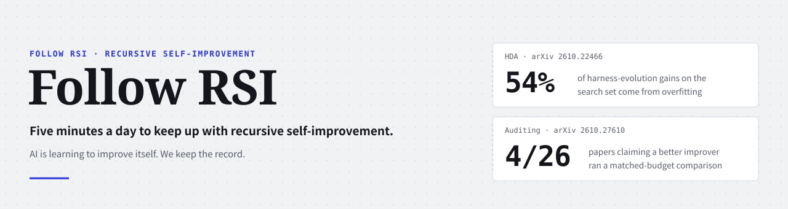
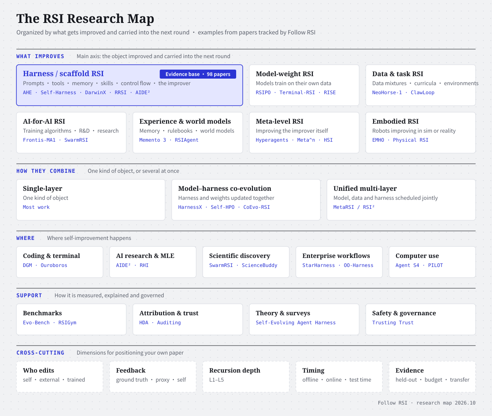

<a href="https://adongwanai.github.io/follow-rsi/">
  <picture>
    <source media="(prefers-color-scheme: dark)" srcset="assets/banner-dark.svg">
    
  </picture>
</a>

# Follow RSI

### Five minutes a day to keep up with recursive self-improvement.

**Current focus: Harness evolution**

RSI papers appear every day, but every claim of improvement needs scrutiny. Follow RSI starts with Harness evolution: we read new papers and check whether gains reflect transferable improvements, overfitting, or extra compute. Keep up in five minutes. Follow RSI Skill is planned for Claude Code and OpenClaw, with subscriptions by subdirection; readers will vote on the next focus.

<!-- AUTO:BADGES:START -->

   

<!-- AUTO:BADGES:END -->

[Today](https://adongwanai.github.io/follow-rsi/daily/) · [Weekly picks](https://adongwanai.github.io/follow-rsi/weekly/) · [Evidence base](https://adongwanai.github.io/follow-rsi/#papers) · [Guide](https://adongwanai.github.io/follow-rsi/guide.html) · [中文](README.md)

## Today

<!-- AUTO:TODAY:START -->

**[Inaugural retrospective · October 14–27](https://adongwanai.github.io/follow-rsi/recaps/2026-10-14--2026-10-27.html)** · 16 papers, human reviewed.

- [Skill^∞](https://arxiv.org/abs/2610.35434) · 2. Evolving the improver (meta / multi-level) · A meta-skill uses the same optimization loop to improve task skills and itself.
- [SERA](https://arxiv.org/abs/2610.29560) · 1.1 Search & evolution (frozen model) · The VLM planner evolves its editable Harness from execution experience while the VLA executor remains fixed.
- [Evolving Agent Interfaces (Agent S4)](https://arxiv.org/abs/2610.28601) · 3. Component-level evolution (skills, memory, context, interfaces) · A meta agent reads trajectories without success labels on synthetic tasks, writing and revising interface repositories; population selection retains repositories using validation tasks hidden from the meta agent.
- [HarnessAdapt-RL](https://arxiv.org/abs/2610.28069) · 4. Model–harness co-evolution · During RL, one teacher generates task-related mechanism-level skills, while another evolves tools and hooks from recurring interaction problems; retains only edits that improve pass rate or trainability without lowering the other metric.
- [RiseHarness](https://arxiv.org/abs/2610.27435) · 1.1 Search & evolution (frozen model) · Targets tasks with inconsistent success across repeated runs: combines agent trajectories and internal runtime traces, maps behavior to source code using a Harness Handbook, and retrieves implementations from other frameworks as references.

[Read this edition →](https://adongwanai.github.io/follow-rsi/recaps/2026-10-14--2026-10-27.html)

<!-- AUTO:TODAY:END -->

## Why this exists

Recursive self-improvement (RSI) is moving from thought experiment to daily practice: agents rewrite their own prompts, tools, memory and control flow; models train their next selves on their own trajectories; research agents improve how they do research. Dozens of new papers appear every week.

But "the score went up" is not the same as "the system improved." [Harness-Delta Attribution](papers/hda.md) finds that, on average, **54%** of harness-evolution gains on the search set come from overfitting and **14%** from extra test-time compute. [Auditing the Product](papers/auditing-product.md) finds that of 26 works claiming a better improvement procedure, only **4** compared generations from the same starting point at a matched budget.

So Follow RSI does three things: **keep up with the frontier, check the receipts, explain the ideas.**

## What an evidence card looks like

Take [StarHarness](papers/starharness.md) from ServiceNow:

| Field | Entry |
| :--- | :--- |
| In one line | Builds the evolution pool by stratifying tasks on the base harness's failures; keeps proposer-visible search tasks, hidden selection tasks and held-out tasks separate |
| Key result | +20–35 pp across enterprise benchmarks after 4–12 accepted changes per environment; gains hold on tasks excluded from evolution and transfer to GPT and Qwen models without re-evolution |
| Who edits | A separate evolution agent |
| Held-out evaluation | ✅ yes |
| Disjoint evolution set | ✅ yes |
| Cross-model transfer | ✅ yes |
| Code released | ✅ yes |
| Matched-budget baseline | ❔ not yet reviewed |
| Cost reported | ❔ not yet reviewed |

Legend: ✅ yes · ◐ partial · ❌ no · ❔ not yet reviewed. Every entry must point to a page or table in the paper.

## Start here

<!-- AUTO:ROUTES:START -->

| Route | Order | What you can answer |
| --- | --- | --- |
| Foundations | [ADAS](papers/adas.md) → [Darwin Gödel Machine](papers/dgm.md) → [Meta-Harness](papers/meta-harness.md) → [DGM-H](papers/hyperagents.md) | What are the two origins of searching agent designs and modifying one’s own code? |
| Mainline methods | [AHE](papers/ahe.md) → [Self-Harness](papers/self-harness.md) → [DarwinX](papers/darwinx.md) → [ModularRSI](papers/modularrsi.md) → [RRSI](papers/rrsi.md) | What does each of the most common comparison baselines address? |
| Experimental design (everyone) | [Rethinking the Evaluation of Harness Evolution for Agents](papers/rethinking-evaluation.md) → [Harness-Delta Attribution](papers/hda.md) → [HarnessDev](papers/harnessdev.md) → [RSIHub](papers/rsihub.md) → [HarnessOpt-Bench](papers/harnessopt-bench.md) → [Auditing the Product, Not the Recursion](papers/auditing-product.md) → [Reflections on Trusting Trust, Revisited](papers/trusting-trust-revisited.md) | Under matched budgets, do gains come from transferable improvements, extra computation, or overfitting? Do the baselines leak answers? |

[All reading routes →](https://adongwanai.github.io/follow-rsi/#routes)

<!-- AUTO:ROUTES:END -->

## 20 must-reads

<!-- AUTO:MUST_READ:START -->

| Date | Paper | In one line | Evidence |
| --- | --- | --- | --- |
| 2024 | [ADAS](papers/adas.md) | Meta Agent Search: a meta agent continually writes new agents in code space and maintains an archive. The search paradigm of “harness as code” starts here. | ❔ ❔ ❔ ❔ |
| 2025 | [Darwin Gödel Machine](papers/dgm.md) | Replaces “prove beneficial” with an open-ended evolutionary archive, continually modifying itself on SWE-bench and Polyglot. Before reproducing it, read Reflections on Trusting Trust, Revisited: container git history can leak answers. | ❔ ❔ ❔ ❔ |
| 2026-03 | [Meta-Harness](papers/meta-harness.md) | A coding agent searches for harnesses by reading source code, scores, and full trajectories of all historical candidates through the filesystem. The most common comparison baseline in the covered period. | ❔ ❔ ✅ ❔ |
| 2026-03 | [DGM-H](papers/hyperagents.md) | Merges the task agent and meta agent into a single editable program; the program that makes meta-level edits can itself be modified. | ❔ ❔ ❔ ❔ |
| 2026-04 | [AHE](papers/ahe.md) | Three pillars of observability: components as files, hierarchical trajectory distillation, and a falsifiable prediction attached to each edit for verification in the next round. | ❔ ❔ ✅ ❔ |
| 2026-06 | [Self-Harness](papers/self-harness.md) | Mine weaknesses → propose minimal edits → accept only after regression tests; does not rely on a stronger external model. | ✅ ❔ ◐ ❔ |
| 2026-07-31 | [DarwinX](papers/darwinx.md) | Harness population selection: a “preserve and expand” contract accepts only variants that do not regress on evaluated tasks; an archive retains multiple lineages and merges complementary expert harnesses. Non-regression is checked only on a finite evaluation set. | ✅ ❔ ❔ ❔ |
| 2026-09-14 | [ModularRSI](papers/modularrsi.md) | Splits the harness into five modules: execution loop, tool use, observation management, context management, and completion detection; evolves each within a restricted scope, then merges them; contrasts successful and failed trajectories; uses 2,000 evolution tasks disjoint from evaluation. | ✅ ❔ ✅ ❔ |
| 2026-09 | [RRSI](papers/rrsi.md) | Anneals the editing budget, uses a critic to filter benchmark-specific proposals, and a pruner to remove ineffective edits. | ✅ ❔ ❔ ✅ |
| 2026-08-24 | [AutoSaddler](papers/autosaddler.md) | Offline mini-batches: deep diagnosis of failure trajectories → structured code patches covering prompts, tools, and middleware → generalization-aware selection using a validation set and EvoDAG. An entry point to the complete engineering loop. | ✅ ❔ ❔ ❔ |
| 2026-08 | [Meta^n](papers/meta-n.md) | Keeps the meta-operation fixed and recurses only over its input; convergence determines the number of levels. | ❔ ❔ ❔ ❔ |
| 2026-09-22 | [AIDE²](papers/aide2.md) | A research agent edits its own code, improving its efficiency at research, which is itself improvement; selection uses hidden evaluations. | ✅ ❔ ❔ ❔ |
| 2026-06 | [HarnessX](papers/harnessx.md) | Typed harness primitives plus a replacement algebra; AEGIS converts trajectories into harness updates; trajectories for the same task under different harness versions are pooled for GRPO. | ❔ ❔ ❔ ❔ |
| 2026-09 | [Co-Evolving Harnesses and Models](papers/co-evolving-harnesses-models.md) | First evolves a harness using a weak model; finds that making the weak model imitate a strong model’s full trajectories breaks their fit; instead, the expert rewrites only the erroneous turn in the weak model’s own trajectory. | ❔ ❔ ❔ ❔ |
| 2026-07-14 | [Rethinking the Evaluation of Harness Evolution for Agents](papers/rethinking-evaluation.md) | With equal feedback and inference budgets, harness evolution on TB2.1 does not beat parallel sampling or sequential revision; on held-out tasks, Opus 4.6 gains only +1.2 and GPT-5.4 is unchanged. However, it has a clear advantage in long-horizon games with finer feedback and more dynamics. | ✅ ✅ ❔ ❔ |
| 2026-10-15 | [Harness-Delta Attribution](papers/hda.md) | Uses a compute-matched baseline and a shortcut-removed evolved harness as two controls to decompose gains into overfitting, test-time scaling, and a remaining upper bound on generalizable gains. Across 11 execution models, three evolution frameworks, and 21 significant settings, the first two account for 54% and 14% on average; validation-set gating is insufficient to prevent overfitting. | ✅ ✅ ❔ ❔ |
| 2026-09-01 | [HarnessDev](papers/harnessdev.md) | Evaluates creation and iterative revision of reusable harnesses with weights fixed. Creation covers six models and five benchmarks; Evolution uses visible feedback before frozen artifacts are evaluated on 630 held-out SWE-Pro tasks, separating creator and executor roles. | ✅ ❌ ✅ ◐ |
| 2023 | [STOP](papers/stop.md) | A program that improves code improves itself, marking a starting point for recursive self-improvement scaffolds in the LLM era; it also discusses safety issues such as bypassing sandboxes. | ❔ ❔ ❔ ❔ |
| 2025 | [SICA](papers/sica.md) | The executor and improver are the same agent, directly modifying its own Python code; a typical comparison for the self-modification approach. | ❔ ❔ ❔ ❔ |
| 2026-05 | [Harness Updating Is Not Harness Benefit](papers/harness-updating-not-benefit.md) | The ability to produce good updates is almost unrelated to model strength (Qwen3.5-9B is close to Claude Opus 4.6); the ability to benefit from updates is nonmonotonic, with medium-sized models benefiting most. | ❔ ❔ ❔ ❔ |
| 2026-10-13 | [Self-Evolving Agent Harness](papers/self-evolving-agent-harness.md) | Decomposes harness self-evolution into update targets and proposal/admission mechanisms, providing generalization bounds, retention bounds, and admission rules based on fresh validation data under continual PAC learning. The theoretical bounds depend on explicit assumptions. | ❔ ❔ ❔ ❔ |

Icons: held-out · matched budget · cross-model · cost; ❔ means not yet reviewed.

61 methods · 16 Harness evaluation and theory · 24 foundations and general RSI papers.
[Full catalog: 101 + 6 candidates](PAPERS.md) · [Filter on the site](https://adongwanai.github.io/follow-rsi/#papers)

<!-- AUTO:MUST_READ:END -->

## The RSI map and focus roadmap

<a href="https://adongwanai.github.io/follow-rsi/#map">
  <picture>
    <source media="(prefers-color-scheme: dark)" srcset="assets/rsi-map-dark.svg">
    
  </picture>
</a>

| Focus | Status |
| --- | --- |
| Harness evolution | Active: methods, evidence and daily tracking |
| Next focus | [Reader vote](../../discussions) |

## Subscribe

- **RSS**: [Atom](https://adongwanai.github.io/follow-rsi/feed/atom.xml) · [JSON](https://adongwanai.github.io/follow-rsi/feed/latest.json)
- **GitHub Releases**: Watch → Custom → Releases for weekly picks.
- **Follow RSI Skill**: subdirection subscriptions for Claude Code / OpenClaw, planned.
- **Chinese channels**: 阿东玩AI on WeChat, Xiaohongshu and Bilibili.

## How it works

<!-- AUTO:SOURCES:START -->

Sources with recorded successful runs: arxiv-adjacent · arxiv-harness · arxiv-rsi · github-releases · hf-daily · rss-deepmind · rss-metr · rss-openai · rss-sakana · rss-weco · s2-citations。 Failed in the latest run: hf-daily · s2-authors。 [Source status](https://adongwanai.github.io/follow-rsi/feed/status.json).

<!-- AUTO:SOURCES:END -->

Discover → deduplicate → Harness gate → summary and number checks → **human review** → publish. HF recommendation dates and original publication dates are shown separately; historical backfills remain separate. [Operations and review](docs/feed-setup.md).

<!-- AUTO:METRICS:START -->


<!-- AUTO:METRICS:END -->

## Contribute

- [Suggest a paper](../../issues/new?template=new-paper.yml) with an original source.
- [Correct evidence](../../issues/new?template=fix-evidence.yml) with a page or table reference.
- **Authors**: review your evidence card and embed its badge.

```markdown

```

[Contribution guide](CONTRIBUTING.md) · [Development](docs/development.md) · [Deployment and review](docs/feed-setup.md)

## Related projects

- [zgcagi/Harness-RSI](https://github.com/zgcagi/Harness-RSI)
- [Prism-Shadow/awesome-rsi](https://github.com/Prism-Shadow/awesome-rsi)
- [Picrew/awesome-agent-harness](https://github.com/Picrew/awesome-agent-harness)

## Citation and license

Please cite [CITATION.cff](CITATION.cff). Code: MIT. Written content: CC BY 4.0.

<!-- AUTO:STAR_HISTORY:START -->

[](https://star-history.com/#adongwanai/follow-rsi&Date)

<!-- AUTO:STAR_HISTORY:END -->
