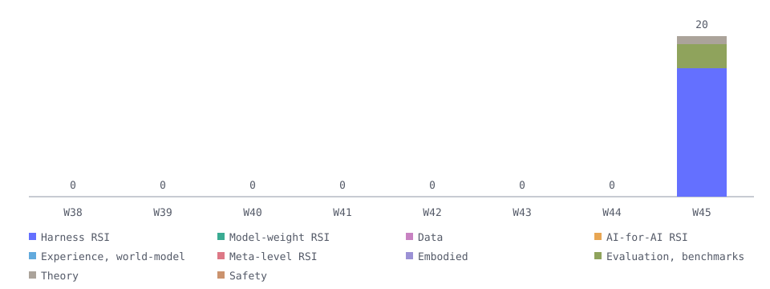

# Follow RSI · 2026-W45

2026-11-02 → 2026-11-08

This edition includes 20 reviewed and approved papers: Harness RSI: 16; Evaluation, benchmarks & attribution: 3; Theory & surveys: 1. Harness RSI has the most papers in this edition.

## Harness RSI · 16

- **R²Orch**：Co-evolves Director weights and versioned skills using execution feedback during training; deployment uses no skills. [arxiv](<https://arxiv.org/abs/2610.22740>) [code](<https://github.com/beita6969/R2Orch>) [s2](<https://www.semanticscholar.org/paper/6baa95b99b084f05c311d0285aae5101800c06e6>) [card](../papers/feed-2610-22740.md) — ✅ Code link · 3 other checks await verification（Curated evidence; see evidence card）
  Original publication: 2026-10-15 · HF recommendations: 2026-11-02 · Version date: 2026-10-22
- **CEPO**：Uses execution feedback to revise coordinator and executor prompts separately, selecting prompts on validation tasks for subsequent use. [arxiv](<https://arxiv.org/abs/2610.34722>) [code](<https://github.com/mlvlab/CEPO>) [s2](<https://www.semanticscholar.org/paper/02bfc41201571241bed2f14d859e7c09ba7eddc6>) [card](../papers/feed-2610-34722.md) — 4 other checks await verification（Curated evidence; see evidence card）
  Modified: System prompt
  Original publication: 2026-10-26 · HF recommendations: 2026-11-02 · Version date: 2026-10-26
- **GEPA-Curator**：Curates tasks and trajectories for feedback-driven prompt and harness-code revisions, carries candidates through iterations, and selects final versions by validation performance. [hf](<https://huggingface.co/papers/2610.37651>) [arxiv](<https://arxiv.org/abs/2610.37651>) [s2](<https://www.semanticscholar.org/paper/5fad229f07a4aa71353c42fe3c314cc2a23bd853>) — 4 other checks await verification（Automated, unverified）
  Modified: Control flow
  Original publication: 2026-10-27 · HF recommendations: 2026-11-02 · Version date: 2026-10-27
- **EvoTeam**：Uses execution feedback to revise team rules and procedural skills, retaining updates for subsequent collaboration and tasks. [hf](<https://huggingface.co/papers/2610.39813>) [arxiv](<https://arxiv.org/abs/2610.39813>) [code](<https://github.com/DEEP-JLU/EvoTeam>) [s2](<https://www.semanticscholar.org/paper/0eda360c6e31e4f56738a6caaad8eeab724e6ebf>) — 4 other checks await verification（Automated, unverified）
  Original publication: 2026-10-29 · HF recommendations: 2026-11-04 · Version date: 2026-10-30
- **Mage-VL-Cowork**：Evolves a frozen teacher’s harness using execution feedback, then reuses the selected version to generate student training trajectories. [hf](<https://huggingface.co/papers/2610.40747>) [arxiv](<https://arxiv.org/abs/2610.40747>) [s2](<https://www.semanticscholar.org/paper/6c9500677dcc7e325a53f16f08c915fa2e8b8522>) — 4 other checks await verification（Automated, unverified）
  Original publication: 2026-10-29 · HF recommendations: 2026-11-04 · Version date: 2026-10-29
- **MemSteer**：Revises storage, retrieval, and context designs using execution diagnostics, retains validation improvements, and transfers frozen designs across benchmarks. [hf](<https://huggingface.co/papers/2610.39276>) [arxiv](<https://arxiv.org/abs/2610.39276>) — 4 other checks await verification（Automated, unverified）
  Original publication: 2026-10-29 · HF recommendations: 2026-11-02 · Version date: 2026-10-29
- **TinyAstral**：Evolves a frozen teacher’s tools and recovery logic with execution feedback and paired tests, then distills a compact model. [hf](<https://huggingface.co/papers/2610.41216>) [arxiv](<https://arxiv.org/abs/2610.41216>) [code](<https://github.com/Garfield-kh/TinyAstral>) — 4 other checks await verification（Automated, unverified）
  Original publication: 2026-10-30 · HF recommendations: 2026-11-03 · Version date: 2026-10-30
- **RoboArchitect**：Uses rollout feedback to revise control code around a frozen robotic policy, evaluating retained harnesses on held-out tasks in simulation. [hf](<https://huggingface.co/papers/2610.42141>) [arxiv](<https://arxiv.org/abs/2610.42141>) [code](<https://github.com/roboarchitect-ai/RoboArchitect>) [card](../papers/feed-2610-42141.md) — 4 other checks await verification（Curated evidence; see evidence card）
  Original publication: 2026-10-30 · HF recommendations: 2026-11-02 · Version date: 2026-10-30
- **ParetoSaddler**：Uses quality and cost feedback to promote revised harnesses and retains candidates evaluated on development tasks for later optimization. [hf](<https://huggingface.co/papers/2611.02079>) [arxiv](<https://arxiv.org/abs/2611.02079>) [s2](<https://www.semanticscholar.org/paper/8378b7bec86079799b1c8a7bc697325db0f38fb8>) — 4 other checks await verification（Automated, unverified）
  Original publication: 2026-11-01 · HF recommendations: 2026-11-04 · Version date: 2026-11-01
- **NorthCUA Technical Report**：Turns failed traces into procedural skills, tests and revises them with a separate agent, then retains them for later applicable tasks. [hf](<https://huggingface.co/papers/2611.02102>) [arxiv](<https://arxiv.org/abs/2611.02102>) [code](<https://github.com/beipo-ai/NorthCUA>) — 4 other checks await verification（Automated, unverified）
  Original publication: 2026-11-01 · HF recommendations: 2026-11-03 · Version date: 2026-11-01
- **Recursa**：Revises instructions and procedural skills from failure feedback, validates changes for regressions, and merges them for subsequent tasks. [hf](<https://huggingface.co/papers/2611.04035>) [arxiv](<https://arxiv.org/abs/2611.04035>) [s2](<https://www.semanticscholar.org/paper/388f73531930c3cc384f624d94bbf8bf495da0d4>) — 4 other checks await verification（Automated, unverified）
  Original publication: 2026-11-02 · HF recommendations: 2026-11-04 · Version date: 2026-11-02
- **Harness-S**：Failure-guided edits create a reusable harness pool, which stays fixed while supporting policy training. [arxiv](<https://arxiv.org/abs/2611.04277>) [s2](<https://www.semanticscholar.org/paper/9488d31c9be1376ca43673709ae84471fbf87cd6>) — 4 other checks await verification（Automated, unverified）
  Original publication: 2026-11-03 · HF recommendations: 2026-11-06 · Version date: 2026-11-03
- **PyRUA-REAL**：Execution feedback revises reusable robot skills, and retained primitives support development on new tasks. [hf](<https://huggingface.co/papers/2611.06768>) [arxiv](<https://arxiv.org/abs/2611.06768>) — 4 other checks await verification（Automated, unverified）
  Original publication: 2026-11-04 · HF recommendations: 2026-11-05 · Version date: 2026-11-04
- **PromptOps**：Observed rating feedback updates judge prompts; validated revisions are reused on later samples under idealized feedback. [arxiv](<https://arxiv.org/abs/2611.07123>) [s2](<https://www.semanticscholar.org/paper/4f9bf5f37928b145ee87376920787f12254bd963>) — 4 other checks await verification（Automated, unverified）
  Original publication: 2026-11-04 · HF recommendations: Not verified · Version date: 2026-11-04
- **EnvOpt**：Only feedback-driven, retained tool and access-interface revisions qualify here as Harness components; ordinary environment restructuring does not. [arxiv](<https://arxiv.org/abs/2611.07372>) [s2](<https://www.semanticscholar.org/paper/fefac882c02c55a744db45fc1e6541f7fdd9d2f5>) — 4 other checks await verification（Automated, unverified）
  Original publication: 2026-11-05 · HF recommendations: Not verified · Version date: 2026-11-05
- **ReferClaw**：Interaction failures update reusable clarification skills, while idle periods train the responsible adapter; updates affect later interactions. [arxiv](<https://arxiv.org/abs/2611.07683>) [s2](<https://www.semanticscholar.org/paper/6e8e235cc9ffcd61ae496b91e3e0ee93c727d223>) — 4 other checks await verification（Automated, unverified）
  Original publication: 2026-11-05 · HF recommendations: Not verified · Version date: 2026-11-05

## Evaluation, benchmarks & attribution · 3

- **Can Coding Agents Sustain Continual Evolution without Forgetting?**：Studies forgetting during continual coding-harness evolution across tasks, tracking changes to prompts, tools, and execution logic. [hf](<https://huggingface.co/papers/2611.03219>) [arxiv](<https://arxiv.org/abs/2611.03219>) [code](<https://github.com/THU-Agent/continual-harness-evolution>) — 4 other checks await verification（Automated, unverified）
  Original publication: 2026-11-02 · HF recommendations: 2026-11-03 · Version date: 2026-11-02
- **Beneath the Surface**：Compares Harness evolution with frozen models, tracking gains, regressions, deployment costs, transfer, and candidate retention. [arxiv](<https://arxiv.org/abs/2611.07624>) [s2](<https://www.semanticscholar.org/paper/04d2ffda334877a42c714256c83f20b7b571e667>) — 4 other checks await verification（Automated, unverified）
  Original publication: 2026-11-05 · HF recommendations: Not verified · Version date: 2026-11-05
- **Learning the Task or Learning the Verifier? Rethinking Criteria Exposure in Embodied Self-Improvement**：Evaluates feedback-driven skill-library revisions with a frozen actor, distinguishing verifier adaptation from cross-task transfer. [arxiv](<https://arxiv.org/abs/2611.08318>) [s2](<https://www.semanticscholar.org/paper/0253728c09dade4926ad92b337e630b24ba82338>) — 4 other checks await verification（Automated, unverified）
  Original publication: 2026-11-05 · HF recommendations: Not verified · Version date: 2026-11-05

## Theory & surveys · 1

- **Video Generation Meets Agent Harness**：Surveys video-harness evolution, separating output repair, retained cross-task changes, and updates to the improvement procedure. [hf](<https://huggingface.co/papers/2610.40191>) [arxiv](<https://arxiv.org/abs/2610.40191>) [code](<https://github.com/agentic-videogen/awesome-agentic-videogen>) — 4 other checks await verification（Automated, unverified）
  Original publication: 2026-10-29 · HF recommendations: 2026-11-03 · Version date: 2026-10-29

## Historical additions (not this week's new papers) · 15

- **MoFlow**：MoFlow searches multi-agent workflows using multi-objective execution feedback, revising operators, roles and branching or loops while retaining a candidate frontier for later preference selection. Development and held-out evaluation are separated; online search and offline reuse provide distinct evidence. [arxiv](<https://arxiv.org/abs/2609.38294>) [s2](<https://www.semanticscholar.org/paper/96afe23944ad5ba71bcbbf3411cd74f46639d864>) — 4 other checks await verification（Automated, unverified）
  Original publication: 2026-09-29 · HF recommendations: Not verified · Version date: 2026-09-29
- **Authorization for Self-Modifying AI Agent Populations**：This work studies authorization inheritance when self-modifying software agents replace, fork or roll back, with framework adapters checking authority after mutations. It concerns Harness-evolution safety theory; adapter validation is not autonomous open-ended evolution, and this review does not recertify the formal proofs. [arxiv](<https://arxiv.org/abs/2610.00347>) [s2](<https://www.semanticscholar.org/paper/ee53a262b0f88cb2d49b4d2a0bedab81c5b90aa7>) — 4 other checks await verification（Automated, unverified）
  Original publication: 2026-09-29 · HF recommendations: Not verified · Version date: 2026-09-29
- **ST-Bench**：ST-Bench evaluates multi-agent workflows optimized with development-score feedback and reused across queries, including test queries not used in optimization. It is included as a Harness-focused evaluation; one-shot, fixed-prompt and weight-training baselines are not all recursive improvement methods. [arxiv](<https://arxiv.org/abs/2610.07763>) [s2](<https://www.semanticscholar.org/paper/00a90908a5d4c7f92616e0222d81e685342c008c>) — 4 other checks await verification（Automated, unverified）
  Original publication: 2026-10-06 · HF recommendations: Not verified · Version date: 2026-10-06
- **Skill-V**：Skill-V uses environment feedback to train policy weights and revise external skill contracts containing procedures, applicability conditions and executable criteria. Contracts admitted by replay checks become new versions for later tasks; declarative operations are restricted, rather than arbitrary generated code, and each skill’s causal effect is not established. [arxiv](<https://arxiv.org/abs/2610.11781>) [s2](<https://www.semanticscholar.org/paper/98b2397a0534beb97852124a42c6969e6ebe9dcf>) — 4 other checks await verification（Automated, unverified）
  Original publication: 2026-10-08 · HF recommendations: Not verified · Version date: 2026-10-08
- **AgentSWE**：AgentSWE evaluates whether coding agents can use development feedback to build deployable agents, including prompts, tool orchestration, state management and output checks. Delivered snapshots are frozen for independent testing; reusable-policy evidence is distinguished from ordinary software-task outputs. [arxiv](<https://arxiv.org/abs/2610.13361>) [code](<https://github.com/VectorSpaceLab/AgentSWE>) [s2](<https://www.semanticscholar.org/paper/3cd355c9600b0232a89e6d0f5257c40db74f9299>) — 4 other checks await verification（Automated, unverified）
  Original publication: 2026-10-09 · HF recommendations: Not verified · Version date: 2026-10-09
- **Cortex**：Cortex turns developer corrections into replay tasks, using execution comparisons and scripted gates to retain or prune coding-agent skills and rules. Admitted artifacts enter the Harness used for later tasks; the main experiments use synthetic repositories, with no learning result on a real project and limitations for strong models and isolation. [arxiv](<https://arxiv.org/abs/2610.14216>) [code](<https://github.com/samugit83/cortex>) [s2](<https://www.semanticscholar.org/paper/42f110affe265d9a5b8fe71c8c82e343dd104ec0>) — 4 other checks await verification（Automated, unverified）
  Original publication: 2026-10-09 · HF recommendations: Not verified · Version date: 2026-10-09
- **Reels-RSI**：Reels-RSI turns video-production feedback into checks used across productions and a revisable director playbook, retaining a human application step. The paper acknowledges position bias in the initial evaluation and leaves a later rewrite unapplied; inclusion concerns the Harness-component mechanism, not a general claim of successful self-improvement. [arxiv](<https://arxiv.org/abs/2610.14495>) [code](<https://github.com/agentic-loops-x/Reels-RSI>) [s2](<https://www.semanticscholar.org/paper/7f12d769c9e561fabc41a9d5297cd677405b6ff6>) — 4 other checks await verification（Automated, unverified）
  Original publication: 2026-10-10 · HF recommendations: Not verified · Version date: 2026-10-10
- **Compiling Expert Procedures into Verified Programs**：PLVR searches external tool-control programs, executes candidates and selects retained versions using teacher-action distance and training-task outcomes before freezing them for new tasks. The programs rely on a manually constructed primitive and rule library, rather than discovery from scratch. [arxiv](<https://arxiv.org/abs/2610.19148>) [s2](<https://www.semanticscholar.org/paper/ebd8da5923ce5c6606582270fce57800bdf60145>) — 4 other checks await verification（Automated, unverified）
  Original publication: 2026-10-13 · HF recommendations: Not verified · Version date: 2026-10-13
- **CarryOn**：CarryOn revises recovery control parameters and control flow after execution failures, saving admitted changes as the next skill-library version. Model weights remain fixed; cumulative retries of failed episodes do not establish independent held-out generalization. [hf](<https://huggingface.co/papers/2610.21453>) [arxiv](<https://arxiv.org/abs/2610.21453>) [code](<https://github.com/JIA-Lab-research/CarryOn>) [s2](<https://www.semanticscholar.org/paper/2b4c6b2ba5c48810d108da02522f37ea9112a89a>) — 4 other checks await verification（Automated, unverified）
  Original publication: 2026-10-15 · HF recommendations: 2026-10-16 · Version date: 2026-10-15
- **IRAH**：IRAH reflects on retrieval scores and mutates retrieval-pipeline configurations, searching retriever, chunker and reranker structures and settings. Configurations selected on optimization queries are retained for independent held-out queries; this is not whole-agent self-rewriting or joint training of every model. [arxiv](<https://arxiv.org/abs/2610.30167>) [s2](<https://www.semanticscholar.org/paper/b10fc309dc2f3292d91e5d66e62ed2dce45d30b0>) — 4 other checks await verification（Automated, unverified）
  Original publication: 2026-10-16 · HF recommendations: Not verified · Version date: 2026-10-16
- **IF-MAP**：IF-MAP uses end-to-end execution loss to prioritize agent nodes, then iterates their prompts through a textual-feedback optimizer. Prompts admitted by development-set checks are retained for later testing; the included scope is feedback-driven target selection and prompt optimization. [hf](<https://huggingface.co/papers/2610.24383>) [arxiv](<https://arxiv.org/abs/2610.24383>) [code](<https://github.com/s1412/IF-MAP>) [s2](<https://www.semanticscholar.org/paper/9e495305471dae3123bd3bd6087124f426926457>) — 4 other checks await verification（Automated, unverified）
  Original publication: 2026-10-17 · HF recommendations: 2026-10-23 · Version date: 2026-10-17
- **HarnessRL**：HarnessRL updates external training interfaces for task sampling, rollout guidance and rubrics alongside policy-weight training. Candidates are admitted after measurement against the currently frozen policy and retained for later training; this temporary freeze does not mean model weights remain fixed throughout. [hf](<https://huggingface.co/papers/2610.26426>) [arxiv](<https://arxiv.org/abs/2610.26426>) [code](<https://github.com/Tongyi-ConvAI/Qwen-Character/tree/main/HarnessRL>) [s2](<https://www.semanticscholar.org/paper/ae5263150a0d9286bd880d17f69a209213733380>) — 4 other checks await verification（Automated, unverified）
  Original publication: 2026-10-19 · HF recommendations: 2026-10-21 · Version date: 2026-10-19
- **SCOPE**：SCOPE compiles natural-language policies into external predicate programs, revising extractors, predicates and composition logic using execution traces and adversarial cases while retaining or reverting candidates. The included component is policy-enforcement Harness optimization; changes to a label pool are not model-weight training. [hf](<https://huggingface.co/papers/2610.31062>) [arxiv](<https://arxiv.org/abs/2610.31062>) [s2](<https://www.semanticscholar.org/paper/d1282dbd5a8137c8fcb1a08fa626a77c2940b284>) — 4 other checks await verification（Automated, unverified）
  Original publication: 2026-10-22 · HF recommendations: 2026-10-23 · Version date: 2026-10-22
- **AgentOrch**：The Replan branch of AgentOrch rewrites complete workflows from tool-execution and control-flow feedback, then reuses them unchanged on new inputs for the same procedure. Only this workflow-improvement branch is included; separate weight training does not establish Harness coevolution. [arxiv](<https://arxiv.org/abs/2610.33375>) [s2](<https://www.semanticscholar.org/paper/8d0b14bf320e12c5afe83ca847a19b54d61b5fb2>) — 4 other checks await verification（Automated, unverified）
  Original publication: 2026-10-24 · HF recommendations: Not verified · Version date: 2026-10-24
- **Batching the Reflective Optimization Loop**：This work batches GEPA's reflective proposals, execution and validation, updating a retained candidate frontier and testing optimized prompts on held-out tasks. It improves a Harness-optimization component; it does not demonstrate recursive evolution of the optimizer itself. [arxiv](<https://arxiv.org/abs/2610.36774>) [code](<https://github.com/gepa-ai/gepa>) [s2](<https://www.semanticscholar.org/paper/242ce440a52d34a1396f2084bf0597a0e2cc0fc7>) — 4 other checks await verification（Automated, unverified）
  Original publication: 2026-10-27 · HF recommendations: Not verified · Version date: 2026-10-27

## Eight-week trend

Found **512** · Accepted **20** · Include precision **14%**

[Atom](../site/feed/atom.xml) · [JSON feed](../site/feed/latest.json) · [GitHub](https://github.com/adongwanai/follow-rsi)
