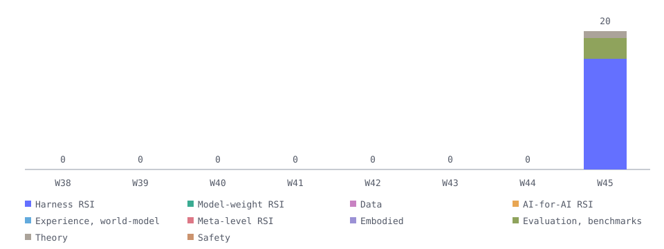

# Follow RSI · 2026 第 45 周

2026-11-02 → 2026-11-08

本期完成审查并获批准 20 篇论文：Harness / 脚手架 RSI 16 篇、评测、基准与归因 3 篇、理论与综述 1 篇。本期论文最多的方向为 Harness / 脚手架 RSI。

## Harness / 脚手架 RSI · 16

- **R²Orch**：在训练中按反馈共演化编排模型与版本化技能；部署时不携带技能。 [arxiv](<https://arxiv.org/abs/2610.22740>) [code](<https://github.com/beita6969/R2Orch>) [s2](<https://www.semanticscholar.org/paper/6baa95b99b084f05c311d0285aae5101800c06e6>) [card](../papers/feed-2610-22740.md) — ✅ 有代码链接 · 其余 3 项待核（人工整理，详见证据卡）
  原始发表：2026-10-15 · HF 推荐：2026-11-02 · 版本日期：2026-10-22
- **CEPO**：用执行反馈分别修订协调者与执行器提示，经验证集选择后用于后续任务。 [arxiv](<https://arxiv.org/abs/2610.34722>) [code](<https://github.com/mlvlab/CEPO>) [s2](<https://www.semanticscholar.org/paper/02bfc41201571241bed2f14d859e7c09ba7eddc6>) [card](../papers/feed-2610-34722.md) — 其余 4 项待核（人工整理，详见证据卡）
  改了什么：系统提示
  原始发表：2026-10-26 · HF 推荐：2026-11-02 · 版本日期：2026-10-26
- **GEPA-Curator**：策展任务与轨迹以修订提示和 Harness 代码，迭代保留候选并按验证表现选优。 [hf](<https://huggingface.co/papers/2610.37651>) [arxiv](<https://arxiv.org/abs/2610.37651>) [s2](<https://www.semanticscholar.org/paper/5fad229f07a4aa71353c42fe3c314cc2a23bd853>) — 其余 4 项待核（自动判断，未核实）
  改了什么：控制流/证据选择
  原始发表：2026-10-27 · HF 推荐：2026-11-02 · 版本日期：2026-10-27
- **EvoTeam**：依据执行反馈更新团队规则和技能，保留改动供后续团队协作与任务复用。 [hf](<https://huggingface.co/papers/2610.39813>) [arxiv](<https://arxiv.org/abs/2610.39813>) [code](<https://github.com/DEEP-JLU/EvoTeam>) [s2](<https://www.semanticscholar.org/paper/0eda360c6e31e4f56738a6caaad8eeab724e6ebf>) — 其余 4 项待核（自动判断，未核实）
  原始发表：2026-10-29 · HF 推荐：2026-11-04 · 版本日期：2026-10-30
- **Mage-VL-Cowork**：以执行反馈演化冻结教师的 Harness，再固定该版本生成学生训练轨迹。 [hf](<https://huggingface.co/papers/2610.40747>) [arxiv](<https://arxiv.org/abs/2610.40747>) [s2](<https://www.semanticscholar.org/paper/6c9500677dcc7e325a53f16f08c915fa2e8b8522>) — 其余 4 项待核（自动判断，未核实）
  原始发表：2026-10-29 · HF 推荐：2026-11-04 · 版本日期：2026-10-29
- **MemSteer**：依据执行失败诊断修订存储、检索与上下文设计，经验证择优保留，并冻结设计跨基准复用。 [hf](<https://huggingface.co/papers/2610.39276>) [arxiv](<https://arxiv.org/abs/2610.39276>) — 其余 4 项待核（自动判断，未核实）
  原始发表：2026-10-29 · HF 推荐：2026-11-02 · 版本日期：2026-10-29
- **TinyAstral**：用执行反馈和配对检验演化冻结教师的工具与恢复逻辑，再蒸馏小模型。 [hf](<https://huggingface.co/papers/2610.41216>) [arxiv](<https://arxiv.org/abs/2610.41216>) [code](<https://github.com/Garfield-kh/TinyAstral>) — 其余 4 项待核（自动判断，未核实）
  原始发表：2026-10-30 · HF 推荐：2026-11-03 · 版本日期：2026-10-30
- **RoboArchitect**：在仿真中用轨迹反馈修订冻结策略外的控制代码，并在留出任务评估。 [hf](<https://huggingface.co/papers/2610.42141>) [arxiv](<https://arxiv.org/abs/2610.42141>) [code](<https://github.com/roboarchitect-ai/RoboArchitect>) [card](../papers/feed-2610-42141.md) — 其余 4 项待核（人工整理，详见证据卡）
  原始发表：2026-10-30 · HF 推荐：2026-11-02 · 版本日期：2026-10-30
- **ParetoSaddler**：用质量与成本反馈筛选 Harness 更新，并保留已完成开发评估的候选供后续优化。 [hf](<https://huggingface.co/papers/2611.02079>) [arxiv](<https://arxiv.org/abs/2611.02079>) [s2](<https://www.semanticscholar.org/paper/8378b7bec86079799b1c8a7bc697325db0f38fb8>) — 其余 4 项待核（自动判断，未核实）
  原始发表：2026-11-01 · HF 推荐：2026-11-04 · 版本日期：2026-11-01
- **NorthCUA Technical Report**：将失败轨迹转成操作技能，经独立测试和修订后保留，供后续适用任务复用。 [hf](<https://huggingface.co/papers/2611.02102>) [arxiv](<https://arxiv.org/abs/2611.02102>) [code](<https://github.com/beipo-ai/NorthCUA>) — 其余 4 项待核（自动判断，未核实）
  原始发表：2026-11-01 · HF 推荐：2026-11-03 · 版本日期：2026-11-01
- **Recursa**：根据失败反馈修订指令和技能，经过回归检查后合并，供后续任务复用。 [hf](<https://huggingface.co/papers/2611.04035>) [arxiv](<https://arxiv.org/abs/2611.04035>) [s2](<https://www.semanticscholar.org/paper/388f73531930c3cc384f624d94bbf8bf495da0d4>) — 其余 4 项待核（自动判断，未核实）
  原始发表：2026-11-02 · HF 推荐：2026-11-04 · 版本日期：2026-11-02
- **Harness-S**：按失败原因编辑并保留多种Harness，再用固定变体池辅助策略训练。 [arxiv](<https://arxiv.org/abs/2611.04277>) [s2](<https://www.semanticscholar.org/paper/9488d31c9be1376ca43673709ae84471fbf87cd6>) — 其余 4 项待核（自动判断，未核实）
  原始发表：2026-11-03 · HF 推荐：2026-11-06 · 版本日期：2026-11-03
- **PyRUA-REAL**：执行反馈推动机器人技能代码修订与保留，既有技能库可用于新任务。 [hf](<https://huggingface.co/papers/2611.06768>) [arxiv](<https://arxiv.org/abs/2611.06768>) — 其余 4 项待核（自动判断，未核实）
  原始发表：2026-11-04 · HF 推荐：2026-11-05 · 版本日期：2026-11-04
- **PromptOps**：依据逐步收到的评分反馈修订评审提示词，验证后的版本用于后续样本；实验反馈仍属理想化设置。 [arxiv](<https://arxiv.org/abs/2611.07123>) [s2](<https://www.semanticscholar.org/paper/4f9bf5f37928b145ee87376920787f12254bd963>) — 其余 4 项待核（自动判断，未核实）
  原始发表：2026-11-04 · HF 推荐：未核实 · 版本日期：2026-11-04
- **EnvOpt**：仅将其中按执行反馈保留的工具与访问接口优化纳入 Harness；普通环境文件重排不计入此范围。 [arxiv](<https://arxiv.org/abs/2611.07372>) [s2](<https://www.semanticscholar.org/paper/fefac882c02c55a744db45fc1e6541f7fdd9d2f5>) — 其余 4 项待核（自动判断，未核实）
  原始发表：2026-11-05 · HF 推荐：未核实 · 版本日期：2026-11-05
- **ReferClaw**：交互失败触发可复用澄清技能更新，并在空闲期优化责任模块适配器；变更只影响后续交互。 [arxiv](<https://arxiv.org/abs/2611.07683>) [s2](<https://www.semanticscholar.org/paper/6e8e235cc9ffcd61ae496b91e3e0ee93c727d223>) — 其余 4 项待核（自动判断，未核实）
  原始发表：2026-11-05 · HF 推荐：未核实 · 版本日期：2026-11-05

## 评测、基准与归因 · 3

- **Can Coding Agents Sustain Continual Evolution without Forgetting?**：评测编码 Harness 跨任务持续演化中的遗忘，跟踪提示、工具和执行逻辑变化。 [hf](<https://huggingface.co/papers/2611.03219>) [arxiv](<https://arxiv.org/abs/2611.03219>) [code](<https://github.com/THU-Agent/continual-harness-evolution>) — 其余 4 项待核（自动判断，未核实）
  原始发表：2026-11-02 · HF 推荐：2026-11-03 · 版本日期：2026-11-02
- **Beneath the Surface**：以冻结模型比较 Harness 演化，分别追踪收益、退化、部署成本和跨基准迁移，并审计候选保留机制。 [arxiv](<https://arxiv.org/abs/2611.07624>) [s2](<https://www.semanticscholar.org/paper/04d2ffda334877a42c714256c83f20b7b571e667>) — 其余 4 项待核（自动判断，未核实）
  原始发表：2026-11-05 · HF 推荐：未核实 · 版本日期：2026-11-05
- **Learning the Task or Learning the Verifier? Rethinking Criteria Exposure in Embodied Self-Improvement**：冻结执行模型与底层原语，评测反馈驱动的技能库迭代，区分验证器适配与跨任务迁移。 [arxiv](<https://arxiv.org/abs/2611.08318>) [s2](<https://www.semanticscholar.org/paper/0253728c09dade4926ad92b337e630b24ba82338>) — 其余 4 项待核（自动判断，未核实）
  原始发表：2026-11-05 · HF 推荐：未核实 · 版本日期：2026-11-05

## 理论与综述 · 1

- **Video Generation Meets Agent Harness**：梳理视频 Harness 演化，并区分产物修复、跨任务保留和改进过程更新。 [hf](<https://huggingface.co/papers/2610.40191>) [arxiv](<https://arxiv.org/abs/2610.40191>) [code](<https://github.com/agentic-videogen/awesome-agentic-videogen>) — 其余 4 项待核（自动判断，未核实）
  原始发表：2026-10-29 · HF 推荐：2026-11-03 · 版本日期：2026-10-29

## 补录（非本周新论文） · 15

- **MoFlow**：MoFlow 根据实际执行的多目标反馈搜索多 Agent 工作流，修改算子、角色和分支循环，并保留候选前沿供后续偏好选择。开发与留出评测分开，在线搜索和离线复用的证据需要分别理解。 [arxiv](<https://arxiv.org/abs/2609.38294>) [s2](<https://www.semanticscholar.org/paper/96afe23944ad5ba71bcbbf3411cd74f46639d864>) — 其余 4 项待核（自动判断，未核实）
  原始发表：2026-09-29 · HF 推荐：未核实 · 版本日期：2026-09-29
- **Authorization for Self-Modifying AI Agent Populations**：本文研究自修改软件 Agent 在替换、分叉和回滚时的授权继承，并用真实框架适配器检查变异后的权限约束。它属于 Harness 演化安全理论；适配器验证不等于自主开放式进化，本次也未复核形式证明。 [arxiv](<https://arxiv.org/abs/2610.00347>) [s2](<https://www.semanticscholar.org/paper/ee53a262b0f88cb2d49b4d2a0bedab81c5b90aa7>) — 其余 4 项待核（自动判断，未核实）
  原始发表：2026-09-29 · HF 推荐：未核实 · 版本日期：2026-09-29
- **ST-Bench**：ST-Bench 包含在开发评分反馈下优化并跨查询复用的多 Agent 工作流，以及未参与优化的测试查询。作为 Harness 专项评测收录，不把其中一次性生成、固定提示或权重训练对照也称为递归改进。 [arxiv](<https://arxiv.org/abs/2610.07763>) [s2](<https://www.semanticscholar.org/paper/00a90908a5d4c7f92616e0222d81e685342c008c>) — 其余 4 项待核（自动判断，未核实）
  原始发表：2026-10-06 · HF 推荐：未核实 · 版本日期：2026-10-06
- **Skill-V**：Skill-V 根据环境反馈同时训练策略权重和修订外部技能契约，契约包含程序步骤、适用条件和可执行判据。通过回放检查的契约作为新版本供后续任务使用；声明式操作受限，不是任意生成代码，也未证明每条技能的因果效果。 [arxiv](<https://arxiv.org/abs/2610.11781>) [s2](<https://www.semanticscholar.org/paper/98b2397a0534beb97852124a42c6969e6ebe9dcf>) — 其余 4 项待核（自动判断，未核实）
  原始发表：2026-10-08 · HF 推荐：未核实 · 版本日期：2026-10-08
- **AgentSWE**：AgentSWE 评测编程 Agent 能否按开发反馈构建可交付的 Agent，包括提示、工具编排、状态管理和输出校验。最终交付快照冻结后再独立测试，可复用策略的证据与普通软件任务产物应区分。 [arxiv](<https://arxiv.org/abs/2610.13361>) [code](<https://github.com/VectorSpaceLab/AgentSWE>) [s2](<https://www.semanticscholar.org/paper/3cd355c9600b0232a89e6d0f5257c40db74f9299>) — 其余 4 项待核（自动判断，未核实）
  原始发表：2026-10-09 · HF 推荐：未核实 · 版本日期：2026-10-09
- **Cortex**：Cortex 把开发者纠正转成回放任务，用真实执行对照和脚本闸门决定是否保留或删除编码 Agent 的技能与规则。通过的工件进入后续任务的 Harness；主要实验来自合成仓库，真实项目未产生学习，强模型收益和隔离设计也有限制。 [arxiv](<https://arxiv.org/abs/2610.14216>) [code](<https://github.com/samugit83/cortex>) [s2](<https://www.semanticscholar.org/paper/42f110affe265d9a5b8fe71c8c82e343dd104ec0>) — 其余 4 项待核（自动判断，未核实）
  原始发表：2026-10-09 · HF 推荐：未核实 · 版本日期：2026-10-09
- **Reels-RSI**：Reels-RSI 将视频制作反馈沉淀为跨作品运行的检查规则和可修订的导演手册，且保留人工应用环节。论文承认首轮评价有位置偏差，后续改写也没有应用；收录的是 Harness 组件机制，不是普遍有效的自进化结论。 [arxiv](<https://arxiv.org/abs/2610.14495>) [code](<https://github.com/agentic-loops-x/Reels-RSI>) [s2](<https://www.semanticscholar.org/paper/7f12d769c9e561fabc41a9d5297cd677405b6ff6>) — 其余 4 项待核（自动判断，未核实）
  原始发表：2026-10-10 · HF 推荐：未核实 · 版本日期：2026-10-10
- **Compiling Expert Procedures into Verified Programs**：PLVR 搜索外部工具调用控制程序，实际执行候选后依据教师动作距离和训练任务结果选择保留版本，冻结后用于新任务。程序依赖人工建立的原语和规则库，不是从零自动发现。 [arxiv](<https://arxiv.org/abs/2610.19148>) [s2](<https://www.semanticscholar.org/paper/ebd8da5923ce5c6606582270fce57800bdf60145>) — 其余 4 项待核（自动判断，未核实）
  原始发表：2026-10-13 · HF 推荐：未核实 · 版本日期：2026-10-13
- **CarryOn**：CarryOn 根据执行失败修订恢复技能的控制参数和控制流，把通过检查的改动保存为下一版技能库。模型权重固定；论文中的累计失败重试不等同于独立留出集泛化。 [hf](<https://huggingface.co/papers/2610.21453>) [arxiv](<https://arxiv.org/abs/2610.21453>) [code](<https://github.com/JIA-Lab-research/CarryOn>) [s2](<https://www.semanticscholar.org/paper/2b4c6b2ba5c48810d108da02522f37ea9112a89a>) — 其余 4 项待核（自动判断，未核实）
  原始发表：2026-10-15 · HF 推荐：2026-10-16 · 版本日期：2026-10-15
- **IRAH**：IRAH 根据真实检索评分反思并变异检索流水线配置，搜索检索器、切分器、重排器的结构和设置。优化查询选出的配置保留用于独立留出查询，不等于整个 Agent 自改代码或同步训练全部模型。 [arxiv](<https://arxiv.org/abs/2610.30167>) [s2](<https://www.semanticscholar.org/paper/b10fc309dc2f3292d91e5d66e62ed2dce45d30b0>) — 其余 4 项待核（自动判断，未核实）
  原始发表：2026-10-16 · HF 推荐：未核实 · 版本日期：2026-10-16
- **IF-MAP**：IF-MAP 用端到端执行损失选择值得改进的 Agent 节点，再由文本反馈优化器迭代该节点的提示。通过开发集检查的提示被保留用于后续测试，收录范围是反馈驱动的目标选择与提示优化组件。 [hf](<https://huggingface.co/papers/2610.24383>) [arxiv](<https://arxiv.org/abs/2610.24383>) [code](<https://github.com/s1412/IF-MAP>) [s2](<https://www.semanticscholar.org/paper/9e495305471dae3123bd3bd6087124f426926457>) — 其余 4 项待核（自动判断，未核实）
  改了什么：无
  原始发表：2026-10-17 · HF 推荐：2026-10-23 · 版本日期：2026-10-17
- **HarnessRL**：HarnessRL 在政策权重训练的同时，根据反馈迭代任务采样、rollout 指导和评分标准等外部训练接口。候选经当前冻结政策上的测量后准入并用于后续训练；这种阶段性冻结不代表模型权重始终固定。 [hf](<https://huggingface.co/papers/2610.26426>) [arxiv](<https://arxiv.org/abs/2610.26426>) [code](<https://github.com/Tongyi-ConvAI/Qwen-Character/tree/main/HarnessRL>) [s2](<https://www.semanticscholar.org/paper/ae5263150a0d9286bd880d17f69a209213733380>) — 其余 4 项待核（自动判断，未核实）
  原始发表：2026-10-19 · HF 推荐：2026-10-21 · 版本日期：2026-10-19
- **SCOPE**：SCOPE 将自然语言政策编译为外部谓词程序，根据执行跟踪和对抗样例修订抽取器、谓词及组合逻辑，并保留或回退候选。收录其策略执行 Harness 组件，标签池变化不等于模型权重训练。 [hf](<https://huggingface.co/papers/2610.31062>) [arxiv](<https://arxiv.org/abs/2610.31062>) [s2](<https://www.semanticscholar.org/paper/d1282dbd5a8137c8fcb1a08fa626a77c2940b284>) — 其余 4 项待核（自动判断，未核实）
  原始发表：2026-10-22 · HF 推荐：2026-10-23 · 版本日期：2026-10-22
- **AgentOrch**：AgentOrch 的 Replan 分支根据工具执行和控制流反馈重写完整工作流，并固定复用于同一流程的新输入。本次仅收录该工作流改进分支；另行进行的权重训练不能据此称为 Harness 共演化。 [arxiv](<https://arxiv.org/abs/2610.33375>) [s2](<https://www.semanticscholar.org/paper/8d0b14bf320e12c5afe83ca847a19b54d61b5fb2>) — 其余 4 项待核（自动判断，未核实）
  原始发表：2026-10-24 · HF 推荐：未核实 · 版本日期：2026-10-24
- **Batching the Reflective Optimization Loop**：本文把 GEPA 的反思候选提出、执行和验证改为批量处理，持续更新被保留的候选前沿，并在留出任务上测试优化后的提示。属于 Harness 优化器组件改进，不能据此称为改进器自身递归演化。 [arxiv](<https://arxiv.org/abs/2610.36774>) [code](<https://github.com/gepa-ai/gepa>) [s2](<https://www.semanticscholar.org/paper/242ce440a52d34a1396f2084bf0597a0e2cc0fc7>) — 其余 4 项待核（自动判断，未核实）
  改了什么：无
  原始发表：2026-10-27 · HF 推荐：未核实 · 版本日期：2026-10-27

## 近 8 周趋势

本周找到 **512** 篇 · 收录 **20** 篇 · include 准确率 **14%**

[Atom](../site/feed/atom.xml) · [JSON feed](../site/feed/latest.json) · [GitHub](https://github.com/adongwanai/follow-rsi)
