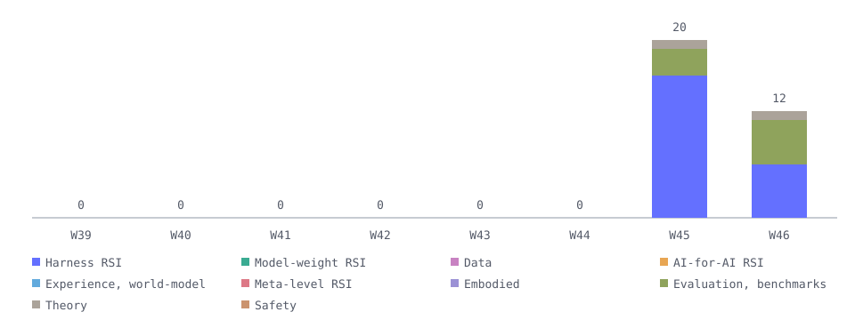

# Follow RSI · 2026-W46

2026-11-09 → 2026-11-15

This edition includes 12 reviewed and approved papers: Harness RSI: 6; Evaluation, benchmarks & attribution: 5; Theory & surveys: 1. Harness RSI has the most papers in this edition.

## Harness RSI · 6

- **The Last Mile to the Real World**：A development agent revises Harness control primitives from failure traces and retains validated primitives after tests and development-set checks for reuse on separate tasks; only the Harness-primitives branch is included. [arxiv](<https://arxiv.org/abs/2611.07461>) [hf](<https://huggingface.co/papers/2611.07461>) — 4 other checks await verification（Automated, unverified）
  Original publication: 2026-11-05 · HF recommendations: 2026-11-09 · Version date: 2026-11-05
- **CPU-ARC**：CPU-ARC turns reasoning steps into reusable Python semantic functions. Its builder revises candidates using execution errors, judge feedback, and checks, then registers successful functions in a system-level cache for later inference. The qualifying mechanism is feedback-driven revision of executable components. Separate small-model finetuning experiments mean the whole paper should not be described as weight-frozen, and inference savings alone do not establish net savings after construction costs. [arxiv](<https://arxiv.org/abs/2611.09891>) [hf](<https://huggingface.co/papers/2611.09891>) — 4 other checks await verification（Automated, unverified）
  Original publication: 2026-11-06 · HF recommendations: 2026-11-09 · Version date: 2026-11-06
- **World In-Context Learning for Agentic Robot Manipulation**：Before task learning, RoboScript segments the collected demonstrations and asks a coding agent to write environment-specific skills for gaps in the existing action interface. An independent driver replays the skills, checks transfer across layouts, and rechecks gains against regressions. Coverage feedback drives further rounds before the skill library is frozen for later tasks. Inclusion is limited to this executable tool-skill construction and selection loop, separate from ordinary Task Memory content updates. The paper does not isolate the contribution of skill construction, and continual failure-driven skill creation during deployment remains future work. [arxiv](<https://arxiv.org/abs/2611.12885>) [code](<https://github.com/ArcheOne-AI/RoboScript>) [s2](<https://www.semanticscholar.org/paper/0c9858a786b99982223249bb2f59898ac930df4d>) — 4 other checks await verification（Automated, unverified）
  Original publication: 2026-11-09 · HF recommendations: 2026-11-11 · Version date: 2026-11-09
- **EmoHarness**：EmoHarness uses a Builder to revise prompts, settings and restricted verification code from a frozen student model’s failure traces. A separate validation split decides whether a candidate replaces the current Harness for later rounds. Most gains come from audio evidence, and the incremental evolution gains do not survive multiple-comparison correction. Human developers inspected some evaluation items, so the evaluation is not an untouched holdout. [arxiv](<https://arxiv.org/abs/2611.11994>) [code](<https://github.com/Emo-Harness/EmoHarness>) [hf](<https://huggingface.co/papers/2611.11994>) — 4 other checks await verification（Automated, unverified）
  Original publication: 2026-11-09 · HF recommendations: 2026-11-10 · Version date: 2026-11-09
- **Verify by Doing**：Uses tool execution and inspection to revise Actor and Evaluator instructions, rubrics and skills, retaining them across improvement rounds; Actor adoption requires support from its own fresh output. Model weights stay fixed. Harnesses and history reset between independent tasks, so cross-task transfer and sustained long-term improvement remain untested. [arxiv](<https://arxiv.org/abs/2611.15276>) [s2](<https://www.semanticscholar.org/paper/c3554867d1cbc93a89809f55e8a4be5b16abe104>) — 4 other checks await verification（Automated, unverified）
  Original publication: 2026-11-11 · HF recommendations: Not verified · Version date: 2026-11-11
- **HyperSkill**：Compiles and retains protocol instructions from failure types in training trajectories, then freezes them for reuse across test questions; a skill library also evolves from feedback. Harness inclusion is limited to the protocol-prompt component. Templates and the execution mechanism stay fixed, retrieved skills are disabled on most datasets, and overall gains cannot all be attributed to hypergraph skill evolution. Counterfactual admission uses model judgments. [arxiv](<https://arxiv.org/abs/2611.15178>) [code](<https://github.com/LHRLAB/HyperSkill>) [s2](<https://www.semanticscholar.org/paper/3ae04a9c45b2074d4a5035af08cbc4a02368f777>) — 4 other checks await verification（Automated, unverified）
  Original publication: 2026-11-11 · HF recommendations: Not verified · Version date: 2026-11-11

## Evaluation, benchmarks & attribution · 5

- **RSI-PDEbench**：Execution and validation feedback select solver edits together with instructions for subsequent investigation, retaining accepted instructions for later rounds while the model and executable supervisor stay fixed. Inclusion rests on instruction-policy evolution; the solver is a task artifact. Developers have seen test results, and a better final program does not establish a better improver. [arxiv](<https://arxiv.org/abs/2611.14949>) [s2](<https://www.semanticscholar.org/paper/fb508a6bcd91c128f9d22f1e77d9645a0e9b94e5>) — 4 other checks await verification（Automated, unverified）
  Original publication: 2026-11-11 · HF recommendations: Not verified · Version date: 2026-11-11
- **AskALCF**：Human experts iteratively revise diagnostic rules, judge skills and an override gate against prespecified target and control cases, retaining accepted Harness versions and checking a session-disjoint evaluation split. This is a human-guided Harness-improvement evaluation. No automatically generated knowledge change has been approved, merged and re-indexed in the deployed corpus, so it does not establish autonomous production repair. [arxiv](<https://arxiv.org/abs/2611.15700>) [s2](<https://www.semanticscholar.org/paper/36a91d7a43050f3a9bb506805e535b5d36733a2e>) — 4 other checks await verification（Automated, unverified）
  Original publication: 2026-11-11 · HF recommendations: Not verified · Version date: 2026-11-11
- **JustRUA**：A self-improvement experiment revises shared Python operations and a guide from execution feedback and reuses them across task groups. It does not clearly outperform the default and costs more per episode. Gains of the final static system are separate; the improvement runs encounter scored tasks, use different groups across rounds, and evaluate each configuration once. [arxiv](<https://arxiv.org/abs/2611.16009>) [code](<https://github.com/ZefanW/JustRUA>) [hf](<https://huggingface.co/papers/2611.16009>) — 4 other checks await verification（Automated, unverified）
  Original publication: 2026-11-11 · HF recommendations: 2026-11-13 · Version date: 2026-11-11
- **Does a Self-Learning Migration Agent Learn? An Audited Evaluation of Evidence-Graded Experience Memory for Oracle-to-PostgreSQL Migration**：A human-supervised migration study selects prompt paragraphs and Harness fixes using prespecified checks and Oracle execution results, retaining revisions across versions; memory and strategy-ranker experiments are separate. The same corpus is repeatedly used for debugging and changes in size; raw artifacts remain internal, so this is not evidence of autonomous improvement or independent holdout validation. [arxiv](<https://arxiv.org/abs/2611.16143>) [s2](<https://www.semanticscholar.org/paper/6db07ac48e1aaac2bc787a6584fd0097fff2892c>) — 4 other checks await verification（Automated, unverified）
  Original publication: 2026-11-12 · HF recommendations: Not verified · Version date: 2026-11-12
- **Small Language Models for Inference-Capability Routing**：Optimizes capability-routing instructions for reasoning, retrieval and tools from feedback, then reuses the retained prompts on later queries to study routing and downstream behavior. Some downstream data overlap earlier data and labels were revised after analysis. Reported savings omit router overhead and the measurements use different environments, so they are not end-to-end cost or latency gains. [arxiv](<https://arxiv.org/abs/2611.16414>) [s2](<https://www.semanticscholar.org/paper/a1739a73d4f579da213c405045276900b4218f13>) — 4 other checks await verification（Automated, unverified）
  Original publication: 2026-11-12 · HF recommendations: Not verified · Version date: 2026-11-12

## Theory & surveys · 1

- **Evidence-Governed Adoption of Self-Generated Updates in Autonomous AI Agents**：Develops a theory for persistent adoption of generated prompt, tool and workflow configurations: freeze a candidate, audit it with fresh observations and prespecified metrics, and constrain degradation relative to a reference. Evidence comes from synthetic statistical experiments, not a real-agent study; guarantees depend on sampling, evaluation validity and target-distribution assumptions. [arxiv](<https://arxiv.org/abs/2611.16378>) [s2](<https://www.semanticscholar.org/paper/438d94146e49fd89ef131a337e30722820a2fdcc>) — 4 other checks await verification（Automated, unverified）
  Original publication: 2026-11-12 · HF recommendations: Not verified · Version date: 2026-11-12

## Historical additions (not this week's new papers) · 32

- **TeleTune**：Uses action-prediction errors on offline logs to propose textual skill-library edits, selects and retains versions by development-set scores, then freezes the library for new tasks. Optimization executes no live actions; its feedback is an offline proxy, not an online execution loop or evidence of universally superior performance at matched cost. [arxiv](<https://arxiv.org/abs/2610.05437>) [s2](<https://www.semanticscholar.org/paper/4a7519940747291393b73e25f0b36c348b8a0a82>) — ✅ Held-out · 3 other checks await verification（Automated, unverified）
  Modified: Skill files
  Original publication: 2026-10-04 · HF recommendations: Not verified · Version date: 2026-10-04
- **What Does a Harness Repair? A Preregistered Study of Visibility, Baseline Adequacy and Evaluation Defects**：A preregistered evaluation compares simple configurations around frozen models, a rescue configuration and GEPA-selected prompts to examine whether Harness-search gains come from answer parseability, baseline choice or evaluation defects. Injected-defect comparisons show that replication through the same pipeline can reproduce a defect’s distortion instead of revealing it. [arxiv](<https://arxiv.org/abs/2610.05533>) [s2](<https://www.semanticscholar.org/paper/cc50759b19c2cc3e4c54e5ccb0f66593ad502c84>) — 4 other checks await verification（Automated, unverified）
  Modified: System prompt
  Original publication: 2026-10-04 · HF recommendations: Not verified · Version date: 2026-10-04
- **AgentSWE**：AgentSWE evaluates whether coding agents can use development feedback to build deployable agents, including prompts, tool orchestration, state management and output checks. Delivered snapshots are frozen for independent testing; reusable-policy evidence is distinguished from ordinary software-task outputs. [arxiv](<https://arxiv.org/abs/2610.13361>) [code](<https://github.com/VectorSpaceLab/AgentSWE>) [s2](<https://www.semanticscholar.org/paper/3cd355c9600b0232a89e6d0f5257c40db74f9299>) — 4 other checks await verification（Automated, unverified）
  Original publication: 2026-10-09 · HF recommendations: Not verified · Version date: 2026-10-09
- **ECG-RSI**：Repairs generator operators, prompts and skills from construction failures, validates them through regression checks and retains versions for later rounds while also training learner weights. This supports a limited weight-and-Harness coevolution classification; aggregate gains do not isolate the effect of generator repair. [arxiv](<https://arxiv.org/abs/2610.17718>) [code](<https://github.com/pork-pay/ECG-RSI>) [s2](<https://www.semanticscholar.org/paper/f2b0819c5218bc3188ea778bc847b50bd1806a3a>) — 4 other checks await verification（Automated, unverified）
  Original publication: 2026-10-13 · HF recommendations: Not verified · Version date: 2026-10-13
- **EmbodiedEvo**：Turns Playground execution feedback into reusable code Skills and diagnostic Lessons, then freezes them for independent agents in unseen scenes, with additional cross-task and cross-model reuse tests. Model weights stay fixed; the execution-cost comparison excludes experience-acquisition cost. [arxiv](<https://arxiv.org/abs/2610.18867>) [s2](<https://www.semanticscholar.org/paper/3cc768d806622292a5ab5badf69ab4c0b974973f>) — 4 other checks await verification（Automated, unverified）
  Modified: Skill files
  Original publication: 2026-10-13 · HF recommendations: Not verified · Version date: 2026-10-13
- **Compiling Expert Procedures into Verified Programs**：PLVR searches external tool-control programs, executes candidates and selects retained versions using teacher-action distance and training-task outcomes before freezing them for new tasks. It uses a handwritten seed and a library of primitives and rules generated by frontier models from teacher traces. [arxiv](<https://arxiv.org/abs/2610.19148>) [s2](<https://www.semanticscholar.org/paper/ebd8da5923ce5c6606582270fce57800bdf60145>) — 4 other checks await verification（Automated, unverified）
  Original publication: 2026-10-13 · HF recommendations: Not verified · Version date: 2026-10-13
- **D-Skill**：Turns differences between fixed teacher and student execution traces into task-general operating rules, progressively patching a reusable skill for later held-out tasks while student weights remain fixed. The rules cover tool use, verification, stopping and retries. The default pipeline adds no environment calls or post-patch evaluation-based selection; the separate SkillOpt variant retains a validation gate, which should not be attributed to the default pipeline. [arxiv](<https://arxiv.org/abs/2610.28914>) [s2](<https://www.semanticscholar.org/paper/35cb61680cb6be63f332956da8b9b66d17fe7981>) — 4 other checks await verification（Automated, unverified）
  Original publication: 2026-10-20 · HF recommendations: Not verified · Version date: 2026-10-20
- **Batching the Reflective Optimization Loop**：This work batches GEPA's reflective proposals, execution and validation, updating a retained candidate frontier and testing optimized prompts on held-out tasks. It improves a Harness-optimization component; it does not demonstrate recursive evolution of the optimizer itself. [arxiv](<https://arxiv.org/abs/2610.36774>) [code](<https://github.com/gepa-ai/gepa>) [s2](<https://www.semanticscholar.org/paper/242ce440a52d34a1396f2084bf0597a0e2cc0fc7>) — 4 other checks await verification（Automated, unverified）
  Original publication: 2026-10-27 · HF recommendations: Not verified · Version date: 2026-10-27
- **EvoGroup**：EvoGroup selects interaction trajectories using confidence and official task outcomes, then uses the diagnosis to revise tool implementations, retrieval algorithms, prompts, and scheduling policies. The evolved harness is frozen and evaluated on an unseen group-conversation memory benchmark. Its Harness evidence comes from program and policy updates, beyond accumulated memory content; the use of official correctness feedback is not fully unsupervised. [arxiv](<https://arxiv.org/abs/2611.03868>) [s2](<https://www.semanticscholar.org/paper/701899b317b06cebf3e2a00bc11e9e16e7c12cc1>) — 4 other checks await verification（Automated, unverified）
  Original publication: 2026-11-02 · HF recommendations: Not verified · Version date: 2026-11-02
- **DualEvolve**：DualEvolve improves both recommendation solutions and research orchestration. Its outer loop uses process scores and execution traces to add, retire, or merge harness and skill rules that guide later search rounds. The recommendation model is an external research artifact, so the dual-level design alone does not establish coevolution of the agent backbone and harness. The paper also evaluates transfer with frozen rules; reported transfer costs exclude source-rule acquisition. [arxiv](<https://arxiv.org/abs/2611.04439>) [code](<https://github.com/ToAdventure/dualevolve>) [s2](<https://www.semanticscholar.org/paper/c5b97597e3fe6507dcbec833e1693c4798cf04ab>) — 4 other checks await verification（Automated, unverified）
  Original publication: 2026-11-03 · HF recommendations: Not verified · Version date: 2026-11-03
- **Meta²**：Meta² compares training trajectories and verifier feedback offline to iteratively revise Meta-Skill rules for when and how to intervene. At deployment, these improver rules are frozen and reused to guide harness edits on new tasks. Each online edit affects only its active run and is discarded afterward, without being written back to the Meta-Skill. The inherited artifact is improver decision guidance, rather than a growing collection of global deployment patches. [arxiv](<https://arxiv.org/abs/2611.05139>) [s2](<https://www.semanticscholar.org/paper/2319fdfe8347a7f8f5d52be898ba33012faf58b9>) — 4 other checks await verification（Automated, unverified）
  Original publication: 2026-11-03 · HF recommendations: Not verified · Version date: 2026-11-03
- **Reglos**：Reglos separates accumulation of user-memory content from improvement of the harness program. An outer coding agent proposes patches to retrieval, ranking, and evidence construction from failure traces, with an independent critic and evaluation selecting retained changes. The qualifying artifact is the program around a frozen task model; the improver and verifier remain fixed. The stricter acceptance rule was adopted after the reported harness was frozen, so it must not be attributed retroactively to all development edits. [arxiv](<https://arxiv.org/abs/2611.06049>) — 4 other checks await verification（Automated, unverified）
  Original publication: 2026-11-04 · HF recommendations: Not verified · Version date: 2026-11-04
- **HarnessFlow**：HarnessFlow uses MCTS to allocate search across refinement paths of executable harnesses. A coding agent uses a parent design, validation feedback, and execution records to revise context construction, state management, tool use, and stopping rules; candidates and scores persist in the search tree. The harness selected on validation is evaluated on a disjoint test set. Matching candidate-attempt counts does not establish matching total tokens, dollar cost, or compute. [arxiv](<https://arxiv.org/abs/2611.06254>) — 4 other checks await verification（Automated, unverified）
  Original publication: 2026-11-04 · HF recommendations: Not verified · Version date: 2026-11-04
- **Learning Multi-Agent Orchestration**：IAPO uses execution-trajectory returns to certify candidate policies for multi-agent orchestration. Its discrete plan-leap branch searches role-call sequences, selects plans using paired returns on separate validation data, and reruns the frozen policy on test data. Inclusion concerns the method and theory for reusable orchestration plans. A single-round experiment is not recursive self-modification of the improver, and a validation-distribution certificate does not guarantee test gains. Reported per-problem deployment costs exclude search and training. [arxiv](<https://arxiv.org/abs/2611.07495>) [s2](<https://www.semanticscholar.org/paper/975e721203aaf1cfb1e47467e7856e1c93b23921>) — 4 other checks await verification（Automated, unverified）
  Original publication: 2026-11-05 · HF recommendations: Not verified · Version date: 2026-11-05
- **Divide, Diagnose, and Compose**：DeCAF divides Harness search into dimensions such as prompts, topology, model assignment, context and tool policies. It iterates using development-set execution results, retains non-dominated candidates, then uses component diagnostics to compose, repair and select a final pipeline for held-out evaluation. Diagnostics locate likely failures; admission still depends on task performance, inference cost and latency. Optimizer repeats are few, inference cost rises on some benchmarks and total optimization cost is higher, so a strictly cost-matched advantage is not established. [arxiv](<https://arxiv.org/abs/2611.08723>) [s2](<https://www.semanticscholar.org/paper/fea3d2023e135dcedc2d4dc822d0dccf8e1e9e50>) — 4 other checks await verification（Automated, unverified）
  Original publication: 2026-11-05 · HF recommendations: Not verified · Version date: 2026-11-05
- **How Much Skill Orchestration Can LLM Agents Compile Away? Execution-Grounded Specialization for Token-Efficient Skill Use**：SkillCache compiles a completed invocation trace into a parameterized capsule of programs and natural-language steps. A host replays candidates in a sandbox, returns failure diagnostics to the compiler agent for repair, and retains qualified capsules for later requests while keeping the source skill for recovery. This execution-feedback repair loop qualifies as component evolution; continued learning from warm executions remains future work. Replay uses the original request conditions, so it does not guarantee arbitrary new requests, and savings depend on compilation cost and reuse frequency. [arxiv](<https://arxiv.org/abs/2611.10022>) [s2](<https://www.semanticscholar.org/paper/dbb4ea55f87f69a7cbc8493bcc6209aee0221c14>) — 4 other checks await verification（Automated, unverified）
  Original publication: 2026-11-05 · HF recommendations: Not verified · Version date: 2026-11-05
- **Rethinking Agent Trajectory Compression**：WAAC retains field-compression policies in a history store after task-success verification and retrieves them for compatible later workflows. Only policies actually validated and applied can become successful precedents; unverified executions are not treated as successes. The qualifying component is a feedback-selected, reusable compression policy. Matching and fusion remain fixed, so this is not evidence of self-rewriting compression source code or merely accumulating general experience content. [arxiv](<https://arxiv.org/abs/2611.08865>) [s2](<https://www.semanticscholar.org/paper/ab5db10f31bc3d03cd45204cfeadd30aaa8632e4>) — 4 other checks await verification（Automated, unverified）
  Original publication: 2026-11-06 · HF recommendations: Not verified · Version date: 2026-11-06
- **Flex-RSI**：Flex-RSI separates solution improvement from harness improvement: an executor edits the task solution, while an improver uses trajectories and results to revise the executor and its own prompts, tools, and workflow for later rounds. Model weights, evaluators, and data splits stay fixed, and the final solution is evaluated on hidden test data. Paired frozen-harness runs study the contribution of harness editing. Uneven task coverage and generally single runs limit claims of robustness or cross-task transfer. [arxiv](<https://arxiv.org/abs/2611.08946>) — 4 other checks await verification（Automated, unverified）
  Original publication: 2026-11-06 · HF recommendations: Not verified · Version date: 2026-11-06
- **BOXBOX**：BOXBOX lets an agent request reviews and rewrite its executable harness in response to difficulties during a long-running task. A kernel validates the changes and hot-reloads the runtime while preserving execution context; the revised harness governs later execution and reviews. PerfRace comparisons use matched task-time budgets against frozen, offline-evolved, and externally controlled harness baselines. This supports within-task inheritance across improvement rounds; independent cross-task transfer remains unknown and equal time does not imply equal dollar cost. [arxiv](<https://arxiv.org/abs/2611.09218>) — 4 other checks await verification（Automated, unverified）
  Original publication: 2026-11-06 · HF recommendations: Not verified · Version date: 2026-11-06
- **AutoRefine**：AutoRefine uses noisy workflow labels, such as merge and abandonment outcomes, to analyze judge-label mismatches and iteratively revise a deployable code-quality review prompt. A teacher may explain a mismatch or abstain, and a separate validation set selects the prompt. The updated artifact is the review component. Experiments replay saved patches without rerunning the agent under test, so better judging does not directly establish improved coding-task success. [arxiv](<https://arxiv.org/abs/2611.09291>) [s2](<https://www.semanticscholar.org/paper/c77344d2283ae48c0325d2a367667046b7f087c9>) — 4 other checks await verification（Automated, unverified）
  Original publication: 2026-11-06 · HF recommendations: Not verified · Version date: 2026-11-06
- **When Feedback Becomes a Backdoor**：This SkillOpt security study asks whether a skill-optimization loop can turn poisoned reference feedback into persistent rules. In a short-answer setting, the natural reflection, editing, and selection chain retains a trigger-conditioned rule, whose role is examined through held-out activation and rule-removal tests. The natural chain in the structured-tool setting does not retain the same exact rule. This is Harness-specific security evaluation, not evidence of a universal effect across optimizers, models, or tasks. [arxiv](<https://arxiv.org/abs/2611.09348>) [s2](<https://www.semanticscholar.org/paper/fde633a88b0170d19d03e43883127dbbb3d672c8>) — 4 other checks await verification（Automated, unverified）
  Original publication: 2026-11-06 · HF recommendations: Not verified · Version date: 2026-11-06
- **From LoRA to Language**：The Harness-relevant branch of From LoRA to Language is its reward loop for skill documents. A writer revises drafts across rounds using development-task success feedback, selects a version on unseen development games, and is evaluated separately on final tests. The document can be reused by an executing model. Inclusion is limited to feedback-driven skill revision; adapter recovery and writer training alone are not Harness evolution, and the gains should not all be attributed to reading LoRA. [arxiv](<https://arxiv.org/abs/2611.09454>) [s2](<https://www.semanticscholar.org/paper/2e3e78dc87deb8e70bc64705e5dc37c486cc7ff2>) — 4 other checks await verification（Automated, unverified）
  Original publication: 2026-11-06 · HF recommendations: Not verified · Version date: 2026-11-06
- **On Agentic Manipulation Policies**：The code-learning branch of AMP lets a manipulation agent revise code and memory in persistent storage using task-success feedback while model weights stay fixed. Reusable Python manipulation functions can be imported by later tasks, providing executable components that persist across tasks. Inclusion is limited to this code-update branch; storing textual experience or using a fixed framework alone does not establish Harness evolution, nor do these results establish generality across arbitrary real robots. [arxiv](<https://arxiv.org/abs/2611.09892>) [s2](<https://www.semanticscholar.org/paper/70fc98b8239106f76513f4d2002e9678d3e70224>) — 4 other checks await verification（Automated, unverified）
  Original publication: 2026-11-06 · HF recommendations: Not verified · Version date: 2026-11-06
- **When Experience Becomes a Backdoor**：BadEvolve examines whether skill-evolving agents can turn poisoned evolution tasks into rules that persist into later behavior, under a threat model that prevents direct modification of victim skills. The evaluated evolvers update skills from execution traces and outcomes, then reuse them on test tasks; clean and trigger-attached tasks are assessed separately. This is Harness-specific security evaluation whose findings are limited to the tested skill-evolution frameworks and threat model, rather than every prompt or memory component. [arxiv](<https://arxiv.org/abs/2611.10542>) [code](<https://github.com/ventr1c/BadEvolve>) [s2](<https://www.semanticscholar.org/paper/1e662f8b344d526862d397421e9e19426b662e72>) — 4 other checks await verification（Automated, unverified）
  Original publication: 2026-11-07 · HF recommendations: Not verified · Version date: 2026-11-07
- **Trustworthy Recursive Self-Improvement with Statistical Guarantees**：TRUST organizes admission of Harness candidates as statistical tests across rounds. Historical feedback guides rule or policy revisions, and paired validation outcomes must accumulate sufficient evidence before replacing the incumbent. An LLM allocates testing budget from information available before validation, while test data are used only for reporting. Its guarantees depend on assumptions about bias from reused validation samples and a tolerated loss margin; they control an expected proportion of unacceptable acceptances, not improvement after every accepted update. [arxiv](<https://arxiv.org/abs/2611.10787>) [s2](<https://www.semanticscholar.org/paper/61e3aac6cf6823f34b1e02154a88461b119c8494>) — 4 other checks await verification（Automated, unverified）
  Original publication: 2026-11-07 · HF recommendations: Not verified · Version date: 2026-11-07
- **JoMoHa**：JoMoHa trains an Engineer that generates executable harnesses and a task-solving Solver using task outcomes. Historical feedback conditions code proposals, which are validated before execution. Saved programs and model checkpoints are selected on validation and frozen for evaluation; program swaps at fixed Solver weights examine the contribution of the code. Its coevolution evidence includes retained and reused code artifacts beyond model learning, without establishing continual self-modification at deployment or local reruns of every cited baseline. [arxiv](<https://arxiv.org/abs/2611.11499>) [s2](<https://www.semanticscholar.org/paper/054ba59dcfc2469ac8ef423720e15435c23be493>) — 4 other checks await verification（Automated, unverified）
  Original publication: 2026-11-08 · HF recommendations: Not verified · Version date: 2026-11-08
- **SciMARS**：SciMARS uses execution traces and public probes to revise team role procedures, handoff contracts, and, in its memory extension, evidence-recording and retrieval policies before composing and selecting a successor harness. Retained edits govern later improvement rounds of the same task; new evaluation tasks reset adaptation, so this is not cross-task accumulation. The optimizer itself stays fixed. Scientific discovery is evaluated through experimental-data replay and a digital twin, rather than new physical wet-lab experiments. [arxiv](<https://arxiv.org/abs/2611.12552>) [s2](<https://www.semanticscholar.org/paper/bba8b71b770055e4dd1dfd355669ab5b35657260>) — 4 other checks await verification（Automated, unverified）
  Original publication: 2026-11-09 · HF recommendations: Not verified · Version date: 2026-11-09
- **RoboACE**：RoboACE alternates revisions to curriculum-selection and execution Harnesses around frozen foundation models. Optimizers inspect independent-run feedback, revise prompts, tool interfaces and procedural skills, and compare versions on fixed task snapshots before retention. The qualifying objects are the selection and execution methods, not the curriculum tasks themselves. Results cover one development trajectory and fixed panels within the LIBERO ecosystem; final evaluation does not select versions. [arxiv](<https://arxiv.org/abs/2611.13034>) [s2](<https://www.semanticscholar.org/paper/f863e133cbfe9440850b06063364449acc97ea11>) — 4 other checks await verification（Automated, unverified）
  Original publication: 2026-11-09 · HF recommendations: Not verified · Version date: 2026-11-09
- **Teaching the Harness**：SAT uses a teacher to write reusable procedural skills from student failure traces and diagnostic probes. Positive utility on development tasks governs admission or replacement of generic skills. After the teacher leaves, the fixed student and base executor reuse the library on later tasks. Benefits depend on the student and delivery method. Evaluation covers new instances of task families seen during preparation, not arbitrary domain transfer. [arxiv](<https://arxiv.org/abs/2611.13144>) [s2](<https://www.semanticscholar.org/paper/a564ae6b5b5c02da2e07027a825e6780279e7d3f>) — 4 other checks await verification（Automated, unverified）
  Original publication: 2026-11-09 · HF recommendations: Not verified · Version date: 2026-11-09
- **NCP**：NCP studies verified admission and persistence of external control rules. Execution telemetry generates candidates, and a verifier binds evidence to the rule and current policy version before admission or rejection; temporary weight interventions are restored after each request. All candidates were rejected in the actual microbenchmark, leaving the active policy and final outputs unchanged. This is control-layer framework and negative-result evidence; promotion in controlled tests does not establish self-improvement on real tasks. [arxiv](<https://arxiv.org/abs/2611.13236>) [s2](<https://www.semanticscholar.org/paper/f10bc968944664a6bf9b54858e9c2c988491ed85>) — 4 other checks await verification（Automated, unverified）
  Original publication: 2026-11-09 · HF recommendations: Not verified · Version date: 2026-11-09
- **Looking One Step Ahead**：LASER represents observation skills as structured instructions and uses discrepancies between generated and reference captions to revise a responsible field or add a skill. A candidate replaces the library only when it improves caption quality without increasing contradictions on a selection set containing different videos. Later rounds reuse the accepted library. Model parameters stay fixed, and evaluation freezes the library; the evidence concerns video object-state description. [arxiv](<https://arxiv.org/abs/2611.14113>) [s2](<https://www.semanticscholar.org/paper/1563eb50692c2f82fe9ecaf9e3eafb3a85eb1bc4>) — 4 other checks await verification（Automated, unverified）
  Original publication: 2026-11-10 · HF recommendations: Not verified · Version date: 2026-11-10
- **When Should Agents Remember? Falsification-Gated Self-Evolution for LLM Agents**：FGSE turns execution experience into bounded prompt or tool-policy patches with explicit preconditions. It tests temporary changes on transfer, falsification and archived regression probes before committing, narrowing the scope and retrying, or rejecting them. Accepted changes are reused on later tasks and can be removed from retrieval after violations. Inclusion is limited to the explicit prompt/tool-policy branch, not all memory content; theoretical guarantees depend on the stated assumptions. [arxiv](<https://arxiv.org/abs/2611.14326>) [s2](<https://www.semanticscholar.org/paper/76a00c126f75c7efc68ea449c6723f79ae5b4f05>) — 4 other checks await verification（Automated, unverified）
  Original publication: 2026-11-10 · HF recommendations: Not verified · Version date: 2026-11-10

## Eight-week trend

Found **234** · Accepted **12** · Include precision **—**

[Atom](../site/feed/atom.xml) · [JSON feed](../site/feed/latest.json) · [GitHub](https://github.com/adongwanai/follow-rsi)
