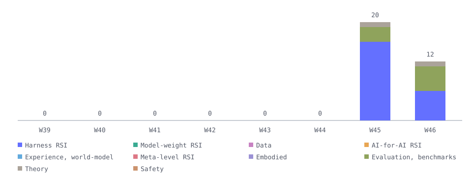

# Follow RSI · 2026 第 46 周

2026-11-09 → 2026-11-15

本期完成审查并获批准 12 篇论文：Harness / 脚手架 RSI 6 篇、评测、基准与归因 5 篇、理论与综述 1 篇。本期论文最多的方向为 Harness / 脚手架 RSI。

## Harness / 脚手架 RSI · 6

- **The Last Mile to the Real World**：开发 Agent 根据失败轨迹修订 Harness 控制原语，经测试与开发集检查后保留，供独立任务复用；仅收录其 Harness 原语分支。 [arxiv](<https://arxiv.org/abs/2611.07461>) [hf](<https://huggingface.co/papers/2611.07461>) — 其余 4 项待核（自动判断，未核实）
  原始发表：2026-11-05 · HF 推荐：2026-11-09 · 版本日期：2026-11-05
- **CPU-ARC**：CPU-ARC 将推理步骤实现为可复用的 Python 语义函数。构建器依据执行错误、judge 反馈和检查结果反复修改候选，通过后注册到系统级缓存，供后续推理调用。纳入依据是反馈驱动的可执行组件更新；论文还包含小模型微调实验，不能将整篇概括为权重完全冻结，也不能只凭推理节省断言计入构建成本后的净收益。 [arxiv](<https://arxiv.org/abs/2611.09891>) [hf](<https://huggingface.co/papers/2611.09891>) — 其余 4 项待核（自动判断，未核实）
  原始发表：2026-11-06 · HF 推荐：2026-11-09 · 版本日期：2026-11-06
- **World In-Context Learning for Agentic Robot Manipulation**：RoboScript 在任务学习前把汇集的示范拆为动作片段，将现有接口无法覆盖的缺口交给 coding agent 编写环境技能。独立 driver 回放、检查跨布局复用并复查新增技能的得失，按覆盖反馈迭代后冻结技能库，供后续任务调用。这里仅将可执行工具技能的构建与筛选闭环纳入 Harness；普通 Task Memory 内容更新另计。论文未单独量化技能构建的贡献，部署中遇到失败再持续生成新技能仍是未来工作。 [arxiv](<https://arxiv.org/abs/2611.12885>) [code](<https://github.com/ArcheOne-AI/RoboScript>) [s2](<https://www.semanticscholar.org/paper/0c9858a786b99982223249bb2f59898ac930df4d>) — 其余 4 项待核（自动判断，未核实）
  原始发表：2026-11-09 · HF 推荐：2026-11-11 · 版本日期：2026-11-09
- **EmoHarness**：EmoHarness让Builder依据冻结学生模型的失败轨迹修改提示、配置和受限验证代码，用独立验证集决定是否替换当前Harness，并将采用版本留给后续改进轮。主要收益来自音频证据，演化增量未通过多重比较校正；人工开发曾查看部分评测项，因此不能将全部评测称为从未触碰的留出集。 [arxiv](<https://arxiv.org/abs/2611.11994>) [code](<https://github.com/Emo-Harness/EmoHarness>) [hf](<https://huggingface.co/papers/2611.11994>) — 其余 4 项待核（自动判断，未核实）
  原始发表：2026-11-09 · HF 推荐：2026-11-10 · 版本日期：2026-11-09
- **Verify by Doing**：通过工具执行与核查共同修改 Actor 和 Evaluator 的指令、评判规则及技能，保留到后续改进轮次；Actor 的采纳须由其自身的新输出支持。模型权重固定，独立任务之间重置 Harness 与历史，跨任务迁移及长期持续改进尚未验证。 [arxiv](<https://arxiv.org/abs/2611.15276>) [s2](<https://www.semanticscholar.org/paper/c3554867d1cbc93a89809f55e8a4be5b16abe104>) — 其余 4 项待核（自动判断，未核实）
  原始发表：2026-11-11 · HF 推荐：未核实 · 版本日期：2026-11-11
- **HyperSkill**：根据训练轨迹的失败类型组合并保留协议指令，冻结后在测试问题间复用；技能库另按反馈演化。Harness 纳入限于协议提示组件，模板和执行机制固定，多数数据集关闭检索技能注入，不能把整体收益全归超图技能演化。反事实准入使用模型判断。 [arxiv](<https://arxiv.org/abs/2611.15178>) [code](<https://github.com/LHRLAB/HyperSkill>) [s2](<https://www.semanticscholar.org/paper/3ae04a9c45b2074d4a5035af08cbc4a02368f777>) — 其余 4 项待核（自动判断，未核实）
  原始发表：2026-11-11 · HF 推荐：未核实 · 版本日期：2026-11-11

## 评测、基准与归因 · 5

- **RSI-PDEbench**：执行与验证反馈共同筛选数值求解器及后续调查指令，并把通过的指令保留到下一轮；模型与可执行监督器固定。纳入依据是指令策略迭代，求解器本身属于任务产物。作者已接触测试结果，最终程序变好不等于改进器变强。 [arxiv](<https://arxiv.org/abs/2611.14949>) [s2](<https://www.semanticscholar.org/paper/fb508a6bcd91c128f9d22f1e77d9645a0e9b94e5>) — 其余 4 项待核（自动判断，未核实）
  原始发表：2026-11-11 · HF 推荐：未核实 · 版本日期：2026-11-11
- **AskALCF**：人工专家按预定目标与控制案例迭代诊断规则、judge 技能和覆盖门，保留通过检查的 Harness 版本，并用按会话分开的评估集检查。属于人工引导的 Harness 改进评测；自动生成的知识变更尚未获批合并到已部署语料并重建索引，不能称生产系统已自主修复。 [arxiv](<https://arxiv.org/abs/2611.15700>) [s2](<https://www.semanticscholar.org/paper/36a91d7a43050f3a9bb506805e535b5d36733a2e>) — 其余 4 项待核（自动判断，未核实）
  原始发表：2026-11-11 · HF 推荐：未核实 · 版本日期：2026-11-11
- **JustRUA**：其中的自改进实验根据运行反馈改写共享 Python 操作与指南并跨任务组复用；未显示明显优于默认配置，且每回合成本更高。最终静态方案的提升与此分开；实验接触被评分任务，各轮任务组不同，每配置仅评测一次。 [arxiv](<https://arxiv.org/abs/2611.16009>) [code](<https://github.com/ZefanW/JustRUA>) [hf](<https://huggingface.co/papers/2611.16009>) — 其余 4 项待核（自动判断，未核实）
  原始发表：2026-11-11 · HF 推荐：2026-11-13 · 版本日期：2026-11-11
- **Does a Self-Learning Migration Agent Learn? An Audited Evaluation of Evidence-Graded Experience Memory for Oracle-to-PostgreSQL Migration**：迁移实验中的人工监督循环以预先写定的检查条件和 Oracle 执行结果筛选提示段与 Harness 修复，保留到后续版本；与记忆和策略 ranker 实验分开。同一语料反复参与调试且规模变化，原始工件未公开，不能当作自主改进或独立留出集验证。 [arxiv](<https://arxiv.org/abs/2611.16143>) [s2](<https://www.semanticscholar.org/paper/6db07ac48e1aaac2bc787a6584fd0097fff2892c>) — 其余 4 项待核（自动判断，未核实）
  原始发表：2026-11-12 · HF 推荐：未核实 · 版本日期：2026-11-12
- **Small Language Models for Inference-Capability Routing**：用反馈优化推理、检索和工具能力的路由指令，再将保留的提示用于后续查询，比较路由质量与下游表现。部分下游数据与前序数据重叠且标签事后修正；所列节省不含路由器开销，两部分测量环境不同，不能当作端到端成本或延迟收益。 [arxiv](<https://arxiv.org/abs/2611.16414>) [s2](<https://www.semanticscholar.org/paper/a1739a73d4f579da213c405045276900b4218f13>) — 其余 4 项待核（自动判断，未核实）
  原始发表：2026-11-12 · HF 推荐：未核实 · 版本日期：2026-11-12

## 理论与综述 · 1

- **Evidence-Governed Adoption of Self-Generated Updates in Autonomous AI Agents**：提出自生成提示、工具和工作流配置的持久准入理论：先冻结候选，再以新鲜审计样本和预定指标决定采纳，并约束相对参考版本的退化。证据来自合成统计实验，尚无真实 Agent 实证；保证受抽样、评估有效性与目标分布假设限制。 [arxiv](<https://arxiv.org/abs/2611.16378>) [s2](<https://www.semanticscholar.org/paper/438d94146e49fd89ef131a337e30722820a2fdcc>) — 其余 4 项待核（自动判断，未核实）
  原始发表：2026-11-12 · HF 推荐：未核实 · 版本日期：2026-11-12

## 补录（非本周新论文） · 32

- **TeleTune**：用离线日志上的动作预测误差提出文本技能库改动，以开发集评分选择并保留版本，再冻结用于新任务。优化期间不执行实时动作，反馈属于离线代理指标，不能据此声称在线执行闭环或同预算全面领先。 [arxiv](<https://arxiv.org/abs/2610.05437>) [s2](<https://www.semanticscholar.org/paper/4a7519940747291393b73e25f0b36c348b8a0a82>) — ✅ 留出集 · 其余 3 项待核（自动判断，未核实）
  改了什么：技能文件
  原始发表：2026-10-04 · HF 推荐：未核实 · 版本日期：2026-10-04
- **What Does a Harness Repair? A Preregistered Study of Visibility, Baseline Adequacy and Evaluation Defects**：预注册评测比较冻结模型周围的简单配置、救援配置与 GEPA 选出的提示，追查 Harness 搜索增益究竟来自答案可解析性、基线选择还是评测缺陷。注入缺陷的对照显示，使用同一管线进行复制可能复现缺陷的影响，而不能揭示它。 [arxiv](<https://arxiv.org/abs/2610.05533>) [s2](<https://www.semanticscholar.org/paper/cc50759b19c2cc3e4c54e5ccb0f66593ad502c84>) — 其余 4 项待核（自动判断，未核实）
  改了什么：系统提示
  原始发表：2026-10-04 · HF 推荐：未核实 · 版本日期：2026-10-04
- **AgentSWE**：AgentSWE 评测编程 Agent 能否按开发反馈构建可交付的 Agent，包括提示、工具编排、状态管理和输出校验。最终交付快照冻结后再独立测试，可复用策略的证据与普通软件任务产物应区分。 [arxiv](<https://arxiv.org/abs/2610.13361>) [code](<https://github.com/VectorSpaceLab/AgentSWE>) [s2](<https://www.semanticscholar.org/paper/3cd355c9600b0232a89e6d0f5257c40db74f9299>) — 其余 4 项待核（自动判断，未核实）
  原始发表：2026-10-09 · HF 推荐：未核实 · 版本日期：2026-10-09
- **ECG-RSI**：根据构造错误修改并回归验证生成器的算子、提示与技能，保留版本供后续轮次复用，同时迭代训练学习器权重。属于限定的权重与 Harness 共演化；整体收益不能单独归因于生成器修复。 [arxiv](<https://arxiv.org/abs/2610.17718>) [code](<https://github.com/pork-pay/ECG-RSI>) [s2](<https://www.semanticscholar.org/paper/f2b0819c5218bc3188ea778bc847b50bd1806a3a>) — 其余 4 项待核（自动判断，未核实）
  原始发表：2026-10-13 · HF 推荐：未核实 · 版本日期：2026-10-13
- **EmbodiedEvo**：把 Playground 运行反馈转为可复用代码技能与诊断经验，冻结后交给新场景中的独立执行 Agent；另有跨任务、跨模型复用实验。模型权重保持不变，执行阶段费用对比不包含经验获取成本。 [arxiv](<https://arxiv.org/abs/2610.18867>) [s2](<https://www.semanticscholar.org/paper/3cc768d806622292a5ab5badf69ab4c0b974973f>) — 其余 4 项待核（自动判断，未核实）
  改了什么：可复用代码技能与诊断教训
  原始发表：2026-10-13 · HF 推荐：未核实 · 版本日期：2026-10-13
- **Compiling Expert Procedures into Verified Programs**：PLVR 搜索外部工具调用控制程序，实际执行候选后依据教师动作距离和训练任务结果选择保留版本，冻结后用于新任务。程序依赖人工种子与前沿模型从教师轨迹生成的原语和规则库。 [arxiv](<https://arxiv.org/abs/2610.19148>) [s2](<https://www.semanticscholar.org/paper/ebd8da5923ce5c6606582270fce57800bdf60145>) — 其余 4 项待核（自动判断，未核实）
  原始发表：2026-10-13 · HF 推荐：未核实 · 版本日期：2026-10-13
- **D-Skill**：将固定的教师与学生执行轨迹差异转成任务通用操作规则，逐批修改并保留可复用技能，供后续独立任务加载；规则涉及工具调用、验证、停止与重试，学生权重保持不变。默认流程不增加环境调用，也不逐次评测筛选补丁；另设的 SkillOpt 变体保留验证门，不能混称为默认在线自评循环。 [arxiv](<https://arxiv.org/abs/2610.28914>) [s2](<https://www.semanticscholar.org/paper/35cb61680cb6be63f332956da8b9b66d17fe7981>) — 其余 4 项待核（自动判断，未核实）
  原始发表：2026-10-20 · HF 推荐：未核实 · 版本日期：2026-10-20
- **Batching the Reflective Optimization Loop**：本文把 GEPA 的反思候选提出、执行和验证改为批量处理，持续更新被保留的候选前沿，并在留出任务上测试优化后的提示。属于 Harness 优化器组件改进，不能据此称为改进器自身递归演化。 [arxiv](<https://arxiv.org/abs/2610.36774>) [code](<https://github.com/gepa-ai/gepa>) [s2](<https://www.semanticscholar.org/paper/242ce440a52d34a1396f2084bf0597a0e2cc0fc7>) — 其余 4 项待核（自动判断，未核实）
  改了什么：无
  原始发表：2026-10-27 · HF 推荐：未核实 · 版本日期：2026-10-27
- **EvoGroup**：EvoGroup 根据置信度与官方任务结果选择交互轨迹，再用诊断结果指导修改工具实现、检索算法以及提示和调度策略。演化后的 Harness 冻结后在未见的群聊记忆基准上评估。纳入依据是可执行程序与策略的更新；仅增加群聊记忆内容不构成这些证据，也不能把官方正确性反馈称为完全无监督。 [arxiv](<https://arxiv.org/abs/2611.03868>) [s2](<https://www.semanticscholar.org/paper/701899b317b06cebf3e2a00bc11e9e16e7c12cc1>) — 其余 4 项待核（自动判断，未核实）
  原始发表：2026-11-02 · HF 推荐：未核实 · 版本日期：2026-11-02
- **DualEvolve**：DualEvolve 在推荐研究中同时改进任务方案和研究编排：外层依据过程评分与执行轨迹增删、合并 Harness 和技能规则，影响后续轮次的搜索。内层改进的推荐模型是外部研究产物，因此不能仅凭“双层”认定 Agent 自身权重与 Harness 共演化。论文另评估冻结规则的迁移，但报告的迁移成本不含源规则获取成本。 [arxiv](<https://arxiv.org/abs/2611.04439>) [code](<https://github.com/ToAdventure/dualevolve>) [s2](<https://www.semanticscholar.org/paper/c5b97597e3fe6507dcbec833e1693c4798cf04ab>) — 其余 4 项待核（自动判断，未核实）
  原始发表：2026-11-03 · HF 推荐：未核实 · 版本日期：2026-11-03
- **Meta²**：Meta² 在离线阶段比较训练轨迹与验证反馈，迭代增删 Meta-Skill 中决定何时、如何干预的规则。部署时冻结这套改进器规则，复用于新任务的 Harness 编辑；每次在线编辑只影响当前运行，结束后丢弃，并不写回 Meta-Skill。这里跨任务保留的是改进器决策规则，不能描述成部署时持续积累全局 Harness 补丁。 [arxiv](<https://arxiv.org/abs/2611.05139>) [s2](<https://www.semanticscholar.org/paper/2319fdfe8347a7f8f5d52be898ba33012faf58b9>) — 其余 4 项待核（自动判断，未核实）
  原始发表：2026-11-03 · HF 推荐：未核实 · 版本日期：2026-11-03
- **Reglos**：Reglos 将用户记忆内容的积累与 Harness 程序的改进分开。外层编码 Agent 从失败轨迹提出检索、过滤排序和证据组织的程序补丁，经独立 critic 与评估筛选后保留。纳入的是这套围绕冻结任务模型的程序更新，改进器和验证器本身保持固定。论文在冻结报告版本之后才采用更严格的准入规则，不能称之前的开发改动都通过了该规则。 [arxiv](<https://arxiv.org/abs/2611.06049>) — 其余 4 项待核（自动判断，未核实）
  原始发表：2026-11-04 · HF 推荐：未核实 · 版本日期：2026-11-04
- **HarnessFlow**：HarnessFlow 用 MCTS 在可执行 Harness 的不同修订路径之间分配搜索。编码 Agent 根据父版本、验证反馈和执行记录提出上下文构造、状态管理、工具使用及终止规则的改动，候选与分数保留在搜索树中供后续迭代。最终按验证集选择的 Harness 再在不相交测试集评估；对齐候选尝试次数不等于对齐全部 token、费用或算力。 [arxiv](<https://arxiv.org/abs/2611.06254>) — 其余 4 项待核（自动判断，未核实）
  原始发表：2026-11-04 · HF 推荐：未核实 · 版本日期：2026-11-04
- **Learning Multi-Agent Orchestration**：IAPO 利用执行轨迹回报为多 Agent 编排的候选策略建立改进证书。其中离散 plan-leap 分支搜索角色调用序列，以独立验证中的配对回报选择计划，再冻结策略于测试集重跑。纳入的是可复用编排计划的方法与理论；论文的单轮实验不等于改进器递归自改，验证分布上的证书也不保证测试提升。部署期每题成本未计入搜索与训练开销。 [arxiv](<https://arxiv.org/abs/2611.07495>) [s2](<https://www.semanticscholar.org/paper/975e721203aaf1cfb1e47467e7856e1c93b23921>) — 其余 4 项待核（自动判断，未核实）
  原始发表：2026-11-05 · HF 推荐：未核实 · 版本日期：2026-11-05
- **Divide, Diagnose, and Compose**：DeCAF 将 Harness 搜索拆为提示、拓扑、模型分配、上下文和工具策略等维度，以开发集执行结果迭代修改并保留非支配候选，再用组件诊断合成、修复并选择最终程序，在留出集评测。组件诊断只定位可能的失败，准入仍依据任务表现、推理费用和延迟。优化器重复次数少，部分基准推理费用上升，优化总费用也更高，未证明严格同费用预算优势。 [arxiv](<https://arxiv.org/abs/2611.08723>) [s2](<https://www.semanticscholar.org/paper/fea3d2023e135dcedc2d4dc822d0dccf8e1e9e50>) — 其余 4 项待核（自动判断，未核实）
  原始发表：2026-11-05 · HF 推荐：未核实 · 版本日期：2026-11-05
- **How Much Skill Orchestration Can LLM Agents Compile Away? Execution-Grounded Specialization for Token-Efficient Skill Use**：SkillCache 将已完成调用的工具轨迹编译成参数化 capsule，包含程序和自然语言步骤。宿主在沙箱回放候选，把失败诊断反馈给编译 Agent 修复，通过后供后续请求复用，原技能保留作恢复路径。纳入的是这条执行反馈修订组件的闭环；当前 warm 执行后的持续学习仍属未来工作。回放主要检查原请求条件，不能保证任意新请求正确，节省也需结合编译成本和复用次数判断。 [arxiv](<https://arxiv.org/abs/2611.10022>) [s2](<https://www.semanticscholar.org/paper/dbb4ea55f87f69a7cbc8493bcc6209aee0221c14>) — 其余 4 项待核（自动判断，未核实）
  原始发表：2026-11-05 · HF 推荐：未核实 · 版本日期：2026-11-05
- **Rethinking Agent Trajectory Compression**：WAAC 把经过任务成功验证的字段压缩策略保留到历史库，并在后续兼容工作流中检索复用。只有实际通过验证、应用后的策略可成为成功先例，未经验证的执行不会被当作成功经验。纳入的是反馈筛选并保留的压缩策略组件；匹配与融合算法仍固定，不能描述成系统自行重写压缩源码，也不能把一般经验内容的积累算作同一种证据。 [arxiv](<https://arxiv.org/abs/2611.08865>) [s2](<https://www.semanticscholar.org/paper/ab5db10f31bc3d03cd45204cfeadd30aaa8632e4>) — 其余 4 项待核（自动判断，未核实）
  原始发表：2026-11-06 · HF 推荐：未核实 · 版本日期：2026-11-06
- **Flex-RSI**：Flex-RSI 将任务解的改进与 Harness 改进分开：executor 修改解，improver 根据轨迹和结果改写 executor 及自身的提示、工具与工作流，后续轮次继续使用更新后的 Harness。模型权重、评估器和数据划分固定，最终解在隐藏测试集评分；论文另用冻结 Harness 配对运行检验 Harness 编辑的贡献。应归 Harness 专项评测，但各模型任务覆盖不齐、通常每格单次运行，不能据此夸大稳健性或跨任务迁移。 [arxiv](<https://arxiv.org/abs/2611.08946>) — 其余 4 项待核（自动判断，未核实）
  原始发表：2026-11-06 · HF 推荐：未核实 · 版本日期：2026-11-06
- **BOXBOX**：BOXBOX 让 Agent 在长时任务中根据执行困难主动复审并改写自己的可执行 Harness。kernel 验证改动后保留上下文、热加载新运行时，后续执行和复审继续使用新版。PerfRace 上与固定 Harness、离线 Harness Evolution 和外部控制的 Harness Scaling 比较，使用相同任务时间预算；这是任务内跨轮 Harness 演化证据，独立跨任务迁移仍为 unknown，不能把时间预算相同写成费用完全相同。 [arxiv](<https://arxiv.org/abs/2611.09218>) — 其余 4 项待核（自动判断，未核实）
  原始发表：2026-11-06 · HF 推荐：未核实 · 版本日期：2026-11-06
- **AutoRefine**：AutoRefine 利用代码工作流中的合并、放弃等噪声标签，分析 judge 与标签的不一致，并反复改写可部署的质量评审提示。教师模型可以解释或弃权，候选提示由独立验证集选择。更新对象是评审组件的提示；实验重放已保存补丁，没有重新运行被评 Agent，因此不能将评审结果改善直接写成编码任务成功率提高。 [arxiv](<https://arxiv.org/abs/2611.09291>) [s2](<https://www.semanticscholar.org/paper/c77344d2283ae48c0325d2a367667046b7f087c9>) — 其余 4 项待核（自动判断，未核实）
  原始发表：2026-11-06 · HF 推荐：未核实 · 版本日期：2026-11-06
- **When Feedback Becomes a Backdoor**：这项 SkillOpt 安全研究检验技能优化循环是否会把受污染的参考反馈变成持久规则。短答案任务的自然反思、编辑和选择链中，作者观察到触发条件规则被保留，并通过留出激活与规则删除实验检查其作用；结构化工具任务的自然链没有保留同样的精确规则。它属于 Harness 专项安全评测，不能推广为所有优化器、模型或任务都存在同样效果。 [arxiv](<https://arxiv.org/abs/2611.09348>) [s2](<https://www.semanticscholar.org/paper/fde633a88b0170d19d03e43883127dbbb3d672c8>) — 其余 4 项待核（自动判断，未核实）
  原始发表：2026-11-06 · HF 推荐：未核实 · 版本日期：2026-11-06
- **From LoRA to Language**：From LoRA to Language 中与本专题直接相关的是技能文档的奖励循环：writer 根据开发任务的成功反馈逐轮修订草稿，再用未见的开发游戏选择版本，最终测试另行进行。技能文档可交给执行模型复用。收录仅针对这条反馈修订技能的分支，不把适配器恢复或 writer 训练本身当作 Harness 演化，也不把全部收益归因于读取 LoRA。 [arxiv](<https://arxiv.org/abs/2611.09454>) [s2](<https://www.semanticscholar.org/paper/2e3e78dc87deb8e70bc64705e5dc37c486cc7ff2>) — 其余 4 项待核（自动判断，未核实）
  原始发表：2026-11-06 · HF 推荐：未核实 · 版本日期：2026-11-06
- **On Agentic Manipulation Policies**：AMP 的代码学习分支让操控 Agent 在模型权重固定时，根据任务成功反馈修订持久存储中的代码与记忆。可复用的 Python 操控函数能被后续任务导入调用，形成跨任务保留的可执行组件。这里纳入的是该代码更新分支；仅保存文字经验或使用固定框架，不足以据此认定 Harness 演化，也不能扩大为任意真实机器人上的泛化结论。 [arxiv](<https://arxiv.org/abs/2611.09892>) [s2](<https://www.semanticscholar.org/paper/70fc98b8239106f76513f4d2002e9678d3e70224>) — 其余 4 项待核（自动判断，未核实）
  原始发表：2026-11-06 · HF 推荐：未核实 · 版本日期：2026-11-06
- **When Experience Becomes a Backdoor**：BadEvolve 检验技能自演化系统是否会把受污染的演化任务转成持续影响后续行为的规则，威胁模型不允许攻击者直接修改受害者技能。被测演化器从执行轨迹与任务结果更新技能，并在后续测试任务中复用；实验分别评估普通任务和带触发条件的任务。它属于 Harness 专项安全评测，结论限于所测技能演化框架与威胁模型，不能推广为所有提示或记忆组件都已验证存在同样问题。 [arxiv](<https://arxiv.org/abs/2611.10542>) [code](<https://github.com/ventr1c/BadEvolve>) [s2](<https://www.semanticscholar.org/paper/1e662f8b344d526862d397421e9e19426b662e72>) — 其余 4 项待核（自动判断，未核实）
  原始发表：2026-11-07 · HF 推荐：未核实 · 版本日期：2026-11-07
- **Trustworthy Recursive Self-Improvement with Statistical Guarantees**：TRUST 把 Harness 候选的准入组织为跨轮统计检验：依据既往反馈提出规则或策略修改，在成对验证结果积累足够证据时替换当前版本。LLM 根据验证开始前的历史分配检验预算，测试集仅用于报告。其保证依赖验证样本重用的偏差条件及容忍损失设定，控制的是不合格接纳的预期比例，并不保证每次接受都提高表现。 [arxiv](<https://arxiv.org/abs/2611.10787>) [s2](<https://www.semanticscholar.org/paper/61e3aac6cf6823f34b1e02154a88461b119c8494>) — 其余 4 项待核（自动判断，未核实）
  原始发表：2026-11-07 · HF 推荐：未核实 · 版本日期：2026-11-07
- **JoMoHa**：JoMoHa 用任务执行回报共同训练生成可执行 Harness 的 Engineer 与执行任务的 Solver。Engineer 根据历史反馈提出代码，经验证后运行；保存的程序与模型检查点经验证集选择，再冻结用于评估，固定 Solver 的新旧程序互换用于区分代码贡献。纳入共演化的依据是模型学习之外确有代码工件生成、保留与复用；不能写成部署期持续自改，也不能把引用的全部基线当作同批重跑。 [arxiv](<https://arxiv.org/abs/2611.11499>) [s2](<https://www.semanticscholar.org/paper/054ba59dcfc2469ac8ef423720e15435c23be493>) — 其余 4 项待核（自动判断，未核实）
  原始发表：2026-11-08 · HF 推荐：未核实 · 版本日期：2026-11-08
- **SciMARS**：SciMARS 根据执行轨迹和公开探针，分别修订多 Agent 团队的角色程序、交接契约，以及扩展版的记忆读写策略，再组合并选择下一版 Harness。被选修改用于同一任务的后续改进轮，新的评测任务会重置，不能写成跨任务积累；改进器本身保持固定。科学发现评测使用实验数据回放与数字孪生，并非新做实体湿实验。 [arxiv](<https://arxiv.org/abs/2611.12552>) [s2](<https://www.semanticscholar.org/paper/bba8b71b770055e4dd1dfd355669ab5b35657260>) — 其余 4 项待核（自动判断，未核实）
  原始发表：2026-11-09 · HF 推荐：未核实 · 版本日期：2026-11-09
- **RoboACE**：RoboACE在冻结基础模型外，交替修改课程选择与任务执行的Harness。优化器读取独立运行的反馈，修订提示、工具接口和程序技能，再用固定任务快照比较并保留版本；纳入的是选择和执行的方法修改，课程任务本身不计作Harness。结果来自单条开发轨迹及LIBERO生态的固定评测子集，最终评测不参与版本选择。 [arxiv](<https://arxiv.org/abs/2611.13034>) [s2](<https://www.semanticscholar.org/paper/f863e133cbfe9440850b06063364449acc97ea11>) — 其余 4 项待核（自动判断，未核实）
  原始发表：2026-11-09 · HF 推荐：未核实 · 版本日期：2026-11-09
- **Teaching the Harness**：SAT教师根据学生的失败轨迹和诊断探测，编写可复用的程序性技能指令；开发任务上的正效用决定技能是否入库或替换通用技能。教师退出后，固定学生与执行框架在后续任务中继续使用技能库。收益依赖学生及技能投递方式，验证范围是准备阶段已见任务族的新实例，不能外推为任意领域迁移。 [arxiv](<https://arxiv.org/abs/2611.13144>) [s2](<https://www.semanticscholar.org/paper/a564ae6b5b5c02da2e07027a825e6780279e7d3f>) — 其余 4 项待核（自动判断，未核实）
  原始发表：2026-11-09 · HF 推荐：未核实 · 版本日期：2026-11-09
- **NCP**：NCP研究外部控制规则的验证准入与持久化：执行遥测生成候选规则，验证器将结果绑定到规则和当前策略版本，再决定采用或拒绝；每次请求结束恢复临时权重干预。真实微基准里所有候选都被拒绝，活动策略和最终结果均未改变。它提供控制层框架及负结果证据，受控测试中的晋升不代表真实任务实现了自我改进。 [arxiv](<https://arxiv.org/abs/2611.13236>) [s2](<https://www.semanticscholar.org/paper/f10bc968944664a6bf9b54858e9c2c988491ed85>) — 其余 4 项待核（自动判断，未核实）
  原始发表：2026-11-09 · HF 推荐：未核实 · 版本日期：2026-11-09
- **Looking One Step Ahead**：LASER把观察技能表示为结构化指令，根据生成描述与参考描述的差异，修订负责的指令字段或增建技能。候选在不同视频组成的选择集上改善描述质量且不增加矛盾时才替换技能库，后续轮次复用；模型参数保持固定，最终评测冻结技能库。证据限定于视频物体状态描述。 [arxiv](<https://arxiv.org/abs/2611.14113>) [s2](<https://www.semanticscholar.org/paper/1563eb50692c2f82fe9ecaf9e3eafb3a85eb1bc4>) — 其余 4 项待核（自动判断，未核实）
  原始发表：2026-11-10 · HF 推荐：未核实 · 版本日期：2026-11-10
- **When Should Agents Remember? Falsification-Gated Self-Evolution for LLM Agents**：FGSE把执行经验转为带适用前提的有限提示或工具策略补丁，在临时状态下测试迁移、反例和历史回归，再提交、缩小适用范围重试或拒绝。通过的行为修改在后续任务中复用，出现违例可停止检索。这里只收录明确的提示/工具策略修改分支，不把所有记忆内容都算作Harness；理论保证依赖论文所列假设。 [arxiv](<https://arxiv.org/abs/2611.14326>) [s2](<https://www.semanticscholar.org/paper/76a00c126f75c7efc68ea449c6723f79ae5b4f05>) — 其余 4 项待核（自动判断，未核实）
  原始发表：2026-11-10 · HF 推荐：未核实 · 版本日期：2026-11-10

## 近 8 周趋势

本周找到 **234** 篇 · 收录 **12** 篇 · include 准确率 **—**

[Atom](../site/feed/atom.xml) · [JSON feed](../site/feed/latest.json) · [GitHub](https://github.com/adongwanai/follow-rsi)
