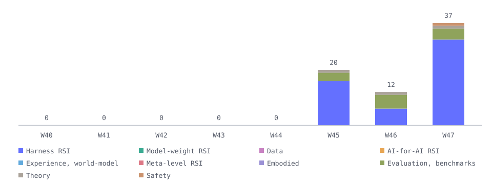

# Follow RSI · 2026-W47

2026-11-16 → 2026-11-22

This edition includes 34 reviewed and approved papers: Harness RSI: 29; Evaluation, benchmarks & attribution: 4; Theory & surveys: 1. Harness RSI has the most papers in this edition.

## Editor's note

Daily editions contain 34 papers; Nov 18–20 supplements were reviewed on Nov 23. A separate section preserves 33 previously published historical additions and their original review/source snapshots; these are not new papers this week. Per-paper first-publication timestamps for the supplement were not separately recorded. The first Nov 18 page timestamp belongs to its earlier status bulletin, so the weekly latency median is left unknown rather than derived from that older page timestamp. Late monitor additions SIR-Agent and RemoteEvolver retain their Nov 20 source date and Nov 23 review date; the SIR-Agent mixed-degradation scenario count remains unverified.

## Harness RSI · 29

- **MIRIX-2.0**：The procedural-skill branch of MIRIX AutoDream judges session outcomes from execution transcripts, then uses a curator to create, edit, or delete skill instructions for later agents. Skills acquired on training tasks are frozen and evaluated for reuse on new tasks. Inclusion rests on feedback-driven revision of procedural steps, separate from semantic-record consolidation and factual retrieval. The experiments evaluate the combined process, without isolating the benefit of every skill edit or individual component. [arxiv](<https://arxiv.org/abs/2611.12068>) [code](<https://github.com/Mirix-AI/MIRIX>) [s2](<https://www.semanticscholar.org/paper/b8a7f0d7b4bdb20292802143a858e9d2dc96e6ed>) — 4 other checks await verification（Automated, unverified）
  Original publication: 2026-11-09 · HF recommendations: 2026-11-16 · Version date: 2026-11-09
- **CompoundingKernel**：Team agents repair the prompts, tools, and evaluation harness in response to operational faults. Human-approved fixes take effect at warm restarts while each task’s search archive is preserved. [arxiv](<https://arxiv.org/abs/2611.19230>) [hf](<https://huggingface.co/papers/2611.19230>) — 4 other checks await verification（Automated, unverified）
  Original publication: 2026-11-14 · HF recommendations: 2026-11-20 · Version date: 2026-11-14
- **Evaluation-Free Recursive Self-Improvement for Coding Agents**：ELITE integrates independently proposed code mechanisms into an executable agent and admits descendants through compilation and execution-protocol checks. The loop uses no downstream task scores, and accepted changes can still fluctuate in performance. [arxiv](<https://arxiv.org/abs/2611.21056>) [s2](<https://www.semanticscholar.org/paper/4fcd98dd606d0344ee66b038975a63e9a8297f34>) — 4 other checks await verification（Automated, unverified）
  Original publication: 2026-11-16 · HF recommendations: Not verified · Version date: 2026-11-16
- **RemeshingAgent**：RemeshingAgent revises executable pipeline templates and skill instructions from mesh-repair trajectories, replacing the incumbent only after held-out selection improves and testing separately. Its tool-expansion experiment produced no adopted new operator. [arxiv](<https://arxiv.org/abs/2611.20533>) [s2](<https://www.semanticscholar.org/paper/17ef011273706df6756e3943ec00ebe1eb8da5e2>) — 4 other checks await verification（Automated, unverified）
  Original publication: 2026-11-16 · HF recommendations: Not verified · Version date: 2026-11-16
- **Synapse**：Synapse repairs natural-language skills using execution traces to locate faults and typed patches to rewrite skill source, with a separate validation suite selecting retained versions. Acceptance requires an improved overall pass rate, not preservation of every previously passing case. [arxiv](<https://arxiv.org/abs/2611.20856>) [s2](<https://www.semanticscholar.org/paper/450f05d7e0e137c0785bb9c399b143b046c7a8f7>) — 4 other checks await verification（Automated, unverified）
  Original publication: 2026-11-16 · HF recommendations: Not verified · Version date: 2026-11-16
- **MetaAct**：MetaAct synthesizes executable action constraints from successful and failed trajectories, checks false blocks through log replay, and uses counterexamples for revision. Accepted constraints persist in deployment. Compilation and blocking mechanisms remain fixed, and the retirement monitor was inactive in the reported results. [arxiv](<https://arxiv.org/abs/2611.20655>) [code](<https://github.com/BaiCubed/MetaAct>) [s2](<https://www.semanticscholar.org/paper/52a7c29c0d4372dbc6756f7d7e8091e9459eb1f1>) — 4 other checks await verification（Automated, unverified）
  Original publication: 2026-11-16 · HF recommendations: Not verified · Version date: 2026-11-16
- **WeVisForensics**：WeVisForensics updates both visual-inspector weights and reusable reporting rules. Rule revisions must improve judgments on held-out recent calls without losing previously correct judgments before publication to subsequent rounds. The visual OCR consistency inspector also trains, while audio tools and the PaddleOCR detector remain fixed. [arxiv](<https://arxiv.org/abs/2611.21373>) [s2](<https://www.semanticscholar.org/paper/018f92aa01424be629da047aeab4b09d355097f8>) — 4 other checks await verification（Automated, unverified）
  Original publication: 2026-11-16 · HF recommendations: Not verified · Version date: 2026-11-16
- **Do LLM Agents Still Need to Be Told How to Self-Improve?**：Frozen models revise prompts and skill files using practice scores and transcripts, then evaluate the retained text on unseen games in fresh sessions. [arxiv](<https://arxiv.org/abs/2611.23219>) [code](<https://github.com/ssundaram21/self-org>) [hf](<https://huggingface.co/papers/2611.23219>) — 4 other checks await verification（Automated, unverified）
  Original publication: 2026-11-17 · HF recommendations: 2026-11-18 · Version date: 2026-11-17
- **Think Once, Act Fast**：JevRSI asynchronously revises procedural decision-support modules from execution feedback and publishes them for later reuse through utility-aware retrieval. [arxiv](<https://arxiv.org/abs/2611.22432>) [code](<https://github.com/usail-hkust/JevRSI>) [s2](<https://www.semanticscholar.org/paper/b979b1a845f890b394659162874fbfa59ba80102>) — 4 other checks await verification（Automated, unverified）
  Original publication: 2026-11-17 · HF recommendations: Not verified · Version date: 2026-11-19
- **Agentic Harness Engineering Beta**：AHE-Beta turns execution evidence into general requirements and merges reusable harness updates after design and code review. [arxiv](<https://arxiv.org/abs/2611.24924>) [s2](<https://www.semanticscholar.org/paper/8934dbbdac714b61d72a89ff2c8e999b30875272>) — 4 other checks await verification（Automated, unverified）
  Original publication: 2026-11-18 · HF recommendations: Not verified · Version date: 2026-11-18
- **Improve How You Improve**：Within each episode, navigation feedback revises policy code and improvement rules for later goals; independent episodes reset both. [arxiv](<https://arxiv.org/abs/2611.23774>) [s2](<https://www.semanticscholar.org/paper/8a16947961e296e9fc33b4a2bc2197961b49c013>) — 4 other checks await verification（Automated, unverified）
  Original publication: 2026-11-18 · HF recommendations: Not verified · Version date: 2026-11-18
- **Great Listeners, Poor Decision-Makers**：Multi-objective evolutionary search tunes external action-gating policies for audio agents, selecting trade-offs between action risk and clarification cost. [arxiv](<https://arxiv.org/abs/2611.23847>) [s2](<https://www.semanticscholar.org/paper/fc3cc01d8bd232c1bb1abce3535ea70a60b20177>) — 4 other checks await verification（Automated, unverified）
  Original publication: 2026-11-18 · HF recommendations: Not verified · Version date: 2026-11-18
- **OpenKAGE**：OpenKAGE revises executable skills from open-world experience and shares them through a registry for subsequent agent use. [arxiv](<https://arxiv.org/abs/2611.24302>) [s2](<https://www.semanticscholar.org/paper/0faacc70b1cebebdc6542b7ce5c433441313068b>) — 4 other checks await verification（Automated, unverified）
  Original publication: 2026-11-18 · HF recommendations: Not verified · Version date: 2026-11-18
- **BaseRSI**：BaseRSI selects transferable prompt procedures and visual-processing entries from failures, then iteratively internalizes their verified gains into model weights. [arxiv](<https://arxiv.org/abs/2611.24578>) [code](<https://github.com/beita6969/BaseRSI>) — 4 other checks await verification（Automated, unverified）
  Original publication: 2026-11-18 · HF recommendations: Not verified · Version date: 2026-11-18
- **Safe Personal RSI**：In a simulated personal-assistant setting, failure traces guide instruction repairs for future tasks, with validation separated from adoption. [arxiv](<https://arxiv.org/abs/2611.23651>) — 4 other checks await verification（Automated, unverified）
  Original publication: 2026-11-18 · HF recommendations: Not verified · Version date: 2026-11-20
- **Beyond Weight Updates**：The method evolves loadable prompt, tool-description and skill adapters from failed trajectories, retaining a Pareto archive over success, cost and latency. [arxiv](<https://arxiv.org/abs/2611.25380>) [s2](<https://www.semanticscholar.org/paper/b324ced60a7b0e7b23d9ad5b93240f77f7e0f94c>) — 4 other checks await verification（Automated, unverified）
  Original publication: 2026-11-19 · HF recommendations: Not verified · Version date: 2026-11-19
- **Meta-RTL**：Meta-RTL traces RTL-optimization failures to agent harness decisions, searches reusable code changes and evaluates a frozen selected harness. [arxiv](<https://arxiv.org/abs/2611.25891>) — 4 other checks await verification（Automated, unverified）
  Original publication: 2026-11-19 · HF recommendations: Not verified · Version date: 2026-11-19
- **Evolve Where It Matters**：SkillPlumber revises skills using execution coverage and verifier feedback, while a maintainer updates diagnostic and revision strategies for later tasks. [arxiv](<https://arxiv.org/abs/2611.25429>) [s2](<https://www.semanticscholar.org/paper/c4335df76ba39eaa49a8cba0835a811ba9294643>) — 4 other checks await verification（Automated, unverified）
  Original publication: 2026-11-19 · HF recommendations: Not verified · Version date: 2026-11-19
- **Sage-Evolve-Preview**：Sage-Evolve-Preview revises prompts, skills and observation-controller rules from recurring failures, committing updates after repair and regression checks. [arxiv](<https://arxiv.org/abs/2611.26132>) — 4 other checks await verification（Automated, unverified）
  Original publication: 2026-11-19 · HF recommendations: Not verified · Version date: 2026-11-19
- **SceneAnything**：SceneAnything validates revisions to parameterized scene generators and stores accepted programs for retrieval and adaptation in subsequent scenes. [arxiv](<https://arxiv.org/abs/2611.25340>) [s2](<https://www.semanticscholar.org/paper/2b73deeebe314087ee0958eeb158eb5755d82f43>) — 4 other checks await verification（Automated, unverified）
  Original publication: 2026-11-19 · HF recommendations: Not verified · Version date: 2026-11-19
- **System-One RSI**：Decision-model, state-prompt and behavior-tree updates are tested on new opponents; a fixed-weight controller effect is not isolated. [arxiv](<https://arxiv.org/abs/2611.26007>) [s2](<https://www.semanticscholar.org/paper/451eb70dd6fa7aa62f3ed9722590a6fe4b26d312>) — 4 other checks await verification（Automated, unverified）
  Original publication: 2026-11-19 · HF recommendations: Not verified · Version date: 2026-11-19
- **MedicalRSI**：MedicalRSI evolves executable tools and workflow skills from clinical task feedback alongside training of the solver and improver. [arxiv](<https://arxiv.org/abs/2611.26806>) — 4 other checks await verification（Automated, unverified）
  Original publication: 2026-11-19 · HF recommendations: Not verified · Version date: 2026-11-19
- **AutoMaster**：Pilot rollout traces and student evaluations guide repeated revisions of teacher skills, with experiment history retained across rounds. Each student is fine-tuned anew from the same initial weights. [arxiv](<https://arxiv.org/abs/2611.26510>) [code](<https://github.com/RUCAIBox/AutoMaster>) [hf](<https://huggingface.co/papers/2611.26510>) — 4 other checks await verification（Automated, unverified）
  Original publication: 2026-11-19 · HF recommendations: 2026-11-20 · Version date: 2026-11-20
- **NavRSI**：NavRSI iteratively rewrites navigation harness code from traces and diagnoses, then freezes the selected harness for transfer evaluation. [arxiv](<https://arxiv.org/abs/2611.27499>) — 4 other checks await verification（Automated, unverified）
  Original publication: 2026-11-20 · HF recommendations: Not verified · Version date: 2026-11-20
- **Fix Where It Fails**：RoHa-SGG uses failure-root-cause analysis to revise inference harness code and selects a retained version before test evaluation. [arxiv](<https://arxiv.org/abs/2611.27529>) — 4 other checks await verification（Automated, unverified）
  Original publication: 2026-11-20 · HF recommendations: Not verified · Version date: 2026-11-20
- **SIR-Agent**：Restoration-chain feedback revises skills and external revision rules, with prior-task replay guiding replacement or addition; the mixed-degradation scenario count remains unverified. [arxiv](<https://arxiv.org/abs/2611.27285>) — 4 other checks await verification（Automated, unverified）
  Original publication: 2026-11-20 · HF recommendations: Not verified · Version date: 2026-11-20
- **RemoteEvolver**：Execution feedback repairs and registers remote-sensing tools and revises or deactivates reusable skills; far-domain negative transfer and forgetting remain. [arxiv](<https://arxiv.org/abs/2611.27110>) — 4 other checks await verification（Automated, unverified）
  Original publication: 2026-11-20 · HF recommendations: Not verified · Version date: 2026-11-20
- **Embodied-Harness**：Embodied-Harness revises reusable operational guidance from robot execution evidence and applies the updated harness to subsequent attempts. [arxiv](<https://arxiv.org/abs/2611.27689>) — 4 other checks await verification（Automated, unverified）
  Original publication: 2026-11-20 · HF recommendations: Not verified · Version date: 2026-11-20
- **EvoTER**：EvoTER proposes skill revisions from tool-use experience, retains accepted updates across rounds and freezes the skills for disjoint test tasks. [arxiv](<https://arxiv.org/abs/2611.27797>) — 4 other checks await verification（Automated, unverified）
  Original publication: 2026-11-20 · HF recommendations: Not verified · Version date: 2026-11-20

## Evaluation, benchmarks & attribution · 4

- **Continual-ARC**：Continual-ARC evaluates persistent agent harnesses on a stream of recurring ARC tasks with fresh instances, using reset controls and frozen seen-task and held-out tests. The tested systems retain programs and skill files across sessions. Persistence alone generally gives limited memorization gains; explicit guidance to write, verify and reuse programs helps on returning tasks, while gains on unseen tasks remain small or absent. This is a harness-focused evaluation, not evidence that feedback-budget comparisons match training and teacher costs. [arxiv](<https://arxiv.org/abs/2611.14505>) [code](<https://github.com/unifyai/continual-arc>) [hf](<https://huggingface.co/papers/2611.14505>) — 4 other checks await verification（Automated, unverified）
  Original publication: 2026-11-10 · HF recommendations: 2026-11-16 · Version date: 2026-11-15
- **The Resolution Hypothesis**：A focused evaluation of prompt, skill, memory, and harness evolution analyzes how proposal quality, selection, and run-to-run variance affect the detectability of improvements. [arxiv](<https://arxiv.org/abs/2611.23068>) [hf](<https://huggingface.co/papers/2611.23068>) — 4 other checks await verification（Automated, unverified）
  Original publication: 2026-11-17 · HF recommendations: 2026-11-19 · Version date: 2026-11-17
- **How Feedback-Free Self-Evolution Reshapes Agent Skills**：This dedicated study measures repeated feedback-free skill rewriting, traces loss of expert knowledge and tests attention markers that preserve the original text. [arxiv](<https://arxiv.org/abs/2611.25534>) [code](<https://github.com/LitaoGuo/How-Self-Evolution-Reshapes-Skills>) [s2](<https://www.semanticscholar.org/paper/8aabab21908171ed23305acf7b0a16cf9863feea>) — 4 other checks await verification（Automated, unverified）
  Original publication: 2026-11-19 · HF recommendations: Not verified · Version date: 2026-11-19
- **CoEvoBench**：CoEvoBench evaluates joint model and harness improvement and tests the nominated frozen model–harness pair in an independent environment. [arxiv](<https://arxiv.org/abs/2611.27116>) [code](<https://github.com/AlibabaResearch/CoEvoBench>) — 4 other checks await verification（Automated, unverified）
  Original publication: 2026-11-20 · HF recommendations: Not verified · Version date: 2026-11-20

## Theory & surveys · 1

- **SCAFFOLD**：SCAFFOLD proposes a theory and reporting protocol for evidence transport and readmission of versioned skills, without an implementation or empirical results. [arxiv](<https://arxiv.org/abs/2611.23990>) [s2](<https://www.semanticscholar.org/paper/a315271d7d96dddca2855954c5d8cf8836868ad8>) — 4 other checks await verification（Automated, unverified）
  Original publication: 2026-11-18 · HF recommendations: Not verified · Version date: 2026-11-18

## Historical additions (not this week's new papers) · 33

- **CollabFlow**：CollabFlow trains a collaboration director while adding, modifying, and removing library skills in response to team execution outcomes. Revised textual strategies are bound to agents in later evolution steps, supporting a model-and-Harness coevolution classification. Its skill-edit analysis selects the steps with the largest gains while the director also changes, so the observed gains cannot be attributed to skill edits alone. [arxiv](<https://arxiv.org/abs/2609.38662>) [s2](<https://www.semanticscholar.org/paper/d255740241b796b74f99f716b0c639c610d1445d>) — 4 other checks await verification（Automated, unverified）
  Original publication: 2026-09-29 · HF recommendations: Not verified · Version date: 2026-09-29
- **From Verification Failures to Reusable Guidance for Coding Agents**：This study turns expert diagnoses of verification failures into versioned procedural guidance, skills, and tool interfaces, and evaluates how these resources affect coding-agent verification. It supports a Harness-specific evaluation classification. The resources are expert maintained and the controlled effect intervals span zero; the study does not establish autonomous Harness evolution, a general benefit, or transfer to an independently held-out task family. [arxiv](<https://arxiv.org/abs/2609.39022>) [s2](<https://www.semanticscholar.org/paper/c5398f399c2ad1a466162a120004d152b67843a5>) — 4 other checks await verification（Automated, unverified）
  Original publication: 2026-09-30 · HF recommendations: Not verified · Version date: 2026-09-30
- **InterEvolve**：InterEvolve revises staged reward programs, transition conditions, and constants using simulation feedback. These programs drive a frozen controller at inference, and selected programs with verifier records enter a skill library for later composition and adaptation. This supports Harness-component evolution. Freezing applies to the evolution phase, and physical demonstrations reuse simulation-evolved programs rather than establishing autonomous online evolution on a robot. [arxiv](<https://arxiv.org/abs/2610.02196>) [s2](<https://www.semanticscholar.org/paper/17013cc3aeb4c6ca7f47ba513d9598ce419276ec>) — ✅ Held-out · 3 other checks await verification（Automated, unverified）
  Original publication: 2026-10-01 · HF recommendations: Not verified · Version date: 2026-10-01
- **SkillScriptBench**：SkillScriptBench evaluates repairs to skill-package instructions and executable scripts, including feedback-guided revision, documentation–code consistency, and preservation of correct behavior. It is a Harness-specific evaluation. Its faults are constructed or injected, so local maintenance results do not establish long-term autonomous evolution across tasks or general downstream reliability. [arxiv](<https://arxiv.org/abs/2610.04008>) [s2](<https://www.semanticscholar.org/paper/839f634ec6404af9713561ab3e91f0363f8f6e59>) — 4 other checks await verification（Automated, unverified）
  Modified: Skill files
  Original publication: 2026-10-02 · HF recommendations: Not verified · Version date: 2026-10-02
- **SkillForge**：SkillForge trains the model while maintaining an external skill library. Execution rewards and failure trajectories guide child-skill generation. Trial skills become active after a usage threshold; fitness and usage govern stabilization and retirement, and later rollouts retrieve from the revised library. This supports a model-and-Harness coevolution classification. Shared task rewards do not isolate each skill’s causal contribution, and the teacher can introduce external knowledge. [arxiv](<https://arxiv.org/abs/2610.09832>) [s2](<https://www.semanticscholar.org/paper/73995808d3b94bc0a4a8118876309ab0a8089c08>) — 4 other checks await verification（Automated, unverified）
  Original publication: 2026-10-07 · HF recommendations: Not verified · Version date: 2026-10-07
- **EvoQuantLab**：EvoQuantLab uses search traces and development-stage overfitting diagnostics to revise the protocol, terminal budgets, and constraints of subsequent quantitative research cycles without training model weights. Accepted child protocols retain their parent lineage and are loaded in the next cycle. The Harness evidence concerns this persistent research controller, not the generated financial factors; the cycle case study is a temporal audit rather than a causal comparison. [arxiv](<https://arxiv.org/abs/2610.17130>) [s2](<https://www.semanticscholar.org/paper/4233542406288f7c83c271541246d6b6380ed05b>) — ✅ Held-out · 3 other checks await verification（Automated, unverified）
  Original publication: 2026-10-12 · HF recommendations: Not verified · Version date: 2026-10-12
- **Multimodal Filesystem Memory For Long-Horizon Embodied Agents**：Multimodal Filesystem Memory lets an agent create, revise, and disable textual or executable procedures using execution feedback, then reuse them in later lives and tasks. The Harness evidence concerns editable procedural skills; spatial notes and working-memory content remain a separate memory branch. These skill-reuse results do not establish a success-rate improvement across all tasks, nor do they show that every stored procedure is beneficial or that a larger skill library is always better. [arxiv](<https://arxiv.org/abs/2610.22686>) [s2](<https://www.semanticscholar.org/paper/bd55b40184229d1b0a04dc21148b49ba7c258206>) — 4 other checks await verification（Automated, unverified）
  Original publication: 2026-10-15 · HF recommendations: Not verified · Version date: 2026-10-15
- **Reward Engine**：With the actor frozen, execution counterexamples revise reusable checkers; accepted verifier versions and repair records carry into later improvement rounds. Cross-task adaptation of the constructor is not evaluated. [arxiv](<https://arxiv.org/abs/2610.22915>) [s2](<https://www.semanticscholar.org/paper/d0e19b905f3897d4f84b8b9d1372e25b1abf6fd9>) — 4 other checks await verification（Automated, unverified）
  Original publication: 2026-10-16 · HF recommendations: Not verified · Version date: 2026-10-16
- **Design and Cross-Domain Evaluation of an Agent Execution Harness**：The harness separates the original objective from mutable plans and execution records, with planner, worker, and reviewer roles; a setup agent revises reusable instructions from trial trajectories and tool feedback. It passes 83 of 89 Terminal-Bench 2.1 instances (93.26%); these results concern the complete configuration, without isolating instruction evolution. [arxiv](<https://arxiv.org/abs/2610.25568>) [s2](<https://www.semanticscholar.org/paper/463d7424dc2cd1ac6bd0977452ace23d1f26cec1>) — 4 other checks await verification（Automated, unverified）
  Modified: System prompt
  Original publication: 2026-10-18 · HF recommendations: Not verified · Version date: 2026-10-18
- **Elicitation or Expansion? Demystifying Gains from Agent Harness Optimization**：Drawing on RL pass@k analysis, the study compares harnesses before and after optimization to distinguish more reliable elicitation from broader task coverage. In the evaluated settings, pass@1 advantages can reverse at larger attempt budgets; this is a focused diagnostic evaluation of harness optimization. [arxiv](<https://arxiv.org/abs/2610.27889>) [s2](<https://www.semanticscholar.org/paper/28eb658ee8628c31f486e0437df19309825ba26d>) — 4 other checks await verification（Automated, unverified）
  Modified: Control flow
  Original publication: 2026-10-20 · HF recommendations: Not verified · Version date: 2026-10-20
- **ChartEvo**：ChartEvo improves base MLLM accuracy on long-tail charts in ChartBench and ChartX via experience-driven harness-level self-improvement, jointly evolving reusable chart Skills and Tools and learning local tool-call chains. [arxiv](<https://arxiv.org/abs/2610.28282>) [s2](<https://www.semanticscholar.org/paper/aa0a11cf3a4102b2ccef81686de0da3bd030234c>) — 4 other checks await verification（Automated, unverified）
  Modified: Skill files
  Original publication: 2026-10-20 · HF recommendations: Not verified · Version date: 2026-10-20
- **Recursive Self-Improvement on a Budget**：A linear readout, frozen after fitting, scores scaffold-code edits before execution, followed by candidate selection and retention using steering-split feedback. In the GPT-4o experiment, returned nodes score 87.0% on held-out HumanEval+, versus 84.2% for the parent-rate ablation; these percentages are scores, not proportions of nodes returned. [arxiv](<https://arxiv.org/abs/2610.29121>) [s2](<https://www.semanticscholar.org/paper/5c1de74ecd644cd617f56bed685607c2491651bd>) — ✅ Held-out · 3 other checks await verification（Automated, unverified）
  Modified: Tool code or library
  Original publication: 2026-10-21 · HF recommendations: Not verified · Version date: 2026-10-21
- **Phronix**：Phronix uses a predictor-validator-corrector loop to refine and retain MCP tools and associated skills from execution outcomes. Among tasks already solved during cold-start runs, warm-start runs inheriting the capability store achieve 93-95% first-attempt success; tasks not solved in cold-start runs are outside that denominator. [arxiv](<https://arxiv.org/abs/2610.31789>) [s2](<https://www.semanticscholar.org/paper/bccbdf83fc6896245e048321a079b85c43c9bd4e>) — 4 other checks await verification（Automated, unverified）
  Modified: Skill files
  Original publication: 2026-10-22 · HF recommendations: Not verified · Version date: 2026-10-22
- **RSI-Opt**：RSI-Opt uses historical run evidence to revise a reusable prompt, playbook, optimizer-code library, and decision cadence, archiving policies for later runs. Model training is the application task; the isolated benefit of recursive inheritance lacks a matched-budget control, and a held-out task description was accessed during development. [arxiv](<https://arxiv.org/abs/2610.32026>) [s2](<https://www.semanticscholar.org/paper/1374308cd138cb2f4bb0ff4e8739974da0b4f28d>) — ✅ Cross-model · 3 other checks await verification（Automated, unverified）
  Modified: Tool code or library
  Original publication: 2026-10-23 · HF recommendations: Not verified · Version date: 2026-10-23
- **HarnessMM**：HarnessMM reuses resolved decisions to reduce later reasoning calls with fixed actor weights, while training feedback and validation selection iteratively refine companion harness configurations. The full DeepSeek Harness configuration reports higher success and lower Tokens/task; the entire gain cannot be attributed to RSI or callback substitution alone. [arxiv](<https://arxiv.org/abs/2610.32813>) [s2](<https://www.semanticscholar.org/paper/4f2714079432936d86f0192f67bd7b2965d3dc6a>) — 4 other checks await verification（Automated, unverified）
  Modified: Control flow
  Original publication: 2026-10-23 · HF recommendations: Not verified · Version date: 2026-10-23
- **ReSight**：ReSight's Explore-Distill-Mount (EDM) converts exploration-derived solutions into reusable memory builders, query tools, and skills, expanding embodied agents' memory access; OC-NaVQA average position error falls from 33.10 m to 24.72 m. [arxiv](<https://arxiv.org/abs/2610.33487>) [s2](<https://www.semanticscholar.org/paper/bc1306df633b8067cea2f628202d8bbf58af2fdf>) — ✅ Held-out · ✅ Matched budget · 2 other checks await verification（Automated, unverified）
  Modified: Tool code or library
  Original publication: 2026-10-24 · HF recommendations: Not verified · Version date: 2026-10-24
- **How Do Coding-Agent Harnesses Self-Evolve? An Empirical Study of Retrospective Adaptation**：The study uses retro to review Claude Code sessions on 30 SWE-bench Verified issues and propose harness changes. Researchers select 24 proposals for implementation and evaluate the resulting eligible changes alongside an author-written comparison on later tasks. Most evaluations encountering the target problem show no reduction in repeated work; selection involves humans. [arxiv](<https://arxiv.org/abs/2610.34938>) [s2](<https://www.semanticscholar.org/paper/1abf49950c14a1f60520a4d13da91a37cf3c3de0>) — 4 other checks await verification（Automated, unverified）
  Modified: Skill files
  Original publication: 2026-10-26 · HF recommendations: Not verified · Version date: 2026-10-26
- **VISTA**：VISTA retains harness versions and evidence in a graph while a meta-agent actively generates rollouts, probes failures, and revises instructions, executable skills, and coordination logic. Simulation experiments report higher success with fewer rollouts than static reflection; efficiency alone does not establish fully matched budgets. [arxiv](<https://arxiv.org/abs/2610.35051>) [code](<https://github.com/AgenticEI/VISTA>) [s2](<https://www.semanticscholar.org/paper/d51cba2213de0ec6e70d0f299f49af90d3c50a45>) — ✅ Code link · 3 other checks await verification（Automated, unverified）
  Modified: Control flow
  Original publication: 2026-10-26 · HF recommendations: Not verified · Version date: 2026-10-26
- **RSIV-Harness**：RSIV-Harness fixes model weights, revises the harness from failure traces, and uses anchor and memory checks for retention or rollback. Relative to the original-backbone static harness in the overall-results table, executability rises by +28.02 points and chart structure by +34.01. The ablation table reports an inconsistent baseline, and transfer does not improve every metric. [arxiv](<https://arxiv.org/abs/2610.35316>) [s2](<https://www.semanticscholar.org/paper/3f013f7b9530d5f949246e92d9a503758309939c>) — 4 other checks await verification（Automated, unverified）
  Modified: Control flow
  Original publication: 2026-10-26 · HF recommendations: Not verified · Version date: 2026-10-26
- **Hierarchical Skill Evolution for Coding Agent**：With the coding model frozen, HSE aggregates task, repository, and cross-repository evidence. Feedback evolves skills and also updates the external writer/evaluator rules and evidence weights, which are transferred to later rounds. Target-benchmark adaptation fixes those rules and updates only the skill library. [arxiv](<https://arxiv.org/abs/2610.35616>) [s2](<https://www.semanticscholar.org/paper/c567ebe6a83082ae825184ec8952d1cfd6241d74>) — ✅ Cross-model · 3 other checks await verification（Automated, unverified）
  Modified: Skill files
  Original publication: 2026-10-26 · HF recommendations: Not verified · Version date: 2026-10-26
- **Skill Dreaming**：Skill Dreaming extracts executable knowledge from PR streams, builds and continuously refines a repository-specific skill library to guide coding agents implementing features while synchronously maintaining tests, documentation, and repository conventions. [arxiv](<https://arxiv.org/abs/2610.36188>) — 4 other checks await verification（Automated, unverified）
  Modified: Skill files
  Original publication: 2026-10-26 · HF recommendations: Not verified · Version date: 2026-10-26
- **When the Critic Falls Behind**：RuHarness co-evolves scoring criteria and harness: continuously discovering and re-evaluating behavioral criteria from trajectories, prioritizing most relevant unresolved weaknesses to guide harness updates, outperforming strong harness-evolution baselines on unseen tasks. [arxiv](<https://arxiv.org/abs/2610.36826>) [s2](<https://www.semanticscholar.org/paper/f557f0391b7a4214a66358be008ce08bdf8131ce>) [card](../papers/ruharness.md) — ✅ Held-out · 3 other checks await verification（Curated evidence; see evidence card）
  Modified: In-loop verifier
  Original publication: 2026-10-27 · HF recommendations: Not verified · Version date: 2026-10-27
- **FilingLoop**：FilingLoop revises procedural Reviewer and Filer skills from requirement-level feedback on scored batches and applies them to later unattempted cases with fixed model weights. This is online adaptation from historical feedback, not an independent held-out evaluation. [arxiv](<https://arxiv.org/abs/2610.37905>) — 4 other checks await verification（Automated, unverified）
  Original publication: 2026-10-27 · HF recommendations: Not verified · Version date: 2026-10-27
- **Masked Erosion**：Masked Erosion studies how acceptance gates can erode redundant safeguards in a textual harness around a fixed model, with accepted edits becoming later parents. Most experiments deliberately impose deletion pressure to isolate gate behavior, rather than estimate general deployment failure rates. [arxiv](<https://arxiv.org/abs/2610.38392>) [s2](<https://www.semanticscholar.org/paper/31fcb9ec2bee6868189d28d205680d78c2a06bfd>) — 4 other checks await verification（Automated, unverified）
  Original publication: 2026-10-28 · HF recommendations: Not verified · Version date: 2026-10-28
- **Appreciation Teaches Unauthorized Execution**：This safety evaluation studies how user appreciation affects personal agents’ authorization judgments under indirect prompt injection. MetaClaw turns session feedback into reusable skills for later conversations; skill evolution and reinforcement-learning weight updates are separately tested branches, not joint co-evolution in one agent. [arxiv](<https://arxiv.org/abs/2610.39122>) [code](<https://github.com/SaFo-Lab/Evolve-IPI>) [s2](<https://www.semanticscholar.org/paper/900bbccd5bb34ebd68a400a3772f0f9eccd0305f>) — 4 other checks await verification（Automated, unverified）
  Original publication: 2026-10-29 · HF recommendations: Not verified · Version date: 2026-10-29
- **Before the Next Rollout**：The study diagnoses changes in skill utility after policy-weight updates and uses readouts and failed trajectories to guide skill edits. In closed-loop experiments, an editor revises the textual skill bank and paired validation decides retention for later windows; the separate diagnostic experiments keep the skill bank fixed. [arxiv](<https://arxiv.org/abs/2610.39358>) — 4 other checks await verification（Automated, unverified）
  Original publication: 2026-10-29 · HF recommendations: Not verified · Version date: 2026-10-29
- **Compile Away Uncertainty**：The method compiles uncertain skill operations into programs, repairs skills and code using execution errors and check discrepancies, and retains validated program assets for later skills. Development inspected held-out failures, so a frozen asset bank at test time does not establish fully independent held-out validation. [arxiv](<https://arxiv.org/abs/2610.39508>) — 4 other checks await verification（Automated, unverified）
  Original publication: 2026-10-29 · HF recommendations: Not verified · Version date: 2026-10-29
- **Acting by Intent, Reacting by Sight**：ViCoR implements visual reflexes as editable Python guide functions, adjusts triggers using visual feedback, and checkpoints the library when episode scores improve for reuse in later episodes. Reflexes wake a fast vision model rather than directly issuing actions. [arxiv](<https://arxiv.org/abs/2611.18723>) [s2](<https://www.semanticscholar.org/paper/07a335eb790dfd090947998154083be8d8181ccd>) — 4 other checks await verification（Automated, unverified）
  Original publication: 2026-11-09 · HF recommendations: Not verified · Version date: 2026-11-09
- **The RSI Tax**：RSI Tax evaluates Harness and related self-improvement methods by recording task outcomes before updating persistent state, separating task-execution tokens from improvement tokens. It tracks subsequent artifact use, which does not establish an accuracy benefit or an actual monetary bill. [arxiv](<https://arxiv.org/abs/2611.13524>) — 4 other checks await verification（Automated, unverified）
  Original publication: 2026-11-10 · HF recommendations: Not verified · Version date: 2026-11-10
- **MULTILOOP**：MULTILOOP revises a multi-agent Harness using training-task scores and trajectories, retaining versions for rollback and selecting the best training performer. Observed changes mainly concern prompts, tool declarations, and a download tool; deeper orchestration problems and additional inference costs remain. [arxiv](<https://arxiv.org/abs/2611.15754>) — 4 other checks await verification（Automated, unverified）
  Original publication: 2026-11-11 · HF recommendations: Not verified · Version date: 2026-11-11
- **Self-Improvement Memory Enables Continual Recursive Self-Improvement**：SIM preserves problem hypotheses, code attempts, and feedback for executable Harness revisions, helping an inherited Harness continue adapting to a new model or dataset. The task Harness changes, while the optimizer’s planning and search procedures remain fixed. [arxiv](<https://arxiv.org/abs/2611.18856>) [s2](<https://www.semanticscholar.org/paper/4aa18b3a28681761140a039a0d6c4905824fd9d7>) — 4 other checks await verification（Automated, unverified）
  Original publication: 2026-11-13 · HF recommendations: Not verified · Version date: 2026-11-13
- **RoboCoEvo**：RoboCoEvo rewrites failure detectors and shared recovery programs from the current robot policy’s failures, reuses programs after held-out recovery testing, and trains the policy on successful recoveries. Programs and policy then continue evolving together in simulation. [arxiv](<https://arxiv.org/abs/2611.19081>) [s2](<https://www.semanticscholar.org/paper/d59fff6fce217445125a799906c03180e459a609>) — 4 other checks await verification（Automated, unverified）
  Original publication: 2026-11-14 · HF recommendations: Not verified · Version date: 2026-11-14
- **SAGE-VQA**：SAGE-VQA stores executable functions in procedural memory, revises them through trial execution or post-answer feedback, and reuses completed versions on later questions. The procedural-tool path is the relevant Harness component; evaluation includes post-answer memory updates rather than a fully frozen memory bank. [arxiv](<https://arxiv.org/abs/2611.19933>) [s2](<https://www.semanticscholar.org/paper/89d48e8ce4a7c7b71ad687d98a0b2bb1fa20c1aa>) — 4 other checks await verification（Automated, unverified）
  Original publication: 2026-11-15 · HF recommendations: Not verified · Version date: 2026-11-15

## Eight-week trend

Found **112** · Accepted **34** · Include precision **—**

[Atom](../site/feed/atom.xml) · [JSON feed](../site/feed/latest.json) · [GitHub](https://github.com/adongwanai/follow-rsi)
