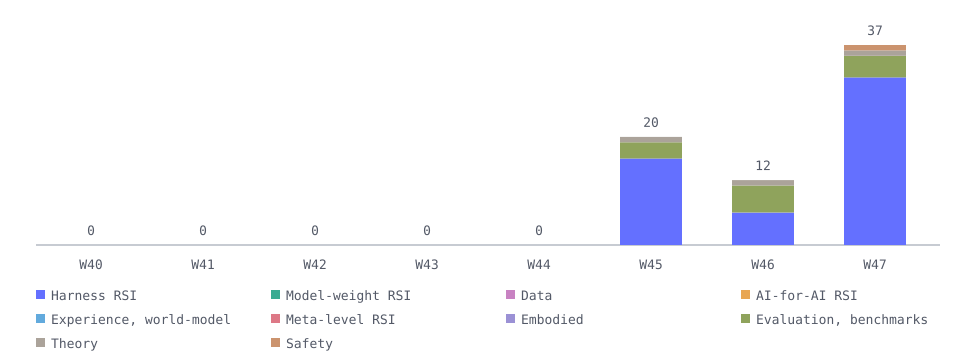

# Follow RSI · 2026 第 47 周

2026-11-16 → 2026-11-22

本期完成审查并获批准 37 篇论文：Harness / 脚手架 RSI 31 篇、评测、基准与归因 4 篇、理论与综述 1 篇、安全与治理 1 篇。本期论文最多的方向为 Harness / 脚手架 RSI。

## 编辑的话

本周日报含37篇；11/18–20补刊于11/23完成审核。另列33篇此前已发布的历史补录，保留当时审核与来源快照，不计为本周新论文。 补刊的逐篇首次公开时间尚未单独记录；11/18 页面首次发布时间属于原状态简报，因此本周时效中位数标为待核，不据旧页面时间推算论文上线延迟。 晚到监控补充的SIR-Agent与RemoteEvolver按11/20来源日归期，11/23复审；SIR-Agent的混合退化场景计数对应仍待核。 11/26补抓信源另按真实来源日补入11/21两篇（HyperHarness、GroupBrief）与11/22一篇（DoppelVet）。

## Harness / 脚手架 RSI · 31

- **MIRIX-2.0**：MIRIX 的 AutoDream 程序性技能分支根据会话轨迹判断成败，再由 curator 创建、编辑或删除供后续 Agent 使用的技能指令。训练任务形成的技能库冻结后，在新任务上评估复用。纳入依据是反馈驱动的程序性步骤修订，语义记录合并与事实检索不属于这条证据；实验评估的是整套流程，未单独证明每次技能修改或某个组件的收益。 [arxiv](<https://arxiv.org/abs/2611.12068>) [code](<https://github.com/Mirix-AI/MIRIX>) [s2](<https://www.semanticscholar.org/paper/b8a7f0d7b4bdb20292802143a858e9d2dc96e6ed>) — 其余 4 项待核（自动判断，未核实）
  原始发表：2026-11-09 · HF 推荐：2026-11-16 · 版本日期：2026-11-09
- **CompoundingKernel**：团队代理根据运行故障修复提示、工具与评测脚手架，经人工批准在热重启启用，保留各任务搜索档案。 [arxiv](<https://arxiv.org/abs/2611.19230>) [hf](<https://huggingface.co/papers/2611.19230>) — 其余 4 项待核（自动判断，未核实）
  原始发表：2026-11-14 · HF 推荐：2026-11-20 · 版本日期：2026-11-14
- **Evaluation-Free Recursive Self-Improvement for Coding Agents**：ELITE 将并行提出的代码机制整合进可执行代理，并以编译和执行协议检查决定下一代；环内不使用下游任务成绩，已接受修改也可能出现性能波动。 [arxiv](<https://arxiv.org/abs/2611.21056>) [s2](<https://www.semanticscholar.org/paper/4fcd98dd606d0344ee66b038975a63e9a8297f34>) — 其余 4 项待核（自动判断，未核实）
  原始发表：2026-11-16 · HF 推荐：未核实 · 版本日期：2026-11-16
- **RemeshingAgent**：RemeshingAgent 从网格修复轨迹修改可执行流水线模板和技能指令，只有留出选择集改善才替换当前技能，并另作测试；工具算子扩展实验未产生被采用的新算子。 [arxiv](<https://arxiv.org/abs/2611.20533>) [s2](<https://www.semanticscholar.org/paper/17ef011273706df6756e3943ec00ebe1eb8da5e2>) — 其余 4 项待核（自动判断，未核实）
  原始发表：2026-11-16 · HF 推荐：未核实 · 版本日期：2026-11-16
- **Synapse**：Synapse 以程序修复方式修改自然语言技能：执行轨迹定位问题，类型化补丁写回技能，再由独立验证集选择保留。接受依据是整体通过率提升，并不保证每个旧样例都不退化。 [arxiv](<https://arxiv.org/abs/2611.20856>) [s2](<https://www.semanticscholar.org/paper/450f05d7e0e137c0785bb9c399b143b046c7a8f7>) — 其余 4 项待核（自动判断，未核实）
  原始发表：2026-11-16 · HF 推荐：未核实 · 版本日期：2026-11-16
- **MetaAct**：MetaAct 从成功与失败轨迹合成可执行动作约束，利用日志回放检查误拦截并将反例用于修订；被接受的约束可持续部署。实验中的编译与拦截机制固定，退役监视器未实际触发。 [arxiv](<https://arxiv.org/abs/2611.20655>) [code](<https://github.com/BaiCubed/MetaAct>) [s2](<https://www.semanticscholar.org/paper/52a7c29c0d4372dbc6756f7d7e8091e9459eb1f1>) — 其余 4 项待核（自动判断，未核实）
  原始发表：2026-11-16 · HF 推荐：未核实 · 版本日期：2026-11-16
- **WeVisForensics**：WeVisForensics 同时更新视觉检查器权重和可复用的报告规则；规则修订须在近期留出调用上改善判断并保留既有正确判断，再发布到后续轮次。视觉 OCR 一致性检查器也参与训练；音频工具和 PaddleOCR 检测器保持固定。 [arxiv](<https://arxiv.org/abs/2611.21373>) [s2](<https://www.semanticscholar.org/paper/018f92aa01424be629da047aeab4b09d355097f8>) — 其余 4 项待核（自动判断，未核实）
  原始发表：2026-11-16 · HF 推荐：未核实 · 版本日期：2026-11-16
- **Do LLM Agents Still Need to Be Told How to Self-Improve?**：冻结模型根据练习得分与轨迹改写提示和技能文件，并在全新会话的未见游戏上评测保留文本。 [arxiv](<https://arxiv.org/abs/2611.23219>) [code](<https://github.com/ssundaram21/self-org>) [hf](<https://huggingface.co/papers/2611.23219>) — 其余 4 项待核（自动判断，未核实）
  原始发表：2026-11-17 · HF 推荐：2026-11-18 · 版本日期：2026-11-17
- **Think Once, Act Fast**：从决策执行反馈异步修订程序性模块，发布到共享库并按历史效用供后续任务复用。 [arxiv](<https://arxiv.org/abs/2611.22432>) [code](<https://github.com/usail-hkust/JevRSI>) [s2](<https://www.semanticscholar.org/paper/b979b1a845f890b394659162874fbfa59ba80102>) — 其余 4 项待核（自动判断，未核实）
  原始发表：2026-11-17 · HF 推荐：未核实 · 版本日期：2026-11-19
- **Agentic Harness Engineering Beta**：把运行证据转成通用需求，通过设计和代码审查将可复用脚手架更新合入后续版本。 [arxiv](<https://arxiv.org/abs/2611.24924>) [s2](<https://www.semanticscholar.org/paper/8934dbbdac714b61d72a89ff2c8e999b30875272>) — 其余 4 项待核（自动判断，未核实）
  原始发表：2026-11-18 · HF 推荐：未核实 · 版本日期：2026-11-18
- **Improve How You Improve**：在单个episode内依据导航反馈修订策略代码与改进规则，供后续目标复用；独立episode重置。 [arxiv](<https://arxiv.org/abs/2611.23774>) [s2](<https://www.semanticscholar.org/paper/8a16947961e296e9fc33b4a2bc2197961b49c013>) — 其余 4 项待核（自动判断，未核实）
  原始发表：2026-11-18 · HF 推荐：未核实 · 版本日期：2026-11-18
- **Great Listeners, Poor Decision-Makers**：以多目标演化搜索调优语音代理的动作门控，在错误风险与澄清成本之间选择策略。 [arxiv](<https://arxiv.org/abs/2611.23847>) [s2](<https://www.semanticscholar.org/paper/fc3cc01d8bd232c1bb1abce3535ea70a60b20177>) — 其余 4 项待核（自动判断，未核实）
  原始发表：2026-11-18 · HF 推荐：未核实 · 版本日期：2026-11-18
- **OpenKAGE**：在开放世界中从执行经验修订可执行技能，并通过共享注册库供后续代理调用。 [arxiv](<https://arxiv.org/abs/2611.24302>) [s2](<https://www.semanticscholar.org/paper/0faacc70b1cebebdc6542b7ce5c433441313068b>) — 其余 4 项待核（自动判断，未核实）
  原始发表：2026-11-18 · HF 推荐：未核实 · 版本日期：2026-11-18
- **BaseRSI**：从失败中筛选可迁移的提示程序与视觉处理条目，再将验证后的增益逐轮内化到权重。 [arxiv](<https://arxiv.org/abs/2611.24578>) [code](<https://github.com/beita6969/BaseRSI>) — 其余 4 项待核（自动判断，未核实）
  原始发表：2026-11-18 · HF 推荐：未核实 · 版本日期：2026-11-18
- **Safe Personal RSI**：在模拟个人助理环境中从失败轨迹修订指令，经验证与独立采纳决策后用于未来任务。 [arxiv](<https://arxiv.org/abs/2611.23651>) — 其余 4 项待核（自动判断，未核实）
  原始发表：2026-11-18 · HF 推荐：未核实 · 版本日期：2026-11-20
- **Beyond Weight Updates**：从失败轨迹演化提示、工具描述与技能适配器，以任务效果和成本筛选可复用版本。 [arxiv](<https://arxiv.org/abs/2611.25380>) [s2](<https://www.semanticscholar.org/paper/b324ced60a7b0e7b23d9ad5b93240f77f7e0f94c>) — 其余 4 项待核（自动判断，未核实）
  原始发表：2026-11-19 · HF 推荐：未核实 · 版本日期：2026-11-19
- **Meta-RTL**：将硬件优化失败追溯到代理脚手架决策，搜索可复用代码改动并冻结评估。 [arxiv](<https://arxiv.org/abs/2611.25891>) — 其余 4 项待核（自动判断，未核实）
  原始发表：2026-11-19 · HF 推荐：未核实 · 版本日期：2026-11-19
- **Evolve Where It Matters**：结合执行覆盖与验证反馈修订技能，并把诊断和修改策略沉淀给后续任务的改进器。 [arxiv](<https://arxiv.org/abs/2611.25429>) [s2](<https://www.semanticscholar.org/paper/c4335df76ba39eaa49a8cba0835a811ba9294643>) — 其余 4 项待核（自动判断，未核实）
  原始发表：2026-11-19 · HF 推荐：未核实 · 版本日期：2026-11-19
- **Sage-Evolve-Preview**：从反复失败中修订提示、技能与观察控制规则，经修复和回归检查后提交更新。 [arxiv](<https://arxiv.org/abs/2611.26132>) — 其余 4 项待核（自动判断，未核实）
  原始发表：2026-11-19 · HF 推荐：未核实 · 版本日期：2026-11-19
- **SceneAnything**：根据重建检查修订参数化场景生成程序，将接受的程序存入库供后续场景检索适配。 [arxiv](<https://arxiv.org/abs/2611.25340>) [s2](<https://www.semanticscholar.org/paper/2b73deeebe314087ee0958eeb158eb5755d82f43>) — 其余 4 项待核（自动判断，未核实）
  原始发表：2026-11-19 · HF 推荐：未核实 · 版本日期：2026-11-19
- **System-One RSI**：联合修订决策模型、状态提示与行为树后测试新对手；未隔离固定权重下的控制器效果。 [arxiv](<https://arxiv.org/abs/2611.26007>) [s2](<https://www.semanticscholar.org/paper/451eb70dd6fa7aa62f3ed9722590a6fe4b26d312>) — 其余 4 项待核（自动判断，未核实）
  原始发表：2026-11-19 · HF 推荐：未核实 · 版本日期：2026-11-19
- **MedicalRSI**：从临床任务反馈修订可执行工具和工作流技能，并与求解器、改进器训练协同迭代。 [arxiv](<https://arxiv.org/abs/2611.26806>) — 其余 4 项待核（自动判断，未核实）
  原始发表：2026-11-19 · HF 推荐：未核实 · 版本日期：2026-11-19
- **AutoMaster**：用试跑轨迹和学生评测反复修订教师技能，跨轮保留实验史；学生每轮均从同一初始权重微调。 [arxiv](<https://arxiv.org/abs/2611.26510>) [code](<https://github.com/RUCAIBox/AutoMaster>) [hf](<https://huggingface.co/papers/2611.26510>) — 其余 4 项待核（自动判断，未核实）
  原始发表：2026-11-19 · HF 推荐：2026-11-20 · 版本日期：2026-11-20
- **NavRSI**：利用导航轨迹和失败诊断迭代改写代码脚手架，冻结选定版本后评估迁移。 [arxiv](<https://arxiv.org/abs/2611.27499>) — 其余 4 项待核（自动判断，未核实）
  原始发表：2026-11-20 · HF 推荐：未核实 · 版本日期：2026-11-20
- **Fix Where It Fails**：根据场景图生成的失败根因改写推理脚手架，经独立选择后保留有效版本。 [arxiv](<https://arxiv.org/abs/2611.27529>) — 其余 4 项待核（自动判断，未核实）
  原始发表：2026-11-20 · HF 推荐：未核实 · 版本日期：2026-11-20
- **SIR-Agent**：从图像复原链反馈修订技能和外部改进规则，回放旧任务后替换或追加；混合退化场景计数映射仍待核。 [arxiv](<https://arxiv.org/abs/2611.27285>) — 其余 4 项待核（自动判断，未核实）
  原始发表：2026-11-20 · HF 推荐：未核实 · 版本日期：2026-11-20
- **RemoteEvolver**：按执行反馈修复并注册遥感工具，修订或停用技能供后续任务复用；远域负迁移与遗忘仍存在。 [arxiv](<https://arxiv.org/abs/2611.27110>) — 其余 4 项待核（自动判断，未核实）
  原始发表：2026-11-20 · HF 推荐：未核实 · 版本日期：2026-11-20
- **Embodied-Harness**：从机器人执行证据提炼并修订操作指引，让更新后的脚手架指导后续尝试。 [arxiv](<https://arxiv.org/abs/2611.27689>) — 其余 4 项待核（自动判断，未核实）
  原始发表：2026-11-20 · HF 推荐：未核实 · 版本日期：2026-11-20
- **EvoTER**：从工具执行经验提出技能修订，经任务验收后跨轮保留，并冻结技能评估留出任务。 [arxiv](<https://arxiv.org/abs/2611.27797>) — 其余 4 项待核（自动判断，未核实）
  原始发表：2026-11-20 · HF 推荐：未核实 · 版本日期：2026-11-20
- **HyperHarness**：HyperHarness利用跨用户下游反馈迭代演化共享元生成器，从用户历史单次合成可执行个性化Harness钩子代码。 [arxiv](<https://arxiv.org/abs/2611.29062>) [s2](<https://www.semanticscholar.org/paper/5accc2e98335c6f5b5b3f8e201d6839f8c01c124>) — 其余 4 项待核（自动判断，未核实）
  原始发表：2026-11-21 · HF 推荐：未核实 · 版本日期：2026-11-21
- **Grounding Collaborative Agents in Group Cognition**：提出多方协作简报基准，并在专题实验中基于覆盖率反馈搜索检索与综合指令脚手架以评估跨项目迁移。 [arxiv](<https://arxiv.org/abs/2611.29036>) — 其余 4 项待核（自动判断，未核实）
  原始发表：2026-11-21 · HF 推荐：未核实 · 版本日期：2026-11-21

## 评测、基准与归因 · 4

- **Continual-ARC**：Continual-ARC 用反复出现且实例更新的 ARC 任务流，比较可保留程序和技能文件的 Agent Harness 与清空状态的对照；流结束后冻结系统，分别测试已见任务的新实例和未见任务。论文观察到，持久化本身的记忆收益有限，明确的程序编写、验证与复用指导能改善已见任务表现，而未见任务的泛化收益仍很小或没有。纳入为 Harness 专项评测；反馈预算可比不代表模型训练与教师成本完全匹配。 [arxiv](<https://arxiv.org/abs/2611.14505>) [code](<https://github.com/unifyai/continual-arc>) [hf](<https://huggingface.co/papers/2611.14505>) — 其余 4 项待核（自动判断，未核实）
  原始发表：2026-11-10 · HF 推荐：2026-11-16 · 版本日期：2026-11-15
- **The Resolution Hypothesis**：对提示、技能、记忆与脚手架演化做专项评测，分析提案、选择与运行方差如何影响可辨识收益。 [arxiv](<https://arxiv.org/abs/2611.23068>) [hf](<https://huggingface.co/papers/2611.23068>) — 其余 4 项待核（自动判断，未核实）
  原始发表：2026-11-17 · HF 推荐：2026-11-19 · 版本日期：2026-11-17
- **How Feedback-Free Self-Evolution Reshapes Agent Skills**：专项评测无反馈的反复技能改写，揭示专家知识流失，并测试保留原文的注意标记。 [arxiv](<https://arxiv.org/abs/2611.25534>) [code](<https://github.com/LitaoGuo/How-Self-Evolution-Reshapes-Skills>) [s2](<https://www.semanticscholar.org/paper/8aabab21908171ed23305acf7b0a16cf9863feea>) — 其余 4 项待核（自动判断，未核实）
  原始发表：2026-11-19 · HF 推荐：未核实 · 版本日期：2026-11-19
- **CoEvoBench**：评测代理能否联合改进模型与脚手架，并在冻结的独立测试中检验最终组合。 [arxiv](<https://arxiv.org/abs/2611.27116>) [code](<https://github.com/AlibabaResearch/CoEvoBench>) — 其余 4 项待核（自动判断，未核实）
  原始发表：2026-11-20 · HF 推荐：未核实 · 版本日期：2026-11-20

## 理论与综述 · 1

- **SCAFFOLD**：提出版本化技能证据迁移与重新准入的理论和报告协议；尚无实现或实证结果。 [arxiv](<https://arxiv.org/abs/2611.23990>) [s2](<https://www.semanticscholar.org/paper/a315271d7d96dddca2855954c5d8cf8836868ad8>) — 其余 4 项待核（自动判断，未核实）
  原始发表：2026-11-18 · HF 推荐：未核实 · 版本日期：2026-11-18

## 安全与治理 · 1

- **DoppelVet**：DoppelVet构造验证器等价替代候选并进行双向同态重放对比，在自演化智能体提交持久技能或记忆前拦截不安全更新。 [arxiv](<https://arxiv.org/abs/2611.29306>) [s2](<https://www.semanticscholar.org/paper/0897f1e40d3a353e5f3583aa6f7d436c99999778>) — 其余 4 项待核（自动判断，未核实）
  原始发表：2026-11-22 · HF 推荐：未核实 · 版本日期：2026-11-22

## 补录（非本周新论文） · 33

- **CollabFlow**：CollabFlow 一边训练协作规划器，一边依据团队执行结果增删改技能库，并将修订后的文本策略绑定到后续轮次的 Agent。两条更新链使其符合模型与外部 Harness 共演化。技能编辑分析聚焦于增益最大的步骤，且规划器同步训练，因此不能据此把收益单独归因于技能修改。 [arxiv](<https://arxiv.org/abs/2609.38662>) [s2](<https://www.semanticscholar.org/paper/d255740241b796b74f99f716b0c639c610d1445d>) — 其余 4 项待核（自动判断，未核实）
  原始发表：2026-09-29 · HF 推荐：未核实 · 版本日期：2026-09-29
- **From Verification Failures to Reusable Guidance for Coding Agents**：研究将专家对验证失败的诊断沉淀为版本化的程序指导、技能与工具接口，并比较这些资源对编码 Agent 验证行为的影响。可作为 Harness 专项评测收录；资源由专家维护，受控对照的效应区间跨零，既不证明自主 Harness 演化，也未确认普遍收益或独立留出集迁移。 [arxiv](<https://arxiv.org/abs/2609.39022>) [s2](<https://www.semanticscholar.org/paper/c5398f399c2ad1a466162a120004d152b67843a5>) — 其余 4 项待核（自动判断，未核实）
  原始发表：2026-09-30 · HF 推荐：未核实 · 版本日期：2026-09-30
- **InterEvolve**：InterEvolve 根据仿真执行反馈修改分阶段奖励程序、转移条件和常数，用它们在推理时驱动冻结的控制器，并将选中的程序与验证记录保留在技能库中供后续任务组合和修改。它符合 Harness 组件演化；模型冻结限于演化阶段，实机展示沿用仿真中生成的程序，未证明物理环境中的在线自主演化。 [arxiv](<https://arxiv.org/abs/2610.02196>) [s2](<https://www.semanticscholar.org/paper/17013cc3aeb4c6ca7f47ba513d9598ce419276ec>) — ✅ 留出集 · 其余 3 项待核（自动判断，未核实）
  原始发表：2026-10-01 · HF 推荐：未核实 · 版本日期：2026-10-01
- **SkillScriptBench**：SkillScriptBench 评测 Agent 对技能包说明和可执行脚本的修复，检查验证反馈下的修订、文档与代码一致性及原有正确行为的保留。它适合作为 Harness 专项评测。故障均为构造或注入，局部维护结果尚不能证明跨任务长期自主演化或下游系统的普遍可靠性。 [arxiv](<https://arxiv.org/abs/2610.04008>) [s2](<https://www.semanticscholar.org/paper/839f634ec6404af9713561ab3e91f0363f8f6e59>) — 其余 4 项待核（自动判断，未核实）
  改了什么：技能文件
  原始发表：2026-10-02 · HF 推荐：未核实 · 版本日期：2026-10-02
- **SkillForge**：SkillForge 同时训练模型并维护外部技能库。它根据执行回报和失败轨迹生成子技能；试用技能达到使用次数门槛后转为活跃状态，稳定与退休再按表现和使用次数管理，更新后的技能库用于后续检索。它符合模型与 Harness 共演化；共享任务回报并不能单独确认每个技能的因果贡献，且教师会带入外部知识。 [arxiv](<https://arxiv.org/abs/2610.09832>) [s2](<https://www.semanticscholar.org/paper/73995808d3b94bc0a4a8118876309ab0a8089c08>) — 其余 4 项待核（自动判断，未核实）
  改了什么：模型权重
  原始发表：2026-10-07 · HF 推荐：未核实 · 版本日期：2026-10-07
- **EvoQuantLab**：EvoQuantLab 在不训练模型权重的量化研究流程中，用开发阶段的搜索轨迹与过拟合诊断修订后续研究循环的协议、终端预算与约束，并将带父版本记录的子协议加载到下一轮。Harness 证据来自这层持久研究控制程序，内层生成的金融因子本身仍是任务产物；跨轮案例属于时间序列审计，不能单独归因为协议更新的因果收益。 [arxiv](<https://arxiv.org/abs/2610.17130>) [s2](<https://www.semanticscholar.org/paper/4233542406288f7c83c271541246d6b6380ed05b>) — ✅ 留出集 · 其余 3 项待核（自动判断，未核实）
  原始发表：2026-10-12 · HF 推荐：未核实 · 版本日期：2026-10-12
- **Multimodal Filesystem Memory For Long-Horizon Embodied Agents**：Multimodal Filesystem Memory 允许 Agent 根据执行结果创建、修改和停用文本或可执行 procedure，并在后续生命与任务中复用。Harness 证据来自可修改的过程技能分支；位置笔记和工作记忆仍属于记忆内容。这些技能复用结果不代表所有任务成功率提高，也不意味着每个存储过程都有益或技能库越大越好。 [arxiv](<https://arxiv.org/abs/2610.22686>) [s2](<https://www.semanticscholar.org/paper/bd55b40184229d1b0a04dc21148b49ba7c258206>) — 其余 4 项待核（自动判断，未核实）
  原始发表：2026-10-15 · HF 推荐：未核实 · 版本日期：2026-10-15
- **Reward Engine**：冻结执行模型，依据执行反例修订可重跑检查器，并将验收后的验证器版本与修复记录带入后续改进轮次。跨任务改进构造器的循环尚未评测。 [arxiv](<https://arxiv.org/abs/2610.22915>) [s2](<https://www.semanticscholar.org/paper/d0e19b905f3897d4f84b8b9d1372e25b1abf6fd9>) — 其余 4 项待核（自动判断，未核实）
  原始发表：2026-10-16 · HF 推荐：未核实 · 版本日期：2026-10-16
- **Design and Cross-Domain Evaluation of an Agent Execution Harness**：该 Harness 将原始目标、可修改计划与执行记录分离，由 planner、worker、reviewer 协作；setup agent 根据试运行轨迹和工具反馈修订可复用指令。在 Terminal-Bench 2.1 上通过 89 个实例中的 83 个（93.26%）；结果针对完整配置，未隔离指令演化的单独贡献。 [arxiv](<https://arxiv.org/abs/2610.25568>) [s2](<https://www.semanticscholar.org/paper/463d7424dc2cd1ac6bd0977452ace23d1f26cec1>) — 其余 4 项待核（自动判断，未核实）
  改了什么：系统提示
  原始发表：2026-10-18 · HF 推荐：未核实 · 版本日期：2026-10-18
- **Elicitation or Expansion? Demystifying Gains from Agent Harness Optimization**：借鉴 RL 的 pass@k 分析，对比优化前后的 Harness，区分增益来自已有能力更可靠地发挥还是可解任务范围扩大。所测设置中，pass@1 优势可能在更大尝试预算下反转，属于 Harness 专项诊断评测。 [arxiv](<https://arxiv.org/abs/2610.27889>) [s2](<https://www.semanticscholar.org/paper/28eb658ee8628c31f486e0437df19309825ba26d>) — 其余 4 项待核（自动判断，未核实）
  改了什么：控制流/工作流
  原始发表：2026-10-20 · HF 推荐：未核实 · 版本日期：2026-10-20
- **ChartEvo**：ChartEvo 通过经验驱动的 harness 级自我改进，联合演化可复用的图表 Skills 与 Tools 并学习局部工具调用链，在 ChartBench 与 ChartX 长尾图表上提升了 base MLLM 的准确率。 [arxiv](<https://arxiv.org/abs/2610.28282>) [s2](<https://www.semanticscholar.org/paper/aa0a11cf3a4102b2ccef81686de0da3bd030234c>) — 其余 4 项待核（自动判断，未核实）
  改了什么：技能文件
  原始发表：2026-10-20 · HF 推荐：未核实 · 版本日期：2026-10-20
- **Recursive Self-Improvement on a Budget**：该方法用拟合后冻结的线性 readout 在执行前给脚手架代码修改打分，再依据 steering-split 反馈选择并保留候选。GPT-4o 实验返回节点在留出 HumanEval+ 上的得分为 87.0%，parent-rate 消融为 84.2%；这些百分比是得分，不是返回节点的比例。 [arxiv](<https://arxiv.org/abs/2610.29121>) [s2](<https://www.semanticscholar.org/paper/5c1de74ecd644cd617f56bed685607c2491651bd>) — ✅ 留出集 · 其余 3 项待核（自动判断，未核实）
  改了什么：脚手架代码
  原始发表：2026-10-21 · HF 推荐：未核实 · 版本日期：2026-10-21
- **Phronix**：Phronix 通过 predictor-validator-corrector 循环，依据工具执行结果改进并保留 MCP 工具与关联技能。对冷启动已解决的任务，继承其能力库的热启动运行首次尝试成功率为 93-95%；该比例的分母不包括冷启动未解决的任务。 [arxiv](<https://arxiv.org/abs/2610.31789>) [s2](<https://www.semanticscholar.org/paper/bccbdf83fc6896245e048321a079b85c43c9bd4e>) — 其余 4 项待核（自动判断，未核实）
  改了什么：技能文件
  原始发表：2026-10-22 · HF 推荐：未核实 · 版本日期：2026-10-22
- **RSI-Opt**：RSI-Opt 的 meta-agent 根据历史运行证据改写可复用的提示、playbook、优化器代码库和决策节奏，并归档策略供后续运行继承。模型训练是应用任务；递归继承的独立增益缺少匹配预算对照，且曾发生留出任务描述被读取的情况。 [arxiv](<https://arxiv.org/abs/2610.32026>) [s2](<https://www.semanticscholar.org/paper/1374308cd138cb2f4bb0ff4e8739974da0b4f28d>) — ✅ 跨模型 · 其余 3 项待核（自动判断，未核实）
  改了什么：工具代码/程序库
  原始发表：2026-10-23 · HF 推荐：未核实 · 版本日期：2026-10-23
- **HarnessMM**：HarnessMM 在 actor 权重固定时复用已有决策，减少后续推理调用；另用训练反馈和验证选择迭代改进配套 Harness 配置。DeepSeek Harness 的完整配置报告成功率上升、Tokens/task 下降，不能把全部收益归因于单一 RSI 或替换组件。 [arxiv](<https://arxiv.org/abs/2610.32813>) [s2](<https://www.semanticscholar.org/paper/4f2714079432936d86f0192f67bd7b2965d3dc6a>) — 其余 4 项待核（自动判断，未核实）
  改了什么：控制流/工作流
  原始发表：2026-10-23 · HF 推荐：未核实 · 版本日期：2026-10-23
- **ReSight**：ReSight 用 Explore-Distill-Mount (EDM) 把探索所得解转为可复用的记忆构建器、查询工具与技能，扩展具身智能体的记忆访问能力，使 OC-NaVQA 平均位置误差从 33.10 m 降至 24.72 m。 [arxiv](<https://arxiv.org/abs/2610.33487>) [s2](<https://www.semanticscholar.org/paper/bc1306df633b8067cea2f628202d8bbf58af2fdf>) — ✅ 留出集 · ✅ 同预算 · 其余 2 项待核（自动判断，未核实）
  改了什么：工具与技能文件
  原始发表：2026-10-24 · HF 推荐：未核实 · 版本日期：2026-10-24
- **How Do Coding-Agent Harnesses Self-Evolve? An Empirical Study of Retrospective Adaptation**：研究让 retro 回顾 Claude Code 在 30 个 SWE-bench Verified 问题上的会话并提出 Harness 修改，研究者选择实施 24 个提案；其中可评估的变更与一个作者另写的对照一起用于后续任务评测。多数遇到目标问题的评估未减少重复工作；这是含人工选择的专项评测。 [arxiv](<https://arxiv.org/abs/2610.34938>) [s2](<https://www.semanticscholar.org/paper/1abf49950c14a1f60520a4d13da91a37cf3c3de0>) — 其余 4 项待核（自动判断，未核实）
  改了什么：技能文件
  原始发表：2026-10-26 · HF 推荐：未核实 · 版本日期：2026-10-26
- **VISTA**：VISTA 用 Harness graph 保留版本与证据，元代理主动生成 rollout、探测失败并修订指令、可执行技能及协调逻辑。仿真实验中相对静态反思报告更高成功率和更少 rollout；效率优势本身不能证明预算完全匹配。 [arxiv](<https://arxiv.org/abs/2610.35051>) [code](<https://github.com/AgenticEI/VISTA>) [s2](<https://www.semanticscholar.org/paper/d51cba2213de0ec6e70d0f299f49af90d3c50a45>) — ✅ 有代码链接 · 其余 3 项待核（自动判断，未核实）
  改了什么：控制流/工作流
  原始发表：2026-10-26 · HF 推荐：未核实 · 版本日期：2026-10-26
- **RSIV-Harness**：RSIV-Harness 固定模型权重，依据失败轨迹修改 Harness，以 anchor 和 memory 检查保留或回滚。相对总体结果表中原骨干的静态 Harness，可执行性提高 +28.02 点、图表结构提高 +34.01 点；消融表的基线数值与总体结果表不一致，跨骨干也并非全部指标提升。 [arxiv](<https://arxiv.org/abs/2610.35316>) [s2](<https://www.semanticscholar.org/paper/3f013f7b9530d5f949246e92d9a503758309939c>) — 其余 4 项待核（自动判断，未核实）
  改了什么：控制流/工作流
  原始发表：2026-10-26 · HF 推荐：未核实 · 版本日期：2026-10-26
- **Hierarchical Skill Evolution for Coding Agent**：HSE 在冻结编码模型下，分层聚合任务、仓库与跨仓库证据；反馈既演化技能，也更新 writer/evaluator 的外部规则与证据权重，并传给后续轮次。目标基准适配阶段固定这些规则，只更新技能库。 [arxiv](<https://arxiv.org/abs/2610.35616>) [s2](<https://www.semanticscholar.org/paper/c567ebe6a83082ae825184ec8952d1cfd6241d74>) — ✅ 跨模型 · 其余 3 项待核（自动判断，未核实）
  改了什么：技能文件
  原始发表：2026-10-26 · HF 推荐：未核实 · 版本日期：2026-10-26
- **Skill Dreaming**：Skill Dreaming 从 PR 流中提取可执行知识，构建仓库专属技能库并持续精炼，用于指导编码代理实现功能，并同步维护测试、文档与仓库约定。 [arxiv](<https://arxiv.org/abs/2610.36188>) — 其余 4 项待核（自动判断，未核实）
  改了什么：技能文件
  原始发表：2026-10-26 · HF 推荐：未核实 · 版本日期：2026-10-26
- **When the Critic Falls Behind**：RuHarness 让评分准则与 harness 共同演化：从执行轨迹持续发现并重估行为准则，优先处理最相关的未解决弱点以指导 harness 更新，在未见任务上优于强 harness 演化基线。 [arxiv](<https://arxiv.org/abs/2610.36826>) [s2](<https://www.semanticscholar.org/paper/f557f0391b7a4214a66358be008ce08bdf8131ce>) [card](../papers/ruharness.md) — ✅ 留出集 · 其余 3 项待核（人工整理，详见证据卡）
  改了什么：环内验证器
  原始发表：2026-10-27 · HF 推荐：未核实 · 版本日期：2026-10-27
- **FilingLoop**：FilingLoop 用已评分批次的要求级反馈改写 Reviewer 与 Filer 的程序性技能，供后续未尝试的案例使用，模型权重保持不变；这是在线历史反馈适应，不能视为独立留出集验证。 [arxiv](<https://arxiv.org/abs/2610.37905>) — 其余 4 项待核（自动判断，未核实）
  原始发表：2026-10-27 · HF 推荐：未核实 · 版本日期：2026-10-27
- **Masked Erosion**：Masked Erosion 研究固定模型外部的文本 Harness 在接受闸门下如何逐步丢失冗余安全约束：被接受的修改成为后续父代。主要实验人为施加删除压力，用于隔离闸门行为，不能概括为部署中的普遍失效率。 [arxiv](<https://arxiv.org/abs/2610.38392>) [s2](<https://www.semanticscholar.org/paper/31fcb9ec2bee6868189d28d205680d78c2a06bfd>) — 其余 4 项待核（自动判断，未核实）
  原始发表：2026-10-28 · HF 推荐：未核实 · 版本日期：2026-10-28
- **Appreciation Teaches Unauthorized Execution**：该安全评测研究用户赞许如何影响个人代理面对间接提示注入时的授权判断。MetaClaw 把会话反馈写成可复用技能并用于后续会话；技能演化和强化学习权重更新是分别测试的分支，不能当成同一代理的协同演化。 [arxiv](<https://arxiv.org/abs/2610.39122>) [code](<https://github.com/SaFo-Lab/Evolve-IPI>) [s2](<https://www.semanticscholar.org/paper/900bbccd5bb34ebd68a400a3772f0f9eccd0305f>) — 其余 4 项待核（自动判断，未核实）
  原始发表：2026-10-29 · HF 推荐：未核实 · 版本日期：2026-10-29
- **Before the Next Rollout**：研究在策略权重更新后诊断技能效用变化，并用 readout 和失败轨迹指导技能编辑。在闭环实验中，编辑器修改文本技能库，配对验证决定是否保留到后续窗口；独立诊断实验则固定技能库。 [arxiv](<https://arxiv.org/abs/2610.39358>) — 其余 4 项待核（自动判断，未核实）
  原始发表：2026-10-29 · HF 推荐：未核实 · 版本日期：2026-10-29
- **Compile Away Uncertainty**：该方法把技能执行中的不确定操作编译为程序，利用执行错误和检查差异修订技能与代码，并保存验证后的程序资产供后续技能复用。开发时曾查看留出失败案例，测试期冻结资产库并不意味着完全独立的留出验证。 [arxiv](<https://arxiv.org/abs/2610.39508>) — 其余 4 项待核（自动判断，未核实）
  原始发表：2026-10-29 · HF 推荐：未核实 · 版本日期：2026-10-29
- **Acting by Intent, Reacting by Sight**：ViCoR 将视觉条件反射实现为可修改的 Python 引导函数，用视觉反馈调整触发规则，并在回合分数改善时保存技能库供后续回合复用。反射负责唤醒快速视觉模型，动作仍由模型决策。 [arxiv](<https://arxiv.org/abs/2611.18723>) [s2](<https://www.semanticscholar.org/paper/07a335eb790dfd090947998154083be8d8181ccd>) — 其余 4 项待核（自动判断，未核实）
  原始发表：2026-11-09 · HF 推荐：未核实 · 版本日期：2026-11-09
- **The RSI Tax**：RSI Tax 以先记录任务结果、再更新持久状态的协议评测 Harness 等自改方法，并区分任务执行与改进调用的 token 成本。它记录工件是否在后续使用；该标签不证明准确率收益，也不等于实际账单。 [arxiv](<https://arxiv.org/abs/2611.13524>) — 其余 4 项待核（自动判断，未核实）
  原始发表：2026-11-10 · HF 推荐：未核实 · 版本日期：2026-11-10
- **MULTILOOP**：MULTILOOP 依据训练任务成绩和多代理轨迹修改 Harness，保存版本以便回滚并选择训练表现最佳者。实际改动主要集中于提示、工具声明和下载工具；深层编排问题与额外推理成本仍未消除。 [arxiv](<https://arxiv.org/abs/2611.15754>) — 其余 4 项待核（自动判断，未核实）
  原始发表：2026-11-11 · HF 推荐：未核实 · 版本日期：2026-11-11
- **Self-Improvement Memory Enables Continual Recursive Self-Improvement**：SIM 为可执行 Harness 的修改保留问题、代码尝试与反馈历史，帮助继承的 Harness 在新模型或数据集上继续修订。被改写的是任务 Harness；改进器的规划和搜索程序保持固定。 [arxiv](<https://arxiv.org/abs/2611.18856>) [s2](<https://www.semanticscholar.org/paper/4aa18b3a28681761140a039a0d6c4905824fd9d7>) — 其余 4 项待核（自动判断，未核实）
  原始发表：2026-11-13 · HF 推荐：未核实 · 版本日期：2026-11-13
- **RoboCoEvo**：RoboCoEvo 根据当前机器人策略的失败改写检测器和共享恢复程序，经留出恢复测试后复用，并以成功恢复数据训练策略。程序与策略随后继续迭代，构成仿真中的权重和 Harness 共演化。 [arxiv](<https://arxiv.org/abs/2611.19081>) [s2](<https://www.semanticscholar.org/paper/d59fff6fce217445125a799906c03180e459a609>) — 其余 4 项待核（自动判断，未核实）
  原始发表：2026-11-14 · HF 推荐：未核实 · 版本日期：2026-11-14
- **SAGE-VQA**：SAGE-VQA 的程序记忆保存可执行函数，试运行或答后反馈可触发修订，完成的版本供后续问题复用。此处纳入程序工具子链；其评测包含答后记忆更新，并非全程固定记忆库。 [arxiv](<https://arxiv.org/abs/2611.19933>) [s2](<https://www.semanticscholar.org/paper/89d48e8ce4a7c7b71ad687d98a0b2bb1fa20c1aa>) — 其余 4 项待核（自动判断，未核实）
  原始发表：2026-11-15 · HF 推荐：未核实 · 版本日期：2026-11-15

## 近 8 周趋势

本周找到 **113** 篇 · 收录 **37** 篇 · include 准确率 **—**

[Atom](../site/feed/atom.xml) · [JSON feed](../site/feed/latest.json) · [GitHub](https://github.com/adongwanai/follow-rsi)
